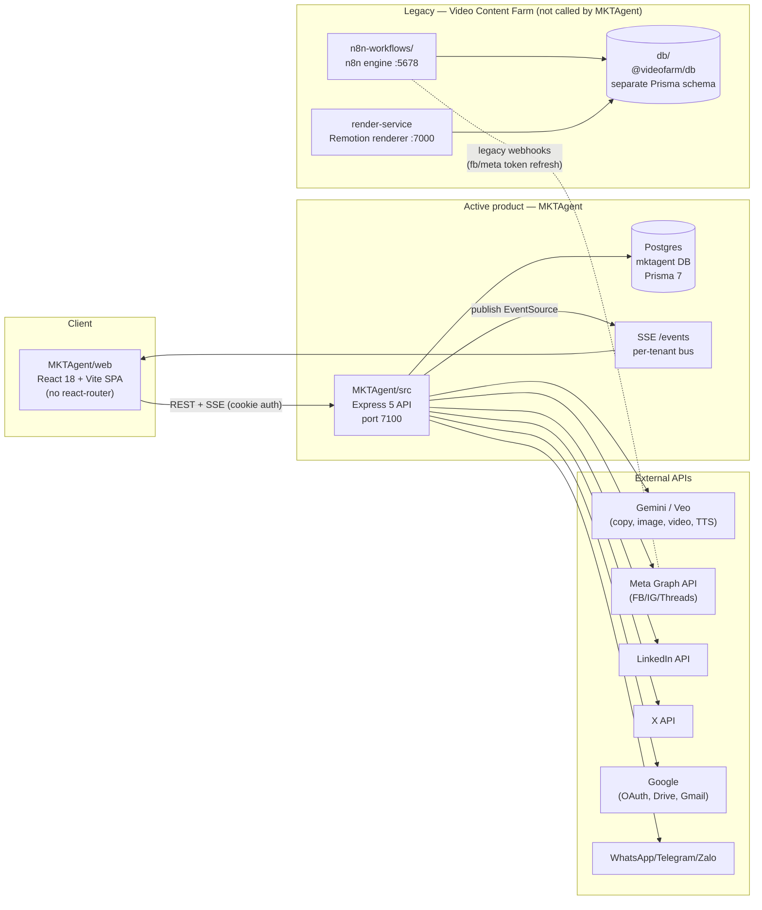
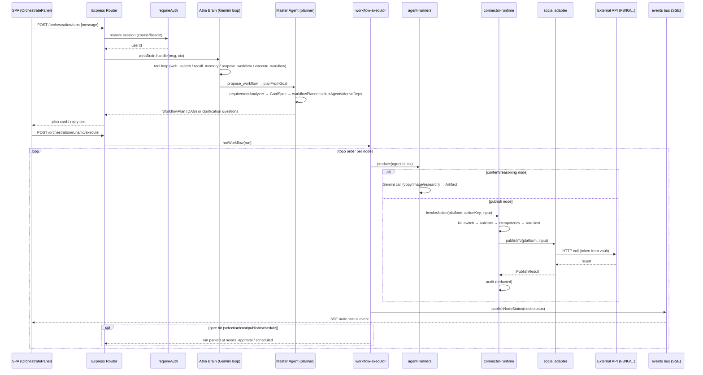
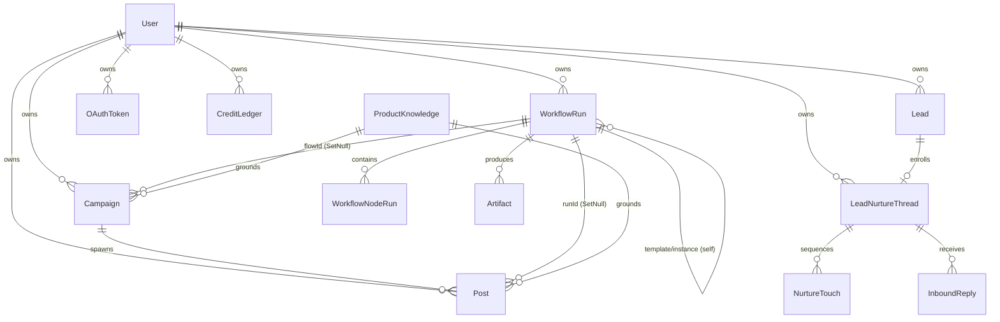

# Architecture, Tech Stack & Layers

Scope: structural map of the repo — components, tech stack, backend layers, request lifecycle, data model, cross-cutting concerns. For a feature/route inventory see `FEATURES.md` (root) and `FEATURES2.md`. This doc does not repeat that inventory.

## 1. System Context

The repo hosts **two generations** of the same product idea (AI-driven marketing content). Only **MKTAgent** is actively developed; `render-service`, `db/`, and `n8n-workflows` are the pre-pivot "Video Content Farm" stack, kept for reference/legacy pipelines and not wired into MKTAgent's request path.

## 2. Component Map

| Component | Path | Stack | Role | Status |
|---|---|---|---|---|
| Backend API | `MKTAgent/src` | Express 5, Prisma 7 (`@prisma/adapter-pg`), Postgres, Zod, JWT (cookie/Bearer), `node-cron` | Sole backend: REST API, DAG orchestration, connectors, crons | **Active**, port 7100 |
| SPA frontend | `MKTAgent/web` | React 18 + Vite 6, no `react-router` (single `App.tsx` state switch), hand-rolled `api/client.ts` (typed via `openapi-typescript` against `MKTAgent/openapi.json`) | Command Center UI, chat, flows, connections, leads, admin | **Active** |
| `render-service` | `render-service/` | Express 5 + Remotion 4 (bundler/renderer), `@videofarm/db` | Video template rendering webhook (`POST /render`), TTS/image/stock routes | **Legacy** — no caller in `MKTAgent/src`; standalone Docker profile `render` |
| `n8n-workflows/` | repo root | n8n engine (Docker), JSON workflow exports | Original no-code pipeline (lead capture, publish, token refresh) MKTAgent ported into TS | **Legacy**, reference only |
| `db/` | repo root | Prisma 7, own `schema.prisma` (4 models: Pipeline/Job/etc.) | Schema for the Video Content Farm pipeline consumed by `render-service` | **Legacy**, unrelated to `MKTAgent/prisma/schema.prisma` |
| `docker-compose.yml` | repo root | Postgres 15-alpine, n8n, render-service (profile `render`) | Local infra: Postgres always-on; n8n + render-service optional | Postgres shared by legacy stack only — MKTAgent's `DATABASE_URL` can point at the same instance or a separate one |
| `scripts/` | repo root | standalone `.ts`/`.cjs`/`.sh` | One-off pipeline scripts (Veo experiments, cooking-explode render, secret scan) predating MKTAgent | **Legacy**/ops tooling |
| `MKTAgent/scripts/` | `MKTAgent/src/scripts` | `.ts` | `set-superadmin.ts` — active ops CLI | **Active** |

**Ports:** MKTAgent API `7100` (from `env.ts` default) · SPA dev server via Vite (`5173` typical) · render-service `7000` · n8n `5678` · Postgres `5432`/`5433` (compose default vs. some dev setups).

## 3. Backend Layer-by-Layer (`MKTAgent/src`)

Every top-level directory under `src/`, its responsibility, key files, and its dependency direction. `verify-*.ts` files embedded in a directory are that layer's self-contained test harness (see §7).

| Dir | Responsibility | Key files | Depends on |
|---|---|---|---|
| `agent/` | Master-Agent **intake** parsing (freeform message → structured setup draft, distinct from the orchestration goal parser) | `gemini-intake-provider.ts`, `intake-provider.ts` | `config`, Gemini SDK |
| `agents/` | Small standalone reasoning helpers invoked as Atria tools (not registry DAG nodes) | `agents/researcher/{grounded-search,run-research}.ts`, `agents/publish-timing/suggest-time.ts` | `config`, Gemini Search grounding |
| `analytics/` | Read-only Insights fetchers per platform, merged null-aware | `fb-insights.ts`, `ig-insights.ts`, `threads-insights.ts`, `x-insights.ts`, `insights-types.ts` | `tokens` (token read), platform Graph APIs |
| `api/` | HTTP layer — one Express `Router` per resource + shared middleware/mappers | `*-router.ts` (25), `middleware-auth.ts`, `middleware-superadmin.ts`, `http.ts` (ok/fail/asyncHandler), `schemas.ts` (Zod bodies), `mappers.ts`/`orchestration-mappers.ts`/`nurture-mappers.ts` (DB row → DTO) | almost every other layer (thin controllers) |
| `assets/` | Media storage abstraction (Drive-backed today) | `drive-client.ts`, `materialize.ts`, `save-uploaded-image.ts`, `store.ts` | Google Drive API, `config` |
| `config/` | Centralized Zod-validated env | `env.ts` | none (leaf) |
| `connectors/audit` | Append-only audit of every external write | `external-action-audit-log.ts` | `db` |
| `connectors/registry` | Declarative map: platform → connector → supported actions | `connector-registry.ts` | `social/types.ts` |
| `connectors/runtime` | **The** external-write chokepoint (kill-switch → validate → idempotency → rate-limit → retry → adapter → audit) | `connector-runtime.ts` (`invokeAction`), `connection-resolver.ts` (pre-execution connection gate), `idempotency-manager.ts`, `rate-limit-manager.ts` | `social`, `connectors/{audit,registry,vault}`, `system/kill-switch`, `db/repos/token-repo` |
| `connectors/vault` | Credential storage abstraction over `AgentCredential`/`OAuthToken` | `credential-vault.ts`, `encrypted-db-vault.ts` | `lib/crypto`, `db/repos` |
| `contract/` | OpenAPI generation for the typed frontend client | `openapi.ts` → emits `MKTAgent/openapi.json` | `zod-to-openapi`, `api/schemas.ts` |
| `copygen/` | Copy-generation engine (LLM prompt build → parse → persist) | `service.ts`, `gemini.ts`, `prompt.ts`, `parse.ts`, `resolve-config.ts` (brand/lang resolution chain), `cron.ts`, `cli.ts` | `db/repos/post-repo`, `product-knowledge`, `orchestration/prompts`, Gemini |
| `cost/` | Spend accounting | `llm-usage.ts` (ledger writer/reader), `credits.ts` (USD→credits), `plan-estimate.ts` (pre-run tiers) | `db` (`LlmUsage`) |
| `db/` | Prisma client singleton + system-owner bootstrap | `client.ts`, `system-owner.ts` | `@prisma/client`, `config` |
| `db/repos/` | One repository per aggregate — **only** place raw Prisma queries live | `campaign-repo.ts`, `post-repo.ts`, `workflow-run-repo.ts`, `token-repo.ts`, `credit-repo.ts`, `lead-repo.ts`, `user-repo.ts`, `user-memory-repo.ts`, `instruction-repo.ts`, `product-knowledge-repo.ts`, `roadmap-demand-repo.ts`, `agent-credential-repo.ts`, `lead-intake-token-repo.ts` | `db/client` |
| `email/` | Owner-scoped Gmail send | `gmail-send.ts`, `email-agent.ts` | `googleapis`, `tokens` |
| `events/` | In-process per-tenant pub/sub backing SSE | `bus.ts` | none (leaf; consumed by `api/events-router.ts`) |
| `imagegen/` | Gemini image generation (nano-banana), text-to-image + reference-edit | `nano-banana.ts` | Gemini SDK, `assets` |
| `impact/` | ROI reporting — measured vs. labeled-estimate | `impact-metrics.ts` (measured), `value-model.ts` (estimates) | `cost`, `db/repos`, `analytics` |
| `leads/` | Lead capture pipeline core | `service.ts` (`captureLead` tenancy chokepoint), `normalize.ts`, `lead-readiness.ts`, `notify.ts`, `backfill-lead-pii.ts` | `db/repos/lead-repo`, `leads/scoring`, `lib/crypto` |
| `leads/scoring` | Hybrid lead scoring | `rule-score.ts` (deterministic 0-100), `llm-score.ts` (Gemini adjustment), `criteria.ts` | `leads/service` |
| `leads/sources` | Per-channel lead intake + comment polling | `comment-poller.ts`, `comment-cron.ts`, `comment-fetch-graph.ts`, `comment-fetchers/`, `meta-webhook.ts`, `post-liveness.ts`, `post-exists.ts` | `social`, `leads/service`, `tokens` |
| `lib/` | Cross-cutting utilities (no domain knowledge) | `auth-jwt.ts`, `auth.ts` (API-key), `crypto.ts` (AES-256-GCM), `google-oauth.ts`, `logger.ts`, `retry.ts`, `session.ts` | `config` only |
| `memory/` | Long-term per-user memory (facts recalled by Atria) | `user-memory.ts` (keyword recall), `profile-facade.ts` | `db/repos/user-memory-repo` |
| `messaging/` | Multi-channel DM adapters (WhatsApp/Telegram/Zalo) | `dm-runners.ts`, `whatsapp.ts`, `telegram.ts`, `zalo.ts`, `opt-in-repo.ts`, `telegram-webhook-router.ts`, `types.ts` (`isLiveDmSend` gate) | `config`, `db` |
| `nurture/` | Lead-nurture drip + reply-driven brain | `enroll.ts`, `sequence.ts`, `nurture-runner.ts`, `nurture-cron.ts`, `gmail-read.ts`, `nurture-brain.ts` (Gemini classify→draft), `nurture-tools.ts`, `guardrails.ts`, `reply-repo.ts`, `nurture-thread-repo.ts` | `orchestration/executor` (kicks a run per touch), `email`, `db/repos`, Gemini |
| `orchestration/` | **The core** — planning, execution, agent registry | see breakdown below | everything |
| `product-knowledge/` | Reusable product-fact library (doc/image → Gemini profile) | `analyze-documents.ts`, `analysis-prompt.ts`, `save-reference-image.ts` | Gemini, `db/repos/product-knowledge-repo` |
| `scheduler/` | Time-based execution: publish queue, generic scheduled-run resume, self-healing reaper | `tick.ts` (due-post publish), `resume-due-runs.ts` (generic scheduler node re-entry), `reaper.ts`/`reaper-cron.ts`, `schedule-calendar.ts`, `lock.ts` (advisory lock), `aggregate.ts` | `connectors/runtime`, `orchestration/executor`, `db/repos` |
| `scripts/` | Ops CLI | `set-superadmin.ts` | `db/repos/user-repo` |
| `social/` | Per-platform publish adapters (thin wrappers over each Graph/REST API) | `facebook.ts`, `instagram.ts`, `threads.ts`, `linkedin.ts`, `x.ts`, `index.ts` (`publishTo` dispatcher), `postability.ts`, `greeting.ts`, `types.ts` | `tokens` (token read), platform APIs |
| `system/` | Global runtime flags | `kill-switch.ts` (`external_actions_paused`) | `db` (`SystemFlag`) |
| `tokens/` | OAuth token lifecycle: vault read/refresh, health cron | `service.ts`, `providers.ts`, `cron.ts`, `types.ts` | `db/repos/token-repo`, `lib/crypto`, `connectors/vault` |
| `video/` | Video generation pipeline (Veo i2v → ffmpeg stitch → TTS mux) | `veo.ts`, `stitch.ts`, `tts.ts` | Gemini/Veo API, `assets` |

### `orchestration/` breakdown (the DAG engine)

| Sub-dir | Responsibility | Key files |
|---|---|---|
| `orchestration/registry` | Closed agent menu + display metadata | `agent-registry.ts` (12 runnable node defs: `requires`/`optional`/`produces`), `agent-types.ts`, `agent-groups.ts`, `vision-agents.ts` (display-only roster), `roadmap-agents.ts` |
| `orchestration/schemas` | Zod contracts for goal/plan/artifacts | `goal-spec.ts`, `workflow-plan.ts`, `artifact-schemas.ts` |
| `orchestration/master` | Planning brain (no writes) | `master-agent.ts` (entry: `handle`/`refine`), `requirement-analyzer.ts` (Gemini → GoalSpec), `workflow-planner.ts` (rule-based DAG builder, `selectAgents`+`deriveDeps`), `workflow-validator.ts`, `clarification-engine.ts`, `goal-merge.ts`, `plan-tiers.ts`, `campaign-materializer.ts`, `campaign-from-flow.ts`, `campaign-grant.ts`, `campaign-intent.ts`, `intent-router.ts`, `workspace-view.ts`, `conversation-author.ts`, `save-offer-author.ts`, `report-answer.ts`, `detect-language.ts`, `goal-to-brief.ts`, `llm-json.ts` |
| `orchestration/atria` | Tool-using reasoning loop (chat entry point) | `atria-brain.ts` (bounded Gemini function-calling loop, `MAX_ROUNDS=3`), `atria-tools.ts` (7 tools), `atria-brain-cache.ts` (static prefix cache), `atria-suggestions.ts`, `memory-agent.ts`, `parse-schedule-time.ts`, `signal-reader.ts`, `workspace-report.ts` |
| `orchestration/executor` | DAG runner + node dispatch | `workflow-executor.ts` (`runWorkflow` — topo order, approval gates, park/resume), `agent-runners.ts` (maps `agentId` → produce-fn, the only place orchestration touches runtime code), `approval-policy.ts` (fail-closed autonomy gate logic), `artifact-store.ts`, `node-cost.ts` |
| `orchestration/autonomy` | Grant-based auto-execution cron | `autonomy-runner.ts`, `autonomy-cron.ts` |
| `orchestration/prompts` | System-prompt assembly | `agent-prompts.ts`, `build-agent-prompt.ts`, `atria-brain-prompt.ts`, `conversation-prompt.ts`, `requirement-prompt.ts`, `resolve-instructions.ts` (layers user `Instruction` rows in) |
| `orchestration/thinking-budget.ts` | Per-agent LLM "thinking" token budget policy bound into `agent-runners`' JSON-call function | — |

**Dependency direction (strict):** `api` → `orchestration/{master,atria,executor}` → `orchestration/registry` + `orchestration/executor/agent-runners` → domain layers (`social`, `copygen`, `imagegen`, `video`, `email`, `leads`) → `connectors/runtime` (only external-write path) → `social` adapters → external API. No domain layer calls `db/repos` for another domain's table; each repo is scoped to its aggregate.

## 4. Frontend Layer (`MKTAgent/web/src`)

| Dir | Responsibility |
|---|---|
| `App.tsx` | Root — `useState<Page>` switch, no router. Owns auth gate, TopNav mount. |
| `app-nav.ts` | `Page` union type (`command-center \| flows \| connections \| product-knowledge \| leads \| usage \| instructions \| impact \| scheduled`) |
| `api/client.ts` | Hand-rolled fetch wrapper (cookie-credentialed), typed against `api/schema.d.ts` |
| `api/schema.d.ts` | Generated by `openapi-typescript` from `MKTAgent/openapi.json` (`npm run gen:types`) — kept in sync manually, not a build-time codegen step |
| `components/` | ~45 page + panel components (one file per surface: `command-center-page.tsx`, `OrchestratePanel.tsx`, `ActiveFlowsPage.tsx`, `PostBoard.tsx`, `ConnectionsPanel.tsx`, `LeadsPage.tsx`, `SuperAdminPage.tsx`, etc.) |
| `flow/` | Client-side DAG/artifact helpers: `artifact-format.ts`, `run-state.ts`, `demo-flow.ts`, `publisher-credential-fields.ts` |
| `hooks/` | `use-run-events.ts`/`use-post-events.ts`/`use-workspace-events.ts` (SSE subscriptions), `use-agent-activity.ts`, `use-auth.ts`, `use-speech-recognition.ts`, `events-bus.ts` |
| `lib/` | `credits.ts`, `read-intent.ts`, `tts-player.ts` |

Some components are unwired legacy (`CampaignList.tsx`, `FlowCanvas.tsx`, `AgentCatalogPreview.tsx`, `PlatformChecklist.tsx`, `concept-selection-gate.tsx`, `publish-review.tsx`) — see `FEATURES.md` §1 for the current list.

## 5. Request Lifecycle

### 5a. Conversational orchestration (Atria chat → publish)

### 5b. Cron-driven publish (scheduled post, no chat)

`scheduler/tick.ts` (every min, `ENABLE_SCHEDULER_CRON`) → claim due `Post` (advisory-lock, `ready`→`posting`) → per-platform validate → `runtimePublishFn` (same `connector-runtime.invokeAction` chokepoint as §5a) → write result → `events/bus` SSE → `leads/sources` comment-source registration.

### 5c. Auth handshake

`GET /auth/google/start` → Google consent (state=HMAC nonce) → `GET /auth/google/callback` → upsert `User` → issue `Session` row (`mkt_session`, SHA-256 of opaque handle) + HttpOnly cookie → SPA calls carry cookie → `middleware-auth.ts:resolveRequestOwner` (Bearer JWT first, then cookie session) → `req.userId` → every downstream repo call filters by it (tenancy chokepoint).

## 6. Data Layer

Postgres via Prisma 7 (`@prisma/adapter-pg`, `prisma-client` generator → `MKTAgent/prisma/generated/prisma`). 28 models in `MKTAgent/prisma/schema.prisma:1-1007`, all tenant-scoped by `ownerId → mkt_user`, `onDelete: Cascade` (except append-only audit tables, which keep `ownerId` nullable/no-FK to survive user deletion).

| Domain | Models | Notes |
|---|---|---|
| Auth / Identity | `User` (`mkt_user`), `Session` (`mkt_session`), `OAuthToken` (`mkt_oauth_token`), `AgentCredential` (`agent_credential`) | `OAuthToken` PK is composite `(ownerId, platform)`; token/refreshToken AES-256-GCM at rest |
| Campaigns / Posts | `Campaign` (`mkt_campaign`), `Post` (`mkt_post`), `ProductKnowledge` (`mkt_product_knowledge`) | `Post.copy` is a language-agnostic JSON bag; `platformAssets`/`assetMedia` JSON maps for per-platform media |
| Orchestration | `WorkflowRun` (`wf_run`), `WorkflowNodeRun` (`wf_node_run`), `Artifact` (`wf_artifact`) | `WorkflowRun.kind` = `template`\|`instance` (Flow-as-Template split); `goal`/`plan` are JSON snapshots, not normalized |
| Agent Chat | `AgentChatSession` (`agent_chat_session`), `AgentChatMessage` (`agent_chat_message`) | DB-backed chat history, not client/session state |
| Instructions / Memory / Roadmap | `Instruction` (`mkt_instruction`), `UserMemory` (`mkt_memory`), `RoadmapDemand` (`mkt_roadmap_demand`) | `Instruction.scope` = workspace/campaign/post layering |
| Leads | `Lead` (`mkt_lead`), `LeadIntakeToken` (`mkt_lead_intake_token`) | PII (`name`/`email`/`phone`/`message`) AES-256-GCM; `emailBidx` HMAC blind index for dedupe-by-equality |
| Nurture | `LeadNurtureThread` (`mkt_nurture_thread`), `NurtureTouch` (`mkt_nurture_touch`), `InboundReply` (`mkt_inbound_reply`), `NurtureSuppression` (`mkt_nurture_suppression`) | Drip state machine; `NurtureSuppression` is a global opt-out keyed by email, checked at enroll AND pre-send |
| Multi-channel DM | `DmContact` (`mkt_dm_contact`), `DmMessage` (`mkt_dm_message`) | `externalId` encrypted + `externalIdBidx` HMAC index (mirrors Lead PII pattern) |
| Cost / Credits | `CreditLedger` (`mkt_credit_ledger`), `LlmUsage` (`mkt_llm_usage`) | Both append-only; balance = `SUM(delta)` over `CreditLedger`, no cached balance column (YAGNI) |
| Audit / Ops | `MktRunLog` (`mkt_run_log`), `ExternalActionAuditLog` (`external_action_audit_log`), `SystemFlag` (`mkt_system_flag`) | `SystemFlag` row `external_actions_paused` is the kill switch |

### Migration history themes (49 migrations, `MKTAgent/prisma/migrations/`)

| Era | Theme |
|---|---|
| Early (pre-06-30, not shown) | Core schema bootstrap: User/Campaign/Post/WorkflowRun/Artifact, OAuth tokens, sessions |
| 2026-06-30 → 07-02 | External-action audit log, campaign↔flow FK, post↔run link, Flow-as-Template split (`kind`, `templateId`) |
| 2026-07-05 → 07-08 | Product Knowledge library + reference images, lead PII encryption + scoring + comment capture, LLM usage ledger, kill switch, Atria instructions + roadmap demand + autonomy approval mode |
| 2026-07-10 → 07-12 | User memory, generic scheduler resume (`scheduledResumeAt`), capability-gap spec (`RoadmapDemand.spec`) |
| 2026-07-14 → 07-15 | Credit wallet + super-admin, nurture threads/replies/brain/settings, DM nurture, lead handle-only identity, credit-wallet multi-debit reconcile |

## 7. Cross-Cutting Concerns

### Auth & tenancy
- Two credential paths resolve to `req.userId` (`api/middleware-auth.ts:resolveRequestOwner`): Bearer JWT (CLI/tests) or opaque session cookie (browser BFF, `lib/session.ts` — cookie holds only a random handle, JWT never reaches the client).
- Every repo query filters by `ownerId`; cross-tenant access returns 404, not 403 (no existence leak).
- `middleware-superadmin.ts` gates `/admin/*` — non-admin gets 404 (surface invisible), keyed off `User.isSuperAdmin`.
- Secret-gated routes (`/leads/webhook`, `/leads/form`, `/leads/calcom`) use per-owner `LeadIntakeToken` (SHA-256 hashed) or legacy shared secrets, not JWT — external funnels have no session.

### Cost / credit ledger
- `LlmUsage` (`mkt_llm_usage`) is the single cross-surface spend ledger — every Gemini/Veo/TTS call records tokens (incl. `thoughtTokens`) + `costUsd`, tagged by `surface` (chat/intake/copygen/research/orchestration/...).
- `CreditLedger` (`mkt_credit_ledger`) is the tenant-facing wallet: balance = `SUM(delta)`; debits are reconciled per-run (`credit-repo.reconcileRunDebit`) so a run parked at multiple stop points is charged only the delta above what was already debited (no double-charge, no charge on pure failure).
- `cost/plan-estimate.ts` produces pre-run tier estimates (Economy/Balanced/Full) shown before execution.

### Cron jobs (`node-cron`, all gated `ENABLE_*`, default OFF, own advisory lock)
| Cron | File | Cadence |
|---|---|---|
| Scheduler (publish) | `scheduler/tick.ts` | every min |
| Scheduler resume | `scheduler/resume-due-runs.ts` | every min |
| Reaper | `scheduler/reaper.ts` | every 5 min |
| Autonomy kickoff | `orchestration/autonomy/autonomy-runner.ts` | every 2 min |
| Copy-gen | `copygen/service.ts` | every 10 min |
| Token maintenance | `tokens/service.ts` | hourly |
| Leads comment poller | `leads/sources/comment-poller.ts` | every 30 min |
| Nurture driver | `nurture/nurture-cron.ts` | (flag `ENABLE_NURTURE_CRON`) |
| Nurture reply poller | `nurture/nurture-reply-cron.ts` | (flag `ENABLE_NURTURE_REPLY_CRON`) |

### Feature flags / env config (names only, `src/config/env.ts:1-224`, Zod-validated, fail-fast on boot)
- **Cron toggles:** `ENABLE_SCHEDULER_CRON`, `ENABLE_SCHEDULER_RESUME`, `ENABLE_TOKEN_CRON`, `ENABLE_COPYGEN_CRON`, `ENABLE_LEADS_CRON`, `ENABLE_REAPER_CRON`, `ENABLE_AUTONOMY_CRON`, `ENABLE_NURTURE_CRON`, `ENABLE_NURTURE_REPLY_CRON`.
- **Live-send gates (fail-closed, default OFF):** `ENABLE_LIVE_DM_SEND`, `ENABLE_ZALO`, `ENABLE_LIVE_GREETING_SEND`, `ENABLE_X_LEAD_CAPTURE`.
- **Core/infra:** `NODE_ENV`, `PORT`, `DATABASE_URL`, `MKT_API_KEYS`, `TOKEN_ENC_KEY`, `JWT_SECRET`/`JWT_TTL`, `UI_BASE_URL`/`SESSION_TTL`, `PUBLIC_BASE_URL`, `GOOGLE_OAUTH_REDIRECT_URI`.
- **Provider clients:** `GOOGLE_CLIENT_ID`/`SECRET`, `GEMINI_API_KEY`, `GEMINI_MODEL`, `VEO_MODEL`, `META_APP_ID`/`SECRET`, `THREADS_APP_ID`/`SECRET`, `META_WEBHOOK_VERIFY_TOKEN`, `LINKEDIN_CLIENT_ID`/`SECRET`, `X_CLIENT_ID`/`SECRET`, `WHATSAPP_PHONE_NUMBER_ID`/`ACCESS_TOKEN`, `TELEGRAM_BOT_TOKEN`/`WEBHOOK_SECRET`, `ZALO_OA_ACCESS_TOKEN`/`TEMPLATE_ID`.
- **DAIS long-lived tokens (legacy, coexist with per-user OAuth):** `MKT_FB_PAGE_ID`/`ACCESS_TOKEN`, `MKT_IG_USER_ID`/`ACCESS_TOKEN`, `MKT_THREADS_USER_ID`/`ACCESS_TOKEN`, `MKT_LINKEDIN_PERSON_ID`/`ACCESS_TOKEN`, `MKT_X_ACCESS_TOKEN`, `GRAPH_VERSION`, `THREADS_VERSION`.
- **Lead capture:** `MKT_LEAD_WEBHOOK_SECRET`, `MKT_CALCOM_WEBHOOK_SECRET`, `MKT_SALES_EMAIL`.
- **Tuning:** `LEADS_LIVENESS_THROTTLE_HOURS`, `REAPER_*_TIMEOUT_MIN`, `REAPER_ORPHAN_TTL_DAYS`, `ATRIA_AUTONOMY_COST_CEILING_USD`, `AUTONOMY_MAX_PER_TICK`, `NURTURE_MAX_PER_TICK`, `IMPACT_AGENCY_DAY_RATE_USD`, `IMPACT_HOURS_PER_POST`, `IMPACT_WORK_HOURS_PER_DAY`, `IMPACT_FREELANCER_PER_POST_USD`, `IMPACT_REACH_PER_POST`.

### Verify scripts as the test layer
No separate `test/` tree or test runner (jest/vitest) — **83 `verify-*.ts` files** live embedded next to the code they exercise (heaviest concentration in `orchestration/` and `leads/`). Each is a standalone `tsx`-runnable script asserting behavior against real or injected-fake dependencies (DB-free where the module supports dependency injection, e.g. `connection-resolver.ts`'s `TokenStatusReader` param). Convention: `verify-<feature>.ts`, run individually via `tsx src/.../verify-x.ts`. This is the CI-equivalent gate referenced by `.claude/hooks` (stop-gate runs `tsc` when `MKTAgent/src` is dirty; no automated verify-suite runner exists at the repo level as of this scan — each verify script is invoked manually/ad hoc).

## 8. Legacy Stack Detail (context only)

- **`render-service`**: Express 5 + Remotion (`@remotion/bundler`/`renderer`) webhook (`POST /render`) that renders video templates from `KNOWN_TEMPLATES`; also hosts `routes/{tts,image,stock,preflight}.ts`. Reads/writes via `@videofarm/db` (the `db/` package), **not** `MKTAgent/prisma`. No code in `MKTAgent/src` imports or calls it (`grep` confirms zero live references beyond a comment noting the two servers "mirror" bootstrap style). Docker-compose profile `render` (opt-in).
- **`db/` (`@videofarm/db`)**: independent Prisma schema (`db/prisma/schema.prisma`, 4 models: `Pipeline` enum + job tracking) for the pre-pivot content-farm pipeline (quiz/news-comic/life-hacks/cooking-explode). Unrelated to `MKTAgent/prisma/schema.prisma`'s 28 models.
- **`n8n-workflows/`**: 15 exported n8n workflow JSONs (lead capture, copy-gen, publish carousel/video, token refresh) — the original no-code implementation MKTAgent's `src/{leads,copygen,social,tokens}` ported into TypeScript. Kept for reference; `docker-compose.yml`'s `n8n` service can still run them against the shared Postgres instance.

## Unresolved Questions
- Whether `render-service`/Remotion is intended for future video-template work inside MKTAgent (currently `src/video/` uses ffmpeg directly, not Remotion) or is fully retired — no code signal either way.
- No repo-level script runs all 83 `verify-*.ts` files as a suite; unclear if CI (if any) invokes them or if they're purely manual/pre-commit discipline.
