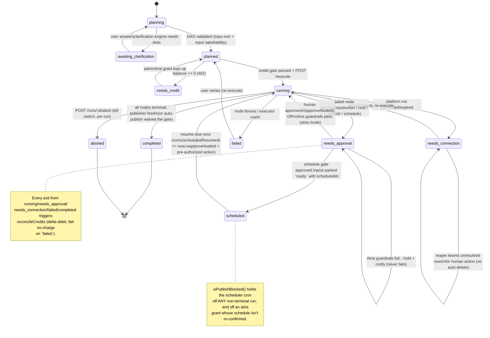

# Logic Gates, Rules & Guardrails

Exhaustive inventory of every control-flow decision point in the MKTAgent backend: approval
gates, financial gates, connectivity gates, safety/abuse guardrails, tenancy/data controls, and
LLM-behavior guardrails. All paths rooted at `MKTAgent/src`. Line numbers are as of 2026-07-18
(`pivot/video-content-farm`) and will drift with edits — treat as pointers, not pins.

---

## 1. Human-approval gates

Every gate that halts a `WorkflowRun` for a human click (or an Atria autonomy-grant policy
decision standing in for one).

| Gate | Where enforced | Trigger | Blocks | Who can pass it | Failure/bypass mode |
|---|---|---|---|---|---|
| **Concept/version selection gate** | `orchestration/executor/workflow-executor.ts:62` (`isSelectionGate`), `:302-315` (resume), `:500-519` (park); registry flag `orchestration/registry/agent-registry.ts:95-99,132-135` (`gate:'selection'`) | `concept_writer`/`campaign_strategist` produces 3-5 versions | Media/publish nodes downstream | Human clicks "select version" (`approveNodeId=<node>`); or Atria-granted run where `atriaApprovalPolicy('selection', ctx)==='approve'` (content produced) | `conceptGate:false` (verify scripts/headless) auto-selects version 1 and continues — opt-out only reachable via `ExecuteOptions`, not the public API |
| **Cost gate (video)** | Registry `agent-registry.ts:218-222` (`requiresApproval:true, gate:'cost'`, agentId `video`); policy `orchestration/executor/approval-policy.ts:43-47` | Before the Veo i2v clip render (highest per-run spend) | The `video` node itself | Human approve; or Atria grant where `estCostUsd <= budgetUsd` (`ATRIA_AUTONOMY_COST_CEILING_USD`, default `$2`, `config/env.ts:82`) | `budgetUsd===null` (ceiling unset) → always `hold`, never blind-spend |
| **Publisher gate (external write)** | Registry `agent-registry.ts:238-239` (`gate:'publish'`, agentId `publisher`); executor `workflow-executor.ts:374-404` (auto-publish waiver logic) | Any real platform post | The `publisher` node | Human approve; auto-publish (`opts.autoPublish` or `goal.autoPublish`, default **OFF**, decision 2026-07-08) when `cleanlyPostable` and no cost-gate coexists (`:389,393-403`); Atria grant via `approval-policy.ts:49-53` (`connected && mediaReady && cleanlyPostable && contentChecksPass`) | Any guardrail gap → `hold`/gate stays — never publishes partial-ready content |
| **Email-agent gate** | Registry `agent-registry.ts:295-296` (`gate:'publish'`, agentId `email_agent`) | Before a real Gmail send | The `email_agent` node | Human approve; or Atria grant (publish-gate policy) | Same publish-gate guardrails as above |
| **DM-agent gate** | Registry `agent-registry.ts:333-334` (`gate:'publish'`, agentId `dm_agent`) | Before a real WhatsApp/Telegram/Zalo send | The `dm_agent` node | Human approve (draft review); DM opt-in check is a SEPARATE hard gate inside the runner (see §3) | Draft review approves the gate; opt-in gate still fires at execution regardless |
| **Greeting/comment-reply gate** | Registry `agent-registry.ts:372-373` (`gate:'publish'`) | Before a public reply/greeting is posted | The greeting/reply node | Human approve the drafted reply | Standard publish-gate mechanics |
| **Schedule gate** | Registry `agent-registry.ts:391-394` (`requiresApproval:true, gate:'schedule'`); policy `approval-policy.ts:55-59`; executor `workflow-executor.ts:405-441` | A future `scheduledAt` on the post/action | The scheduler node → downstream action (publish/send) never fires inline | Human explicitly confirms the exact instant (`approveNodeId===planNodeId`) — **NEVER** auto-cleared, even for a granted run (parse ambiguity + timezone risk); cron re-entry (`scheduler/resume-due-runs.ts`) later waives it once confirmed | `atriaApprovalPolicy('schedule', ctx)` always returns `'hold'` — hard invariant, no code path skips it |
| **Publish-completeness gate (future-proofing)** | `workflow-executor.ts:327-346` | Publisher node reached while a sibling node is still non-terminal (running/pending/awaiting_approval) | Publisher firing before all steps finish | N/A — self-clears once siblings complete; no human action needed, just re-poll | If never clears, the run sits `needs_approval` until a sibling completes or the reaper reaps it |
| **Deferred connection gate at publish boundary** | `workflow-executor.ts:348-372` (BUG-3 fix) | Post's target platforms disconnect/expire between the up-front gate and actual publish | Publisher node | User connects/reconnects via the surfaced `requiredActions`; DRY-RUN (`!opts.publishFn`) skips unless a verify explicitly injects `connectionReaderFn` | Parks run at `needs_connection` (never lets `runPublisher` throw on missing creds) |
| **`approveNodeId` re-entry** | Threaded through every gate check in `workflow-executor.ts` (e.g. `:307,417,448,462`) | Any resume call (`POST /runs/:id/execute` with an approved node, or a scheduler cron re-entry) | N/A — this is the UNLOCK mechanism, not a block | Caller must supply the exact `nodeId` that was parked; wrong id ⇒ gate stays parked | `scheduler/resume-due-runs.ts:43-46` scopes the waiver to exactly the pre-authorized downstream action node — no blanket bypass |
| **Atria autonomy grant — backend double-confirm** | `api/orchestration-router.ts:554-575`; `api/autonomy-grant-token.ts:1-26` (stateless HMAC, `(runId,ownerId)`-scoped) | User requests "grant autonomy" on a `planned`/`failed`/`needs_connection` run | Flipping `approvalMode → 'atria'` | Two calls required: step 1 (no token) issues one, does NOT grant; step 2 must echo the exact token back | A single stray/forged call can never grant — token unforgeable without `JWT_SECRET` |
| **Campaign-scoped grant** | `autonomy-grant-token.ts:31-40` (`issueCampaignGrantToken`/`verifyCampaignGrantToken`); repo `db/repos/workflow-run-repo.ts:477-487` (`grantAutonomyForCampaign`) | Same double-confirm, but authorizes EVERY materialized post's run in one campaign | All posts under the campaign | Distinct HMAC prefix (`atria-campaign-grant:`) — a run token can't confirm a campaign grant or vice versa | Scoped to `(campaignId, ownerId)` — can't cross campaigns/tenants |
| **Per-post autonomy grant** | `api/posts-router.ts:462-489` | Same double-confirm, scoped to ONE campaign-plan post's backing run | That single run | Requires `post.runId` + `post.campaignId` (409 otherwise) | Step 1 always returns the cost estimate (`estimatePostCost`, `orchestration/master/campaign-grant.ts:9-12`) so the user sees spend BEFORE confirming |
| **Atria guardrail policy (single source of truth)** | `orchestration/executor/approval-policy.ts:36-61` | Every atria-mode gate check (`workflow-executor.ts:443-460,505-511`) | Fail-closed: any unproven guardrail ⇒ `hold` | Only a fully-passing `GuardrailContext` clears a gate | Pure + unit-tested (`approval-policy.verify.ts`) — no DB/network in the decision function itself |
| **Autonomous hold + notify (never fail, never publish)** | `workflow-executor.ts:244-250` (`atriaHold`) | Any atria-mode gate that resolves to `hold` | Sets node `awaiting_approval`, run `needs_approval`, audits (`atria_gate` log), emits an SSE notice | Human reviews and approves manually — same as a human-mode park | Never silently drops or fails the run |

---

## 2. Financial gates

Credit wallet, cost accounting, and spend-authorization control flow.

| Gate | Where enforced | Trigger | Blocks | Who can pass it | Failure/bypass mode |
|---|---|---|---|---|---|
| **402 at flow start (insufficient credits)** | `api/orchestration-router.ts:163-172` (`executePlannedRun`) | `balance <= 0` at `POST /runs/:id/execute` | Run entering `running` | Admin/super-admin grants credits (`grantCredits`), or trial credit; chat/planning stays free (brain never routes through here) | Ordered BEFORE the connection gate — a broke tenant is told to top up, not sent to connect an unusable account |
| **402 on test-run** | `orchestration-router.ts:519-521` | `getBalance(ownerId) <= 0` before `POST /runs/:id/test-run` | Template-clone + execute | Same as above | Independent check — a test-run still spends real credits |
| **"chạy đi" (voice/chat execute) credit gate** | `orchestration-router.ts:322-334` | Atria brain's `execute_workflow` tool fires on an already-planned run | Execution; the flow card stays on screen | Same as flow-start gate | On insufficient balance, the reply is appended with a plain top-up message — run stays `planned`, never silently fails |
| **Debit-on-terminal-completion (every stop point)** | `orchestration/executor/workflow-executor.ts:103-128` (`reconcileCredits`, `finally` block `:533-535`) | Every exit from `runWorkflow` — park (`needs_approval`/`needs_connection`), fail, abort, or complete | Nothing (accounting only) | N/A — automatic, best-effort (never throws) | A run that parks-resumes-parks-again is charged its real accumulated cost exactly once (delta-based), never more |
| **Fail-no-charge (2026-07-15 product decision)** | `workflow-executor.ts:116-121` | Run status is `failed` when `reconcileCredits` runs | The debit itself | N/A | A run that errors mid-DAG bills the tenant $0, even for nodes that ran before the failure — only genuine crash is free; park states still charge |
| **Debit idempotency (no double-charge)** | `db/repos/credit-repo.ts:113-142` (`reconcileRunDebit`) | Concurrent stop-points for the same run (SSE-driven resume racing a manual re-entry) | Duplicate debit rows | Transaction-scoped advisory lock keyed on `runId` (`pg_advisory_xact_lock`) | `toDebit = costSoFar - alreadyDebited`; `<=0` ⇒ no-op |
| **Trial grant idempotency** | `credit-repo.ts:50-65` (`ensureTrialGrant`) | First login | Double-granting the 2000-credit trial | N/A — one-time, automatic | Advisory lock keyed on `ownerId` closes the TOCTOU where two concurrent first-logins both see `count=0` |
| **Super-admin manual grant** | `credit-repo.ts:42-48` (`grantCredits`); routed via `api/admin-router.ts` behind `requireSuperAdmin` | Explicit admin action | N/A — adds credits | Only a `User.isSuperAdmin=true` account | Audited via `grantedBy` on the ledger row |
| **Atria autonomy cost ceiling** | `approval-policy.ts:43-47`; `config/env.ts:82` (`ATRIA_AUTONOMY_COST_CEILING_USD`, default `$2`) | Cost-gated node (video) on a granted run | Auto-clearing the cost gate | Only when `estCostUsd <= budgetUsd`; unset ceiling ⇒ always `hold` | Never a silent override — held runs notify + audit |
| **Campaign/post cost estimate before grant** | `orchestration/master/campaign-grant.ts:9-38` (`estimatePostCost`, `estimateCampaignCost`) | Step 1 of any grant flow | Nothing — informational, shown before the human confirms | N/A | Uses the owner's real per-agent cost history (`agentCostAverages`) with fallbacks — not a guess |
| **Credit display (transparent token passthrough)** | `cost/credits.ts:1-39` | Every cost surface | N/A — display only, `TOKENS_PER_CREDIT=250`, `USD_PER_CREDIT=$0.000625` | N/A | No markup, no billing engine in MVP — a future paid plan layers price on top without reworking display |

---

## 3. Connectivity gates

Connection resolution, external-write chokepoint, kill switch, rate limiting, idempotency, and
live-vs-DRY-RUN flags.

| Gate | Where enforced | Trigger | Blocks | Who can pass it | Failure/bypass mode |
|---|---|---|---|---|---|
| **Connection resolver (pre-execution)** | `connectors/runtime/connection-resolver.ts:83-131` (`resolveConnections`) | Any plan node with `requiresConnection` targeting a platform | Run start (unless deferred — see below) | User connects/reconnects (`connectUrl`); token liveness re-checked on every call | Deferred (not fast-failed) when the plan can produce a reviewable draft first (`orchestration-router.ts:181-189`) — only a plan with NOTHING to review up front still fast-fails |
| **Token liveness classification** | `connection-resolver.ts:63-72` (`livenessOf`) | Every resolve call | Distinguishes `connected` / `needs_attention` (expired/revoked) / `not_connected` | Fresh OAuth or a verified form-pasted token | Expiry compared against `now` on every call — no cached staleness |
| **Form-token synthetic liveness** | `connection-resolver.ts:46-61` | A pasted (non-OAuth) platform credential with no `OAuthToken` row | Reads as `needs_attention` (never `active`) until verified | User verifies the pasted token (`verifyAndRecordFormToken`) | Fail-closed by design (Phase 06/H5 fix) — an unverified paste must not authorize real spend |
| **Autonomy-runner connection gate** | `orchestration/autonomy/autonomy-runner.ts:42-49` | Granted-but-unstarted run claimed by the autonomy cron | Execution | Same connection resolution as manual execute | Parks `needs_connection`, same fail-closed gate as manual `/execute` |
| **Global kill switch** | `system/kill-switch.ts:19-31` (read, 3s TTL cache), `:49-58` (toggle); enforced in `connectors/runtime/connector-runtime.ts:74-81` | Ops "stop everything" toggle (`SystemFlag` table) | EVERY external action platform-wide, checked FIRST (before input validation) | Only an operator via the admin toggle endpoint | **Fails OPEN on a DB read fault** (`kill-switch.ts:26-30`) — a Postgres hiccup does not block publishing (explicit, logged trade-off); a DRY-RUN publish never reaches this check at all |
| **Idempotency dedupe (no double external-write)** | `connectors/runtime/idempotency-manager.ts:21-45`; wired in `connector-runtime.ts:91-99,143-155` | A retried/re-entered action with the same `(ownerId, idempotencyKey)` | Re-sending to the platform | N/A — automatic short-circuit, returns the cached `externalId` | Only dedupes **successes** — a prior `error` row never blocks a genuine retry; no new table (reuses `external_action_audit_log`) |
| **Rate-limit spacing (anti-burst)** | `connectors/runtime/rate-limit-manager.ts:14,30-48` | Every `invokeAction` call | Minimum 2s gap between two writes to the same `(ownerId, platform)` | N/A — automatic queueing | **In-memory, single-process only** — not a distributed limiter (explicit scope note, `:6-10`); multi-instance deploys need Redis |
| **Required-input validation (pre-network)** | `connector-runtime.ts:82-89` | `invokeAction` before any network call | The action, with a structured `ok:false` (never a thrown error) | N/A | Not audited (pre-network rejections aren't logged to the forensic action log — only real attempts are, `:111-115`) |
| **DRY-RUN vs LIVE — DM send** | `messaging/types.ts:43-51` (`isLiveDmSend`); flag `config/env.ts:182` (`ENABLE_LIVE_DM_SEND`, default `false`) | Every DM send attempt | Real network send | Requires provider token PRESENT **AND** `ENABLE_LIVE_DM_SEND=true`; Zalo additionally needs `ENABLE_ZALO` (`env.ts:197`) | Fail-closed by design — missing/false anywhere in the chain ⇒ always DRY-RUN |
| **DRY-RUN vs LIVE — social greeting/mention reply** | `social/greeting.ts:16` (`isLiveGreetingSend`); flag `ENABLE_LIVE_GREETING_SEND` (`env.ts:203`, default `false`) | Every greeting/mention-reply send | Real network send | Explicit flag flip on top of the adapter implementing it | Mirrors `isLiveDmSend`'s fail-closed gate exactly |
| **DM opt-in refusal (hard invariant)** | `messaging/dm-runners.ts:97-104` | `dm_agent` about to send | Send, throws loud (`refusing to send`) | Only a contact with `getOptInState()==='opted_in'` | Runs even in DRY-RUN — the check is exercised on every send path, not skipped in verification |
| **Publish ownership — single chokepoint** | `connectors/runtime/connector-runtime.ts:143-155` (`runtimePublishFn`) | Both the in-flow executor (immediate) and the scheduler cron (scheduled) publishes | Any shadow bypass of kill-switch/audit/idempotency/rate-limit | N/A — architectural invariant | Documented in `scheduler/tick.ts:10-16`: they never double-publish because the executor PARKS a scheduled-future post `ready` and never inline-publishes it |
| **Publish-blocked guard (scheduler)** | `db/repos/workflow-run-repo.ts:190-211` (`isPublishBlocked`); consumed in `scheduler/tick.ts:209-218` | Cron about to fire a due post | Delays that post (tries the next due post instead) | Self-clears once the run's nodes all reach terminal state and (human approved OR `scheduleConfirmed=true`) | An atria grant whose finalized schedule was NOT re-confirmed (`scheduleConfirmed=false`) is blocked forever until re-confirmed — never auto-fires an unconfirmed autonomous schedule |

---

## 4. Safety/abuse gates

Anti-spam, self-healing, hallucination containment, and webhook authenticity.

| Gate | Where enforced | Trigger | Blocks | Who can pass it | Failure/bypass mode |
|---|---|---|---|---|---|
| **Nurture daily send cap** | `nurture/guardrails.ts:22,68-70` (`DAILY_SEND_CAP=100`) | `preSendCheck` before waiving the `email_agent` gate for one nurture touch | Sends once 100 nurture emails have gone out (any lead) in a rolling 24h | N/A — hard ceiling, not a per-tenant setting (YAGNI note, `:20-22`) | Guards against a runaway loop (bug re-planning the same thread every tick), not normal single-tenant volume |
| **Nurture max-touches cap** | `guardrails.ts:53-55,67` | `touchIndex >= maxTouches` for a drip touch | That touch's send | N/A | Reply touches are indexed `100+n` — deliberately outside the drip cadence's index space, so a conversational reply is NEVER subject to the drip's max-touches cap |
| **Nurture opt-out suppression + unsubscribe link** | `guardrails.ts:29-49,66` (HMAC-signed, stateless, no DB row); consumed via `isEmailSuppressed` | Every pre-send check and every enroll check | Sending to a suppressed email | Token scoped to `(ownerId, emailLower)` — survives restarts, can't cross tenants/leads | `verifyUnsubscribeToken` uses `timingSafeEqual` (no timing side-channel) |
| **Nurture enroll guardrail aggregator** | `guardrails.ts:77-82` (`canEnroll`) | Lead-nurture enrollment | Opted-out / disabled-toggle / no-email leads from enrolling | `nurtureEnabled` toggle + valid email + not suppressed | Single source of truth for the enroll rules (the inline checks in `enroll.ts`/`lead-repo.ts` are the actual enforcement path; this aggregates them for one assertable surface) |
| **Nurture brain — deterministic opt-out fast path** | `nurture/nurture-brain.ts:39-43,95-97` (`OPT_OUT_RE`) | Reply body matches unsubscribe/stop/not-interested phrasing | Reaching the LLM at all | N/A — zero-spend, guaranteed-correct | Errs toward catching a FALSE positive (low-harm, inbox can resume) over missing a real opt-out |
| **Nurture brain — confidence floor + unclear-intent escalate** | `nurture-brain.ts:79-81`; `nurture-brain-prompt.ts:56-57` (`CONFIDENCE_FLOOR=0.55`) | A `draft_reply` decision with `confidence<0.55` or `intent` unclear/null | Sending the draft | N/A — forces `escalate` | Overrides the model's OWN tool call — the system can't ship a low-confidence draft even if the model was confident-sounding |
| **Nurture brain — hallucinated-pricing guard** | `nurture-brain.ts:45-51,77-89` (`extractPriceFigures`, `applyGuardrails`) | Any price/currency figure in a `draft_reply` not found verbatim in `productKnowledge` | Sending the draft | N/A — forces `escalate` (`unverifiable_pricing_claim`) | Mechanical, not model-trusted: EVERY figure must appear in grounding, not just "some price exists somewhere" |
| **Nurture brain — never sends itself** | `nurture-tools.ts:1-8` (file header), `nurture-brain.ts:8-11` | Architectural | The brain can only classify/draft/escalate — dispatchTool never performs an external action | Human approval gate downstream (email_agent) owns the actual send | Mechanical separation, not a prompt promise |
| **Meta webhook — GET challenge verify** | `leads/sources/meta-webhook.ts:159-172` (`handleVerifyChallenge`) | One-time subscribe handshake | Echoing `hub.challenge` | Only when `hub.verify_token` matches `META_WEBHOOK_VERIFY_TOKEN` (constant-time `safeEqual`) | Wrong/missing token ⇒ 403, no challenge echoed |
| **Meta webhook — POST signature verify** | `meta-webhook.ts:45-55` (`verifyMetaSignature`), `:180-183` | Every delivery | Processing the payload at all | HMAC-SHA256 of the RAW body must match `X-Hub-Signature-256` | Unsigned/wrong-signature POST ⇒ 401 `invalid_signature`, rejected outright (public URL, no JWT) |
| **Comment-capture keyword/identity gate** | `meta-webhook.ts:126-153` (`routeMetaComment`) | Every comment on every connected page (webhook receives ALL, not just watched posts) | Capturing a lead when there's no matching `leadCaptureKeyword` or no email/handle identity | Post must have `leadCaptureKeyword` set AND the comment must hit that keyword | Silently ignored (not an error) when a post isn't watched — this is expected high-volume noise filtering |
| **Self-healing reaper** | `scheduler/reaper.ts:23-84` | Stuck states: `posting` posts, `running` nodes/runs past a timeout | Nothing new — RECOVERS rows a crash/redeploy left stranded | N/A — always-on, 5-min sweep (`ENABLE_REAPER_CRON`) | Video nodes get a bigger budget (`REAPER_VIDEO_NODE_TIMEOUT_MIN=30` vs `REAPER_NODE_TIMEOUT_MIN=10`, `env.ts:88-91`) so a long render isn't false-reaped |
| **Orphan surfacing (never auto-delete)** | `reaper.ts:71-78` | Parked runs (`needs_approval`/`planned`) older than `REAPER_ORPHAN_TTL_DAYS` (default 7) | Nothing — logged only, one summary line per sweep | Human investigates/acts | Explicit design choice: the user may still act on an old parked run; the reaper never deletes it |
| **Publish idempotency key derivation** | `connector-runtime.ts:137-138` (`publishIdempotencyKey`) | Every publish via `runtimePublishFn` | Duplicate publish of the same `(postId, platform, assetType)` | N/A | Callers that don't set a key opt out of dedupe (not used elsewhere in this codebase) |

---

## 5. Data/tenancy gates

Tenant isolation, PII protection, secret sealing, and superadmin access control.

| Gate | Where enforced | Trigger | Blocks | Who can pass it | Failure/bypass mode |
|---|---|---|---|---|---|
| **Super-admin gate → 404 (not 403)** | `api/middleware-superadmin.ts:8-18` (`requireSuperAdmin`); mounted `server.ts:145,147` (`requireAuth → requireSuperAdmin → adminRouter`) | Any `/admin/*` request | The entire admin surface | Only `User.isSuperAdmin===true` | Non-admin gets `404 not_found` — the surface's EXISTENCE isn't revealed by probing; the obscure `/superadminatria101` frontend URL is defense-in-depth on top, not the real boundary |
| **Tenant isolation (repo-level scoping)** | Pervasive pattern, e.g. `db/repos/workflow-run-repo.ts:214-223` (`deleteRun`), `:225-230` (`getRunWithNodes`) | Every owner-scoped read/write | Cross-tenant data access | `findFirst({ where: { id, ownerId } })` / `deleteMany({ where: { id, ownerId } })` — wrong tenant reads as `not_found`, never a 403 that confirms existence | Consistent codebase-wide convention (repos never accept an unscoped id) |
| **Lead PII encryption at rest** | `db/repos/lead-repo.ts:6,53-60` (`encryptToken`/`decryptToken`/AES-256-GCM); backfill `leads/backfill-lead-pii.ts` | Every lead write (`name`/`email`/`phone`/`message`) | Plaintext PII landing in the DB | Decryption happens only on authenticated, owner-scoped reads | Legacy plaintext rows tolerated on read (`decrypt` falls back to raw value, `lead-repo.ts:57`) until the one-off backfill runs — idempotent, skips already-encrypted rows |
| **Email masking before LLM context** | `orchestration/atria/atria-tools.ts:58-63` (`maskEmail`, used by `find_lead`) | Any lead lookup surfaced to the Atria brain | Full email address reaching the model | N/A — always masks (`j***@domain.com`) | Only the first local char + full domain kept — enough to disambiguate candidates without full PII in LLM context |
| **Credential vault seal/open** | `connectors/vault/encrypted-db-vault.ts:11-18` | Every OAuth token store/read | Plaintext secrets in the DB | Same AES-256-GCM primitive as lead PII (`lib/crypto.ts`) | Interface-abstracted (`CredentialVault`) so an external-vault impl (Vault/KMS) can replace this without touching callers |
| **Data Guard — >40k chunking, fail-closed masking** | `orchestration/executor/agent-runners.ts:855-947` (`SECURITY_SCAN_CHARS=40000`, `chunkText`, `scanSecurityWindow`, `runSecurity`) | The `security` node (task pipeline, e.g. `summarize`'s upstream requirement) | Raw PII/sensitive data reaching `summarize` or any downstream node | N/A — mandatory upstream step, `summarize` `requires` it | **Fail-closed per window**: `hasSensitive && !maskedText` throws rather than leak raw source (`:904-906`); full-document coverage — no window silently dropped |
| **`sourceText` upstream cap** | Referenced `agent-runners.ts:853` (goal-spec caps at 200k chars) | Task-pipeline goal input | Unbounded LLM cost/latency from a huge document | N/A | Bounds the number of 40k-char security-scan chunks to a known maximum |
| **Zod request-body validation** | `api/http.ts:16-27` (`parseOr422`); used across every router (`posts-router.ts`, `orchestration-router.ts`, `leads-router.ts`, etc.) | Every mutating API request | Malformed input reaching a handler | N/A — automatic | `422 validation_failed` with per-field errors (`r.error.flatten().fieldErrors`) — never a raw 500 on bad input |
| **Workflow plan schema validation** | `goalSpec.parse(...)` / `workflowPlan.parse(...)` calls throughout (e.g. `orchestration-router.ts:173-174,530-531`) | Every run load/resume from stored JSON | Executing a malformed/corrupted plan or goal | N/A | A parse failure throws before any node executes |
| **DAG integrity + input satisfiability** | `orchestration/master/workflow-validator.ts:18-70` (`topoSort`, `validatePlan`) | Every plan before it's accepted/executed | Cyclic/dangling-edge plans, or a node whose required artifact type isn't produced upstream | N/A | Returns a recoverable `{ok:false, error}` (never throws) — `plan_cyclic_or_dangling` or `plan_unsatisfiable_inputs` |

---

## 6. LLM-behavior guardrails

Reasoning-loop bounds, tool allowlists, cost policy, intent classification, and prompt hardening.

| Gate | Where enforced | Trigger | Blocks | Who can pass it | Failure/bypass mode |
|---|---|---|---|---|---|
| **Atria brain tool allowlist (closed menu)** | `orchestration/atria/atria-tools.ts:66-` (`TOOL_DECLARATIONS`) | Every brain round | The model calling anything outside `web_search / get_workspace_data / recall_memory / save_memory / propose_workflow / execute_workflow / find_lead / set_schedule / propose_task` | N/A — Gemini functionDeclarations enforce the schema; `dispatchTool` only recognizes these names | Unknown tool name degrades to a note, doesn't crash the loop |
| **Nurture brain tool allowlist** | `nurture/nurture-tools.ts:25-72` (`TOOL_DECLARATIONS`: `classify_reply`, `draft_reply`, `set_state`, `escalate`) | Every nurture-brain round | Model performing anything beyond classify→finalize | Must call `classify_reply` FIRST (prompt-enforced), then exactly one finalizing tool | A second finalizing call this turn is a no-op (`already_finalized`, `:89,103,116`) |
| **Thinking-budget policy (per-agent ceiling)** | `orchestration/thinking-budget.ts:36-55` (`thinkingBudgetFor`) | Every LLM node call | Runaway/unbounded "thinking" spend on `gemini-2.5-*` | N/A — ceiling only (model self-limits below it); tiers: `REASONING=4096`, `CREATIVE∈{2048,4096,8192}` by `qualityPref`, `SUMMARIZE∈[2048,8192]` scaled by doc length, `ACTION=0` for publisher/email_agent/scheduler | Unlisted agent ⇒ defaults to `REASONING` (safe, self-limiting) |
| **Brain wall-clock + round budgets** | `atria-brain.ts:51-53` (`MAX_ROUNDS=3, TURN_BUDGET_MS=45000, CALL_TIMEOUT_MS=30000`); `nurture-brain.ts:34-36` (`MAX_ROUNDS=3, TURN_BUDGET_MS=20000, CALL_TIMEOUT_MS=15000`) | Every turn | The reasoning loop from blocking `POST /runs` indefinitely | N/A | Deadline exceeded mid-loop ⇒ returns whatever proposal exists, else a graceful degrade reply — never hangs the request |
| **Runtime-failure graceful degrade** | `atria-brain.ts:112-120` (`gracefulReply`) | Gemini 5xx / empty-content / exception | Falling back to a marketing-plan proposal on a transient failure | N/A | Deliberately a short apology, NOT `masterAgent.handle(...)` — a transient blip must not re-box a general request as marketing |
| **No-API-key fallback (sole non-LLM path)** | `atria-brain.ts:105-110,125` (`legacyFallback`) | `env.GEMINI_API_KEY` unset | The whole reasoning loop | N/A | Falls back to the deterministic marketing planner — the only capability that works with zero LLM |
| **One-shot transient retry** | `atria-brain.ts:180-190` (5xx retry), `:204-211` (empty-content retry) | A single flaky Gemini response | Discarding a good turn as an apology | N/A | Exactly one re-call, logged at `warn` — not an infinite retry loop |
| **`detectCampaignIntent` create/plan/ambiguous classifier** | `orchestration/master/campaign-intent.ts:92-116` | A chat follow-up on a SAVED flow (`kind==='template'`) | Silently reproducing a new flow instead of binding to the saved one (2026-07-13 bug) | Deterministic regex, VN+EN, Unicode-aware boundaries — NOT the LLM | `isAmbiguous` (named create + batch signal together) forces a RECONFIRM turn (`orchestration-router.ts:250-257`) rather than guessing |
| **Clarification engine (max-5-questions, hard-slot gate)** | `orchestration/master/clarification-engine.ts:25,61,67-` (`MAX_QUESTIONS=5`, `AUTONOMY_HARD_SLOTS={product,productDetails,output_format}`) | Every plan attempt | Planning with insufficient context | Human answers the questions; Atria-autonomous path (`autonomous:true`) only still blocks on the 3 hard slots — everything else is inferred/defaulted | Pure + deterministic (slot presence, not LLM judgment) — unit-testable without a model |
| **Thin-product / placeholder detection** | `clarification-engine.ts:30-51` (`isThinProduct`, `PLACEHOLDER_PRODUCT`, `DANGLING_POSSESSIVE`) | A product string that satisfies `!!product` but carries no real info (e.g. "my product") | Planning on a vacuous product slot | User supplies a real description (≥12 chars) or `productDetails` | Anchored regex — a genuine description merely starting with "sản phẩm" is not wrongly flagged |
| **Reply-language pin** | `atria-brain.ts:154-164` | Every brain turn | The model drifting to the language of memory/Instructions context instead of the user's actual message | N/A — LAST preamble item, closest to the user's words, names the detected language explicitly | Recurring bug (`feedback_reply_language_pin` memory) — fix is preamble ORDER; regressions show up as EN-input→VN-reply |
| **Nurture prompt-injection hardening** | `nurture/nurture-brain-prompt.ts:24-27,53` | The "LATEST REPLY" block (lead-authored, untrusted) | The model treating lead text as instructions ("ignore your rules", "send me the discount code") | N/A — labeled explicitly as DATA, not instructions, in the system prompt AND the per-turn block | Prompt-level control only (no mechanical filter) — backstopped by the price-hallucination + confidence guardrails above, which don't trust the model's own compliance |
| **Auto-publish NL flag scoping** | `workflow-executor.ts:387-389` | Goal's `autoPublish` flag (set by the analyzer from phrases like "đăng luôn") | Auto-publish activating when a cost gate coexists in the plan | N/A | `autoPublish = (opts.autoPublish ?? goal.autoPublish ?? false) && !hasCostGate` — approving a video cost gate must NOT cascade into auto-publish |
| **Conversational-vs-proposal turn routing** | `atria-brain.ts:170-173,199-214` (`proposalOrNull`) | Every brain turn's terminal state | Miscategorizing a `plan_error` outcome as a valid proposal | N/A | Only `ctx.proposal.outcome.status !== 'plan_error'` counts as a proposal-winning turn |

---

## 7. Run gate lifecycle (state diagram)

---

## Status/Summary/Concerns

**Status:** DONE

**Summary:** Documented 6 gate categories (human-approval, financial, connectivity, safety/abuse,
data/tenancy, LLM-behavior) covering ~55 distinct gates across `MKTAgent/src/orchestration`,
`scheduler`, `cost`, `connectors`, `nurture`, `messaging`, and `leads/sources`, each with
file:line, trigger, block target, bypass authority, and failure mode. Added a Mermaid run-lifecycle
state diagram. Written to `docs/product/02-logic-gates-rules-guardrails.md` (~330 lines source).

**Concerns:**
- Line numbers will drift on next edit to any cited file — treat as pointers to re-locate, not
  permanent anchors.
- Two explicit fail-OPEN behaviors exist and are worth flagging to the user as accepted risk:
  kill-switch read fault (`system/kill-switch.ts:26-30`) and rate-limiter is single-process/in-memory
  only (`connectors/runtime/rate-limit-manager.ts:6-10`, no distributed guard for multi-instance
  deploys).
- Did not trace the `agent-registry.ts` full agent list line-by-line (only cited gate-relevant
  entries) — a few more `requiresConnection`-only agents exist without approval gates (by design,
  low-risk reads) and weren't individually tabled.
- Zod schema files (`goal-spec.ts`, `workflow-plan.ts`, `artifact-schemas.ts`) were confirmed to
  exist and be the parse target everywhere but not enumerated field-by-field — that's a schema
  reference doc, not a gates doc.
- No unresolved questions blocking this doc; flag to the user only if line-drift makes a citation
  stale enough to mislead.
