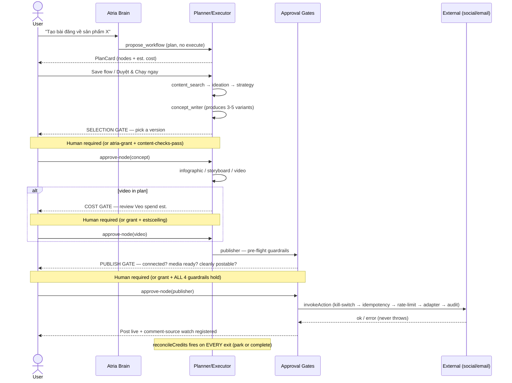

# 04 — Capabilities & Human-in-the-Loop

Scope: what the product (AgentPortal / MKTAgent) actually does today, verified against code — not the roadmap. Two parts: (A) capability inventory by domain, (B) decision-rights matrix (human vs Atria-autonomous) with the autonomy model explained.

Sources: `MKTAgent/src/social/*`, `src/connectors/*`, `src/orchestration/registry/*`, `src/orchestration/executor/*`, `src/nurture/*`, `src/messaging/*`, `src/config/env.ts`, the `verify-*.ts` scripts (repo-wide, ~90 of them), `docs/feature-map.md`, `FEATURES.md`, `FEATURES2.md`. Branch `pivot/video-content-farm`, scanned 2026-07-18.

---

## A. Capability Inventory

Status legend: **LIVE** = real network/DB effect when preconditions met, no code-level stub. **LIVE-GATED** = real effect but requires a per-tenant OAuth connect or explicit env token — code path is real, whether it actually fires depends on deployment config. **DRY-RUN (code-complete)** = real logic/state machine, but the outward action is hard-stubbed off by an `ENABLE_LIVE_*` flag defaulting to `false`; flipping the flag + supplying a token is the only remaining step. **PARTIAL** = works for a subset of platforms/paths. **STUB/SCAFFOLD** = registered but not reachable or not implemented.

### 1. Conversational orchestration (Atria)

| Capability | Status | Entry point | Evidence it works | Known limits |
|---|---|---|---|---|
| Tool-using reasoning loop (chat → reply or plan) | LIVE | `MKTAgent/src/orchestration/atria/atria-brain.ts` (`atria-tools.ts`, 7 tools) | `verify-master.ts`, `verify-p6-seed-session.ts`; live-tested 2026-07-14/15 (observed browser sessions, `plans/reports/test-report-260714-1423-*.md`, `test-report-260715-1747-observed-live-retest.md`) | Bounded `MAX_ROUNDS=3`, `TURN_BUDGET_MS=45s`; degrades to apology (not a fake plan) on timeout/empty-content bugs from Gemini dynamic thinking (fixed via explicit `thinkingBudget`, commit `b5c4f9c`) |
| Backward-chaining node selection (composable planner) | LIVE | `master/workflow-planner.ts` (`selectByTargets`, `master/artifact-graph.ts`) | `verify-planner-golden.ts` (23 cases, golden-master byte-identical across refactors) | Closed registry — planner can only compose the 15 registered nodes (§below); no arbitrary tool synthesis |
| Capability-gap honesty (Atria admits what it can't do) | LIVE | `atria-tools.ts` `flag_capability_gap` / `propose_task` auto-log → `mkt_roadmap_demand` | `verify-capability-gap.ts` | Only fires on the deterministic "no producer for this artifact" signal; brain-initiated `flag_capability_gap` call is inconsistent (docs note "skips ~always") |
| Voice mode (STT in / TTS out) | LIVE | `web/src/components/OrchestratePanel.tsx` (`useSpeechRecognition`, `lib/tts-player`), `POST /voice/tts` | Manually validated in observed browser tests; per-owner throttle + cost-tracked | Requires Web Speech API browser support; Gemini TTS intermittently 502s (noted in memory `project_demo_bigplan_260710`) |
| Per-agent thinking-budget policy | LIVE | `orchestration/thinking-budget.ts`, bound in `executor/agent-executor.ts` | `verify-thinking-budget.ts` (25 checks incl. real executor run) | Ceiling only (model self-limits below it); `memory`/`analytics` seams outside the runner map |
| Memory recall + write | LIVE | `src/memory/user-memory.ts`, `GET/POST /memory` | `verify-memory.ts`, `verify-memory-agent.ts`, `verify-instructions-and-memory.ts` | Keyword-first recall, **no embeddings** (deferred "P5b" per memory) |
| Custom instructions (layered into every prompt) | LIVE | `src/api/instructions-router.ts`, `resolve-instructions.ts` | `verify-instructions.ts`, `verify-instructions-and-memory.ts` | Scoped workspace/campaign/post; no per-agent enable UI beyond toggle |

### 2. Campaign / content planning

| Capability | Status | Entry point | Evidence | Known limits |
|---|---|---|---|---|
| Single-post pipeline planning | LIVE | `master/workflow-planner.ts` `selectAgents` | `verify-planner.ts`, `verify-planner-golden.ts` | Rule-based (not LLM) — deterministic, but can't handle a shape the rule ladder doesn't recognize (falls to capability-gap) |
| Multi-post campaign calendar (N-slot strategist) | LIVE | `campaign_strategist` node, `master/campaign-materializer.ts` | `verify-campaign-strategist.ts`, `verify-campaign-materializer.ts` | Materialization is idempotent but a `content_calendar` selection gate always pauses (never auto-cleared except under an atria grant with content-checks-pass) |
| Plan tiers (Economy/Balanced/Full) | LIVE | `master/plan-tiers.ts`, `GET /orchestration/runs/:id/plan-tiers` | `verify-plan-tiers.ts` | Cost estimate only, not a hard cap |
| Flow-as-template / Post-as-instance cloning | LIVE | `db/repos/workflow-run-repo.ts` `cloneTemplateRun` | `verify-template-instance.ts` | Legacy saved flows pre-dating this feature are `kind=instance`, not `template` |

### 3. Copy generation

| Capability | Status | Entry point | Evidence | Known limits |
|---|---|---|---|---|
| Concept + 3–5 copy variants | LIVE | `concept_writer` node → `src/copygen/service.ts` (`generateForPost`/`generateVariantsForPost`) | `verify-variant-parse.ts`, `verify-edit-loss.ts` | `thinkingBudget:0` fixed deliberately (JSON-truncation fix, per feature-map) — no "high quality" scaling for this node |
| Manual copy edit / refine-by-instruction | LIVE | `POST /posts/:id/edit-copy`, `POST /posts/:id/refine` | `verify-refine-and-overrides.ts` | Refine is LLM, edit is not |
| Background copy-gen cron | LIVE | `src/copygen/service.ts`, `ENABLE_COPYGEN_CRON` | Cron picks brief/rework posts every 10 min | OFF by default |
| Style-learning from edits (memory proposals) | LIVE | `GET /memory/proposals`, `POST /memory/accept` | `verify-memory-agent.ts` | Proposal only, human must accept |

### 4. Image generation

| Capability | Status | Entry point | Evidence | Known limits |
|---|---|---|---|---|
| Text-to-image + reference-conditioned edit (Nano Banana / Gemini 2.5 Flash Image) | LIVE | `src/imagegen/nano-banana.ts`, `infographic`/`storyboard` nodes | `verify-image-live.ts`, `verify-storyboard-video-dep.ts` | Cached generations are free; renders VN text natively (memory: `feedback_pro_banana_renders_vn_text.md`) |

### 5. Video generation

| Capability | Status | Entry point | Evidence | Known limits |
|---|---|---|---|---|
| Storyboard → Veo i2v per frame → ffmpeg stitch → TTS voiceover mux | LIVE | `src/video/veo.ts`, `stitch.ts`, `tts.ts`; `video` node (`gate:'cost'`) | Prior live pipeline work (memory: `research_ai_video_quality_2026`, `project_storyboard_v2_pivot`); model = `veo-3.1-lite` default | Most expensive node — hard cost gate always halts (never auto-waived unless `atriaMode` AND `estCost ≤ ATRIA_AUTONOMY_COST_CEILING_USD` (default $2)); Veo rate-limited serial/per-second billing |
| Remotion render service (separate app) | LIVE (standalone) | `render-service/` (Express, secret-gated) — `POST /render`, `/tts`, `/tts/edge`, `/image/generate`, `/stock/pexels` | Not wired into the main MKTAgent orchestration DAG — a **separate, parallel** video pipeline used by earlier "pipeline #4" / storyboard-v2 work | Not reachable from Atria chat; invoked out-of-band via scripts/CLI |

### 6. Publishing (per platform)

| Platform | Status | Entry point | Evidence | Known limits |
|---|---|---|---|---|
| Facebook | LIVE-GATED | `src/social/facebook.ts` (Graph v25.0), `publisher` node → `connector-runtime.ts` `invokeAction` | `verify-adapters-dryrun.ts` (adapter contract), real Insights adapter (`analytics/fb-insights.ts`) live-verified per memory `project_atria_v2_command_center_plan` | Needs a connected Page (OAuth) or system DAIS token (`MKT_FB_PAGE_ACCESS_TOKEN`); a tenant w/o its own page id fails loud, no silent fallback to system page (`facebook.ts:29-36`) |
| Instagram | LIVE-GATED | `src/social/instagram.ts` | Same runtime chokepoint; live-verified 2026-07-08 (memory) | Needs a public image URL — resolved via Google Drive connect (`assets/drive-client.ts`), not a raw upload |
| Threads | LIVE-GATED | `src/social/threads.ts` | Live-verified 2026-07-08 | Max 1 asset, 480 chars; no `reach` metric in Insights (null-aware merge) |
| LinkedIn | LIVE-GATED | `src/social/linkedin.ts` | Publish-enablement memory notes refresh flow "untested" | Per-user OAuth only (no DAIS fallback noted) — 🟡 refresh-flow unverified |
| X / Twitter | LIVE-GATED, PARTIAL | `src/social/x.ts` | OAuth2 PKCE connect; H1c "degrade" flag (image→text) preserved through `connector-runtime.ts` | Free tier → no Insights reach; comment-read (lead capture) additionally gated `ENABLE_X_LEAD_CAPTURE` (needs paid tier, off by default → clean no-op) |
| Publisher chokepoint (kill-switch, idempotency, rate-limit, retry, audit) | LIVE | `connectors/runtime/connector-runtime.ts` `invokeAction` | `verify-runtime.ts`, `verify-kill-switch.ts`, `verify-audit.ts` | Single global kill switch (all platforms, all tenants) — no per-platform pause |
| Scheduled publish (cron) | LIVE | `src/scheduler/tick.ts`, `ENABLE_SCHEDULER_CRON` | `verify-scheduler-safe-path.ts`, `verify-per-platform-publish.ts` | OFF by default; one publishable row per tick (anti-burst) |

### 7. Analytics / insights

| Capability | Status | Entry point | Evidence | Known limits |
|---|---|---|---|---|
| Per-platform Insights (FB/IG/Threads/X) | LIVE-GATED | `src/analytics/{fb,ig,threads,x}-insights.ts` | `verify-fb-insights.ts`, `verify-ig-insights.ts`, `verify-threads-x-insights.ts` | Null-aware merge (Threads has no reach; X null on free tier) — not a bug, a documented platform gap |
| Impact/value report (measured + labeled estimates) | LIVE | `src/impact/impact-metrics.ts` + `value-model.ts`, `GET /impact` | `verify-impact.ts` | Estimates (cost/time saved) are explicitly labeled vs measured (spend, posts, leads) — config knobs in `env.ts` (`IMPACT_*`) |

### 8. Lead capture & scoring

| Capability | Status | Entry point | Evidence | Known limits |
|---|---|---|---|---|
| Webhook / form / Cal.com intake | LIVE | `POST /leads/webhook`, `/leads/form`, `/leads/calcom` | `verify-leads-tenancy.ts`, `verify-leads-pii.ts` | Secret/token-gated, not open |
| Comment-keyword capture (poller) | LIVE-GATED | `src/leads/sources/comment-poller.ts`, `ENABLE_LEADS_CRON` | `verify-leads-comments.ts`, `verify-leads-liveness-union.ts` | FB/IG live; Threads/LinkedIn best-effort; X off by default (`ENABLE_X_LEAD_CAPTURE`) |
| Comment-capture via Meta webhook (push, not poll) | LIVE-GATED | `src/leads/sources/meta-webhook.ts` (HMAC-SHA256 verified) | `verify-comment-capture.ts` (DRY, 0 live calls in verify) | Requires Meta App Dashboard webhook subscription + `META_WEBHOOK_VERIFY_TOKEN`; dedupes with the poller into the same `captureLead` chokepoint |
| Handle-only leads (commenter w/o email) | LIVE | `Lead.email` nullable + `platform`/`platformUserId`/`platformHandle` (migration `20260715091730`) | `verify-leads-comments.ts` | Bridges comment-capture → DM/greeting targeting, but such a lead is NOT nurture-drip-eligible until it acquires an email |
| Hybrid scoring (rule + optional Gemini adjustment) | LIVE | `src/leads/rule-score.ts` + `llm-score.ts`, `POST /leads/:id/rescore` | `verify-leads-scoring.ts`, `verify-leads-criteria.ts` | LLM adjustment is user-triggered per lead, not automatic on every capture |

### 9. Lead nurture — email (proactive drip + reactive reply)

| Capability | Status | Entry point | Evidence | Known limits |
|---|---|---|---|---|
| Drip sequence (day 0/3/6) | LIVE, human-gated | `src/nurture/sequence.ts`, `nurture-cron.ts` (`ENABLE_NURTURE_CRON`, off by default) | `verify-nurture-drip.ts` | Every touch still parks at `email_agent`/`scheduler` approval — cron only PLANS the touch, never sends unsupervised |
| Reply ingestion (Gmail read + threading) | LIVE-GATED | `src/nurture/gmail-read.ts` (needs `gmail.readonly` re-consent), `nurture-reply-poller.ts` (`ENABLE_NURTURE_REPLY_CRON`) | `verify-reply-ingestion.ts` | Degrades to one-way drip (Phase 01 only) for an owner who hasn't re-consented — never crashes |
| Nurture brain (classify → draft → escalate) | LIVE | `src/nurture/nurture-brain.ts` (Gemini function-calling, mirrors `atria-brain`) | `verify-nurture-brain.ts`, `verify-nurture-e2e.ts` (every send traces to an approval, 0 real sends in verify) | Fail-closed to escalate on unverifiable price/promise; prompt-injection-hardened (reply treated as DATA not instruction) |
| Approval inbox (approve/edit/reject) | LIVE | `web/src/components/nurture-inbox-panel.tsx`, `MKTAgent/src/api/nurture-router.ts` | Manual review of code: `to` field is structurally non-editable (`nurture-router.ts:80-90`) | Approve bypasses the generic `/approve-node` HTTP route on purpose (schedule-gate rejects "now" instants) — calls `runWorkflow` directly |
| Global opt-out / suppression | LIVE | `NurtureSuppression` checked at enroll + pre-send + legacy email panel | `verify-nurture-brain.ts` guardrail cases | Deterministic regex opt-out runs BEFORE the LLM (never depends on model judgment) |
| Guardrails (daily cap, signed unsubscribe) | LIVE | `src/nurture/guardrails.ts` (`preSendCheck`) | Invoked at every gate approval, not just the send gate (`nurture-router.ts:92-98`) | Cap is per-owner daily, not per-thread |

### 10. Lead nurture — DM (WhatsApp/Telegram/Zalo)

| Capability | Status | Entry point | Evidence | Known limits |
|---|---|---|---|---|
| DM draft + send node pair | **DRY-RUN (code-complete)** | `dm_writer`→`dm_agent` (registry), `src/messaging/dm-runners.ts`, adapters in `src/messaging/{whatsapp,telegram,zalo}.ts` | `verify-dm-node.ts` (0 live calls) | Live send needs BOTH the channel's token (`WHATSAPP_ACCESS_TOKEN`/`TELEGRAM_BOT_TOKEN`/`ZALO_OA_ACCESS_TOKEN`) AND `ENABLE_LIVE_DM_SEND=true` (`messaging/types.ts:47` `isLiveDmSend`); Zalo additionally needs `ENABLE_ZALO` (deferred — ZNS template not yet approved) |
| Opt-in gate | LIVE | `src/messaging/opt-in-repo.ts` | Hard gate inside `isLiveDmSend`/adapter `optInStatus` | Opt-in status is LOCAL only — no provider queryable opt-in API exists for any of the 3 channels |
| Telegram inbound webhook | LIVE-GATED | `src/messaging/telegram-webhook-router.ts` | Optional `TELEGRAM_WEBHOOK_SECRET` signature check | No bot token configured in this deployment as of 2026-07 |

### 11. Nurture — public greeting (mention/reply)

| Capability | Status | Entry point | Evidence | Known limits |
|---|---|---|---|---|
| Greeting draft + post node pair | **DRY-RUN (code-complete)** | `greeting_writer`→`greeting_agent`, `src/social/greeting.ts` | `verify-greeting-node.ts` | Gated by `ENABLE_LIVE_GREETING_SEND` (`env.ts:203`, off by default) — reuses the SAME connected social tokens as `publisher`, so a tenant with a live publish connection could NOT accidentally greeting-post; the flag is the sole extra gate |
| Per-platform action support | PARTIAL (by design) | `social/greeting.ts` `isLiveGreetingSend` | X reply live / mention pre-check-degrade; Threads both; FB mention-tag only; IG unsupported | IG greeting is a hard no-op regardless of flags — API limitation, not a bug |

### 12. Email send (Gmail, non-nurture)

| Capability | Status | Entry point | Evidence | Known limits |
|---|---|---|---|---|
| Marketing-flow email (`email_writer`→`email_agent`) | LIVE-GATED | `src/email/gmail-send.ts`, `email_agent` node (`gate:'publish'`) | `verify-email-node.ts`, `verify-email-agent.ts` | Requires the owner's Drive-connect refresh token to carry `gmail.send` scope |
| Legacy nurture-panel draft/send | LIVE-GATED | `GET/POST /email/*` (`email-router.ts`) | — | Superseded in UX by the Nurture Inbox but endpoint still live |
| Reply threading (In-Reply-To/References/threadId) | LIVE | `gmail-send.ts:6-9`, `sendGmailAs` | Used by nurture reply path | — |

### 13. Scheduling

| Capability | Status | Entry point | Evidence | Known limits |
|---|---|---|---|---|
| Generic scheduler node (any terminal action) | LIVE | `scheduler` registry node, `src/scheduler/resume-due-runs.ts` (`ENABLE_SCHEDULER_RESUME`) | Real send LIVE-VALIDATED per memory `project_generic_scheduler_node_260712` (run `d5970244`, birthday email, park→cron re-entry→`sent:1`) | Re-entry waives ONLY the pre-authorized terminal action's gate, nothing else |
| Post scheduling (scheduled publish) | LIVE-GATED | `src/scheduler/tick.ts` | `verify-per-platform-publish.ts` | Depends on platform LIVE-GATED status above |
| Reschedule / cancel | LIVE | `POST /orchestration/runs/:id/reschedule`, `/cancel-schedule` | — | — |
| Self-healing reaper (stuck-row rescue) | LIVE | `src/scheduler/reaper.ts` (`ENABLE_REAPER_CRON`) | `verify-reaper.ts` | OFF by default; timeouts generous (video node gets 30 min) |

### 14. Memory / Instructions / Product Knowledge

| Capability | Status | Entry point | Evidence | Known limits |
|---|---|---|---|---|
| Product knowledge library (multimodal analysis) | LIVE | `src/product-knowledge/analyze-documents.ts`, `POST /product-knowledge/analyze` | `verify-library.ts` | Wins the grounding-resolution chain over campaign `brandContext` |
| Document-upload summarize (bypasses chat LLM) | LIVE | `POST /orchestration/summarize-file` → `security`→`summarize` direct plan | `verify-summarize-node.ts` (real executor run) | Deliberately bypasses Atria brain — raw PII would trip the chat LLM's safety filter |
| Data Guard (PII masking before any downstream read) | LIVE | `security` node, full-document windowed scan (>40k chars) | `verify-summarize-node.ts` bug-batch cases | Fail-closed per window; concatenates masked output — commit `9f915fa` fixed a >40k silent-truncation bug |

### 15. Impact reporting & Credits/Admin

| Capability | Status | Entry point | Evidence | Known limits |
|---|---|---|---|---|
| Credit wallet (real balance, not just spend display) | LIVE | `db/repos/credit-repo.ts`, `mkt_credit_ledger` (balance = SUM(delta)) | `verify-credit-wallet.ts` (16/16 incl. concurrent-trial race) | Idempotent via `@@unique([runId,kind])`; trial = 2000 credits on first login, race-hardened advisory lock |
| Credit gating (402 at balance ≤0) | LIVE | `executePlannedRun`, `/test-run`, brain `execute_workflow` in `orchestration-router.ts` (lines ~150-171, 327, 507-521) | `verify-credit-gating-and-admin-http.ts` (9/9, live server + real auth) | Ordered BEFORE the connection gate; chat turns (`POST /orchestration/runs`) are never gated (loss-leader) |
| Debit-on-completion (never charge a failed run) | LIVE | `executor/workflow-executor.ts` `reconcileCredits` (finally block) | Same verify suite; product decision 2026-07-15 | Charges on park too (content already generated) — only a genuine `failed` status is free |
| Super-admin console (grant credits, view capability backlog) | LIVE | `api/admin-router.ts`, `api/middleware-superadmin.ts`, hidden route `/superadminatria101` | Manual verify: `requireSuperAdmin` returns 404 (not 403) for non-admins | Single flag `User.isSuperAdmin`; bootstrap via `scripts/set-superadmin.ts <email>` (run once for `auto.agent.solution@gmail.com`) |
| Payments (turning credits into real purchase) | **NOT BUILT** | — | — | Explicitly deferred per feature-map — admin grant is the only way credits currently increase (besides trial) |

---

## B. Decision-Rights Matrix

Every user-visible workflow, who decides vs who executes, and the file:line gate that enforces it.

| Step | Who decides | Who executes | Gate (file:line) | Delegable to Atria? | Never without a human |
|---|---|---|---|---|---|
| **Create campaign / plan a flow** | Human (types intent) | Atria brain plans, human confirms | `master/workflow-planner.ts` `planWorkflow` — produces a plan, never auto-creates a run without a save/execute call | N/A — planning itself is not a gated action, only execution is | The FIRST goal-to-plan translation always surfaces as a chat PlanCard for confirmation |
| **Generate copy (concept variants)** | Human triggers (or auto-run since `concept_writer` has no pre-gate) | `concept_writer` runs inline (cheap, internal) | No `requiresApproval` — `registry/agent-registry.ts:132` (`requiresApproval: false`); post-execution `gate:'selection'` pauses AFTER | Yes, automatically included in any plan; the SELECTION after it is gated | — |
| **Pick a concept/copy version** | Human (or Atria under a grant) | Executor resumes at `approve-node` | `executor/workflow-executor.ts:306-315` (selection-gate resume), `:500-519` (park) | Yes — `atriaMode` + `atriaApprovalPolicy('selection', ctx)`: auto-approves IF `contentChecksPass` (`approval-policy.ts:38-41`) | Never picks a version without EITHER a human click OR an active grant + content-produced check |
| **Approve video spend (cost gate)** | Human (or Atria under a grant, capped) | Executor | `registry/agent-registry.ts:217-222` (`gate:'cost'`), `approval-policy.ts:43-47` | Yes — ONLY if `estCostUsd ≤ budgetUsd` (default ceiling $2, `env.ts:82` `ATRIA_AUTONOMY_COST_CEILING_USD`); unset ceiling → always hold | An ungranted run ALWAYS halts here — no default auto-spend |
| **Publish to social** | Human (or Atria under a grant, ALL guardrails must hold) | `connector-runtime.ts` `invokeAction` (real network write) | `registry/agent-registry.ts:237-239` (`requiresApproval:true, gate:'publish'`); `approval-policy.ts:49-53` (connected && mediaReady && cleanlyPostable && contentChecksPass) | Yes, with the strictest guardrail set of any gate; also gated by the global kill-switch (`system/kill-switch.ts`, checked FIRST in `invokeAction`) | Never publishes with ANY guardrail unproven — fail-closed; auto-publish (human mode) is a SEPARATE opt-in default-OFF heuristic (`workflow-executor.ts:378-403`), distinct from the atria grant path |
| **Send email (nurture or marketing)** | Human (approve draft) or Atria (grant, publish guardrails) | `email_agent` → `gmail-send.ts` | `registry/agent-registry.ts:294-296` (`gate:'publish'`); nurture path additionally re-checks `guardrails.ts` `preSendCheck` at EVERY approval (`nurture-router.ts:92-98`), not just the final send | Yes for marketing-flow email under a grant; **nurture reply/drip is human-gated by product decision regardless of any flag** — every touch parks (feature-map: "human approval before EVERY send") | The nurture recipient (`to`) field is structurally non-editable and the flow ALWAYS parks at least once per touch — there is no nurture autonomy grant surface at all |
| **Send DM (WhatsApp/Telegram/Zalo)** | Human approves draft | `dm_agent` → channel adapter | `registry/agent-registry.ts:333-334` (`gate:'publish'`); live-send additionally gated by `messaging/types.ts:47` `isLiveDmSend` (token present AND `ENABLE_LIVE_DM_SEND`) | Same grant mechanism as any `publish` gate, but currently moot — no live token exists in any deployment as of 2026-07, so this is DRY-RUN regardless of grant | A DM never reaches a real network call without BOTH a provisioned channel token AND the master flag explicitly flipped — a code review / infra decision, not a UI toggle |
| **Post a public greeting (@mention/reply)** | Human approves draft | `greeting_agent` → `social/greeting.ts` | `registry/agent-registry.ts:372-373` (`gate:'publish'`); `ENABLE_LIVE_GREETING_SEND` (`env.ts:203`) | Same grant mechanism; moot until flag flipped | Same as DM — an env flag a human/ops must deliberately enable |
| **Schedule a send/publish for later** | Human confirms the instant | `scheduler` node parks; `resume-due-runs.ts` cron re-enters and the run continues under its grant | `approval-policy.ts:55-59` — `case 'schedule': return 'hold'` unconditionally, even under an active grant | **Execution: yes** (the grant carries through re-entry). **The instant itself: no** — always human-confirmed | Atria cannot bypass a scheduling requirement to execute immediately. The hold is the wait mechanism, not a block on autonomy |
| **Spend credits (any flow execution)** | System (balance check), human only decides to top up via admin ask | `executePlannedRun` / `/test-run` / brain `execute_workflow` | `api/orchestration-router.ts` ~150-171, 327, 507-521 (402 `insufficient_credits`) | N/A — not a gate Atria clears, it's a hard stop before Atria can act at all | A tenant at ≤0 balance cannot run ANY flow (chat is exempt — loss-leader) until a super-admin grants more |
| **Connect a social/email account** | Human (OAuth consent) | User's browser → platform OAuth → token stored | `connect-router.ts` (`GET /connect/:platform/start|callback`); `connection-resolver.ts` gate re-checked at BOTH plan-time and the publish boundary (`workflow-executor.ts:355-371`, BUG-3 fix) | No — OAuth consent is fundamentally a human act (3rd-party login flow); Atria can only prompt/redirect | Atria can never mint or approve a connection on the user's behalf |
| **Delete data (posts, runs, campaigns, chats, memory)** | Human only | REST `DELETE` endpoints | Every delete route is `requireAuth`-gated, tenant-scoped (404 cross-tenant); a `running` run 409s rather than orphaning (`atria-resume-work-cards.tsx` dismiss comment) | No — no registry node/tool performs a delete; Atria has no delete capability at all | Atria literally cannot delete anything — no tool exists for it |
| **Grant Atria autonomy (the meta-decision)** | Human, double-confirmed | Backend flips `approvalMode` | `orchestration-router.ts:554-575` — step 1 issues a `confirmationToken` WITHOUT granting; step 2 requires echoing it back (`verifyGrantToken`) | This IS the delegation mechanism — see §C | A SINGLE stray API call can never grant autonomy (two-step by design); every grant is audited (`logRun('info','atria_grant',...)`) |
| **Kill switch (pause all external actions)** | Human (any authenticated user of the tenant, or ops) | `system/kill-switch.ts` `SystemFlag` row, checked first in `invokeAction` | `connectors/runtime/connector-runtime.ts:77-81` | N/A — this is a human-only emergency control, no Atria path touches it | — |

---

## C. The autonomy model, explicitly

**Default posture:** every action gate (`selection`, `cost`, `publish`, `schedule`) halts the run and parks it `needs_approval` unless one of two independent mechanisms clears it:

1. **Auto-publish waiver (human mode, opt-in, publish-gate only)** — `workflow-executor.ts:378-403`. Off by default (`autoPublish: false`); enabled per-UI-toggle or via the goal's NL flag ("đăng luôn"/"post it now" parsed by the analyzer). Applies ONLY to the publish gate, ONLY when every target platform's adapter can cleanly handle the chosen asset type, and is suppressed entirely whenever the plan has a `cost` gate (a video run always requires a separate explicit publish approval after the video is reviewed).
2. **Atria autonomy grant (`approvalMode='atria'`)** — a per-FLOW, backend-enforced double-confirm (`grant-autonomy` endpoints on runs/posts/campaigns). Once granted, `atriaApprovalPolicy(gate, ctx)` (a pure, fail-closed function, `executor/approval-policy.ts`) is consulted at every gate instead of a hardcoded skip:
   - `selection` → approve iff content was actually produced.
   - `cost` → approve iff `estCostUsd ≤ ATRIA_AUTONOMY_COST_CEILING_USD` (default $2; `null` ceiling → always hold).
   - `publish` → approve iff connected AND media ready AND every target platform can cleanly post the asset AND content checks pass — ALL FOUR, not majority.
   - `schedule` → **always hold**, unconditionally, grant or no grant.

   A `hold` never fails the run — it parks + notifies + audits (`atriaHold` in `workflow-executor.ts:244-250`), identical to the human-mode halt, just with a machine-attempted-first stamp in the log (`atria_gate` events). This is the **machine-approve seam**: the SAME park/resume mechanism a human uses, with the policy function substituting for the click when a grant exists. There is no separate "autonomous execution path" — granted and ungranted runs travel the identical executor code, differing only in whether `atriaApprovalPolicy` gets consulted before the human-click check.

**Why the boundary is drawn where it is:**
- **Schedule always holds — but this is a HALT, not a veto.** The hold is the mechanism by which a run waits for its intended instant; it is not a statement that Atria is untrusted with scheduling. The invariant it protects is that **Atria cannot bypass a scheduling requirement and execute immediately** — if the user asked for "6am tomorrow", a granted run must still land at 6am tomorrow, not now. The secondary reason it stays human-confirmed is parse/timezone ambiguity: a wrong resolution of "6am tomorrow" is silent and hard to detect after the fact (`approval-policy.ts:55-59`). Once confirmed, the cron re-enters the run at the parked node (`scheduler/resume-due-runs.ts`) and the remaining gates clear under the grant as normal.
- **Publish requires ALL FOUR guardrails**, not a cost-style threshold, because it's the only truly irreversible external write (a bad post is live, a bad draft is not).
- **Nurture email/DM/greeting have NO grant surface at all.** This is a deliberate product decision independent of the generic grant mechanism — "human approval before EVERY send" (feature-map, lead-nurture agent). Even a tenant who has granted full autonomy on their marketing flows still manually approves every nurture touch; the two systems don't share a bypass.
- **Autonomy kickoff cron runs in DRY-RUN posture** (`autonomy/autonomy-runner.ts:7,20-27,51-55`) — this is the **test configuration**, not a capability limit. The cron path exercises the full autonomous loop end-to-end while writing to no real platform, which is the point: validating the loop should not cost real platform writes. Two layers implement it — `autoPublish: false` parks the run at the publisher gate, and `dryAutonomyPublish` sits behind that as a no-op. Going live is a configuration decision, not engineering work. Do not read this as "autonomy doesn't publish" — a granted run under `atriaApprovalPolicy` is authorized to execute end-to-end including a real publish, per the mechanism described above in this same section.
- **Credits are checked BEFORE any gate, not as a gate** — a broke tenant can't even reach the first spend-generating node; this is ordered ahead of the connection gate specifically so the user is told to top up rather than sent to connect an unrelated account (`orchestration-router.ts` comment near line 34 of feature-map credit-wallet entry).
- **DM and greeting are code-complete but env-gated to DRY-RUN everywhere** — not a maturity gap in the orchestration logic (both pass full `verify-*` suites), but an infrastructure gap: no live channel tokens are provisioned in any current deployment, and the master flags (`ENABLE_LIVE_DM_SEND`, `ENABLE_LIVE_GREETING_SEND`) default off specifically so shipping the code never silently starts sending (memory: `feedback_no_burst_social_posts` — a prior Meta 24-48h ban risk).

---

## D. Typical run — human handoff points

---

## Status/Summary/Concerns

**Status:** DONE

**Summary:** Wrote `docs/product/04-capabilities-and-human-in-the-loop.md` (new dir). Part A inventories 15 capability domains against code (registry, adapters, cron flags, verify scripts). Part B is a 13-row decision-rights matrix with file:line gate citations; Part C explains the two independent autonomy mechanisms (auto-publish waiver vs `approvalMode='atria'` grant) and why schedule/nurture are carved out as permanently human; Part D is a Mermaid sequence diagram of the gate sequence.

**Concerns/Findings worth flagging to the user:**
- DM (WhatsApp/Telegram/Zalo) and public greeting are **fully code-complete, verify-suite-passing, but zero live sends have ever happened** — no channel tokens provisioned anywhere as of this scan. If a demo implies these are "live," that's inaccurate.
- Autonomy-cron-started grants (`ENABLE_AUTONOMY_CRON`) never publish externally — the run parks at the publisher approval gate (`autoPublish: false`) with a DRY publish fn behind it as a second layer. Only an interactive (human-session) grant execution can result in a real publish. Correct fail-closed behaviour; easy to misrepresent as "fully autonomous."
- LinkedIn token refresh is noted in prior memory as untested — did not independently re-verify in this scan (no live LinkedIn token in this environment to exercise).
- The Remotion `render-service` is a live, working video pipeline but architecturally disconnected from the Atria orchestration DAG — worth clarifying to stakeholders that there are effectively two separate video systems in this repo.
- Did not exhaustively trace every `verify-*.ts` script's assertions (there are ~90) — cited the ones most directly relevant to each capability row; a deeper audit would re-run them (not done here per "do not run builds" instruction).

**Unresolved questions:**
- Is the Remotion render-service still an active product surface, or fully superseded by the Veo/nano-banana pipeline inside MKTAgent?
- Is there a target date/decision for provisioning real WhatsApp/Telegram tokens, or should DM nurture be considered indefinitely deferred?
- Payments/credit-purchase: confirm this is intentionally out of scope for the current fundraising/demo narrative (currently admin-grant-only).
