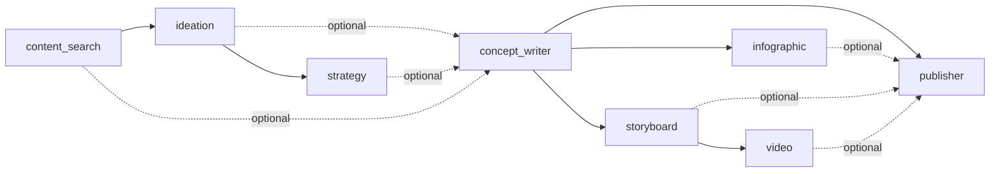

# 05 — Agent Nodes Architecture

Reference for the agent-node system: registry, planner, execution, cost, and — the load-bearing question —
whether registry nodes are real sub-agents or typed function wrappers around single LLM/API calls.

All paths relative to `MKTAgent/src/` unless stated.

---

## 1. Registry anatomy

### 1.1 `AgentDefinition` — the exact shape

`orchestration/registry/agent-types.ts:42-107`:

```ts
export interface AgentDefinition {
  id: RunnableAgentId;
  name: string;
  description: string;
  implStatus: AgentImplStatus;        // 'live' | 'stub'
  requires: ArtifactType[];           // hard upstream inputs
  optional: ArtifactType[];           // soft/optional upstream inputs
  produces: ArtifactType[];           // outputs (drives edge derivation)
  requiresConnection: boolean;        // needs an OAuth/social connection
  requiresApproval: boolean;          // executor halts BEFORE running
  gate?: 'selection' | 'cost' | 'publish' | 'schedule'; // WHY it pauses (UI-facing)
  capabilities?: string[];            // e.g. 'social.post.image' (publisher)
  // Persona layer (additive, Atria Phase 05-A) — display + prompt-as-data:
  emoji?: string;
  group?: AgentGroupId;               // 'intelligence'|'creative'|'delivery'|'data'|'core'
  vibe?: string;
  successMetrics?: string[];
  decisionFramework?: string;
  promptSections?: { role?: string; goal?: string; capabilities?: string[]; constraints?: string[] };
}
```

`AgentDefinition` is **pure metadata** — a capability menu entry. The function that actually runs the
node lives in a *separate* map keyed by the same id (`executor/agent-runners.ts:1216-1237`). This split
is intentional: the registry stays testable/serializable (no execution logic), and the runner map is the
only place orchestration touches the rest of the codebase (copy-gen, publish, Gmail, Veo, etc).

`RunnableAgentId` (`agent-types.ts:36`) = `AgentId | 'publisher' | 'email_agent' | 'scheduler' | 'dm_agent' | 'greeting_agent'` — 18 ids total, all declared in `registry/agent-registry.ts:8-439`.

No agent is ever invented at plan time — the registry is a **closed menu** (comment at `agent-registry.ts:1-5`); both the deterministic marketing planner and Atria's `propose_task` tool can only select from `AGENTS`.

### 1.2 Backward-chaining selection (`selectAgents`)

`orchestration/master/workflow-planner.ts`. Two-step:

1. `targetsFromGoal(goal)` (`:32-79`) maps the `GoalSpec`'s output flags (or `goal.taskTargets`, see §1.4) to a list of **terminal artifact types** the goal wants (e.g. `needsVideo` → `video_prompt`).
2. `selectByTargets(targets)` (`:85-97`) does true backward-chaining: for each target artifact, look up its producer via `producerOf()` (`master/artifact-graph.ts:25`, a reverse index built once at module load from every `agent.produces`), add the producer, then recursively queue its `requires` (not `optional` — optional grounding is an edge concern only). Returns the closed node set sorted by a fixed `PIPELINE_ORDER` (`:23-27`) so downstream edge derivation and template dedup stay stable.

Edges are **derived, not authored**: `deriveDeps()` (`:112-131`) links each node to the most-recently-placed upstream node whose `produces` matches one of its `requires ∪ optional`. Adding a node to the registry (+ a runner) is the only change needed to extend a flow — no planner edit.

Two special splices happen after selection, both node-type-agnostic:
- **Scheduler splice** (`:154-159, 184-195`): if `goal.schedule.at` is set, a `scheduler` node is inserted immediately before the plan's terminal external-write node (`TERMINAL_ACTIONS`, `:137`) and re-wired as its sole dependency.
- **Publish-only guard** (`isPublishOnly`, `:104-108`): a publish goal with zero content targets is rejected with an actionable error instead of silently auto-pulling `concept_writer`.

`artifact-graph.ts` asserts a single producer per artifact type at module load (`:14-19`) — two agents producing the same type is treated as a registry authoring bug, not a runtime ambiguity to resolve.

### 1.3 Master Agent planning is rule-based, not LLM-based

Selection itself (`selectAgents`/`planWorkflow`) is **pure deterministic code** — the brief's "locked" decision (`workflow-planner.ts:1-6`). The only LLM involvement upstream is producing the `GoalSpec` (via `requirement-analyzer.ts` or Atria's tool loop). A valid `GoalSpec` always yields a valid DAG or a structured `PlanResult` error — never a hallucinated plan.

### 1.4 The general-task seam: `taskTargets` / `propose_task` / capability gap

Two closed lists gate what a *non-marketing* request can reach:

- `TASK_CAPABILITIES` (`atria/atria-tools.ts:50`): `{ summarize: 'summary' }` — the only currently-wired capability→artifact mapping.
- The Gemini tool `propose_task` (`atria-tools.ts:159-170`, dispatch `:349-377`): the brain passes a free-text `capability` id; the dispatcher looks it up in `TASK_CAPABILITIES`.
  - **Hit** → builds a `GoalSpec` with `taskTargets: [target]` (bypassing every marketing flag/clarification), calls `masterAgent.planFromGoal(goal, { skipClarification: true })`. `workflow-planner.ts:37` reads `goal.taskTargets` FIRST, before any marketing output flag, and backward-chains from it — proving the DAG composes any registry capability, not just the marketing pipeline.
  - **Miss** → `recordCapabilityGap()` (`db/repos/roadmap-demand-repo.ts:36`) writes a `RoadmapDemand` row (`action:'requested'`), deduped per `(ownerId, capabilityId)` (`:32-33`). This is the **reliable** gap-logging path — it fires deterministically from the planner's own "I can't build this," not from hoping the LLM separately calls `flag_capability_gap`.
- `flag_capability_gap` tool (`atria-tools.ts:172-186`, dispatch `:378-401`) is a second, LLM-judgment-driven path for requests entirely outside the pipeline (translate a doc, transcribe audio) — same `RoadmapDemand` sink, richer optional spec (`CapabilityGapSpec`: `produces`, `requires`, `whatItWouldDo`, `exampleTask`).

Separately, `ROADMAP_AGENTS` (`registry/roadmap-agents.ts:13-32`) is a **static, hand-authored** list of 3 not-yet-built agents (email nurture — now shipped, memory, analytics) that Atria proactively *pitches* on a trigger signal (`atria-suggestions.ts`), logged via `logRoadmapDemand(...,'pitched'|'accepted')`. This is a different mechanism from the capability-gap path: roadmap agents are product-team-authored pitches; capability gaps are user-driven, freeform, and open-ended (any kebab-case verb).

`VISION_AGENTS` (`registry/vision-agents.ts:25-85`) is a third, purely-display list for the constellation UI's "coming soon" / already-shipped-as-a-surface nodes (memory, lead_collector, analytics, email, nurture) — explicitly **not** in `RunnableAgentId`, zero planner/executor visibility (`vision-agents.ts:1-8`).

---

## 2. Full node catalogue

All 18 `RunnableAgentId`s. Registry file:line from `registry/agent-registry.ts`; runner file:line from `executor/agent-runners.ts` unless noted.

| ID | Display name | Group | Purpose | Requires | Produces | LLM? | Gate | Cost profile | Registry / Runner |
|---|---|---|---|---|---|---|---|---|---|
| `ideation` | Ideation Agent | intelligence | Brainstorm campaign directions, pick one | — (`research_summary` optional) | `campaign_ideas` | 1 Gemini JSON call | none | text tokens (REASONING budget 4096) | `agent-registry.ts:9-38` / `agent-runners.ts:426-443` |
| `strategy` | Strategy Agent | intelligence | Positioning + audience + pillars | `campaign_ideas` | `strategy_brief` | 1 Gemini JSON call | none | text tokens (4096) | `:39-68` / `:446-465` |
| `content_search` | Content Search (Researcher) | intelligence | Market/competitor/proof research | — | `research_summary` | 1 grounded-search call (`google_search` tool, single shot) | none | text tokens + $0.035 grounding surcharge (4096) | `:69-85` / `:257-295`, search in `agents/researcher/grounded-search.ts:56-92` |
| `campaign_strategist` | Campaign Strategist | intelligence | N-slot content calendar (pillars×funnel×cadence) | — (`research_summary`, `strategy_brief` optional) | `content_calendar` | 1 Gemini JSON call | `selection` (post-produce park) | text tokens (4096) | `:86-119` / `:472-503` |
| `concept_writer` | Concept Writing Agent | creative | Campaign angle + 3-5 copy variants | — (`research_summary`, `strategy_brief` optional) | `content_concept` | 1 call via `generateVariantsForPost` (copy-gen engine, external to orchestration) | `selection` (post-produce park) | text tokens | `:120-157` / `:127-250` (delegates to `copygen/service.ts`) |
| `infographic` | Infographic Agent | creative | Visual brief + 1 generated image | `content_concept` | `infographic_brief` | 0 text LLM calls; 1 image-gen call (nano-banana) | none | flat/token image cost (~$0.04 or real usage) | `:158-173` / `:573-596` |
| `storyboard` | Storyboard Agent | creative | 3-6 scene plan (LLM) + N generated frame images | `content_concept` | `storyboard` | 1 Gemini JSON call (plan) + 1 image-gen call per frame, sequential loop (NOT agentic — fixed plan-then-render) | none | text (creative-tier budget) + N × image cost | `:174-203` / `:600-690` |
| `video` | Video Agent | creative | Animate storyboard frames → 1 stitched mp4 + TTS voiceover | `storyboard` | `video_prompt` | 0 text LLM; 1 Veo call per frame + 1 TTS call (procedural loop) | `cost` (pre-execution halt) | $0.05/s × clips (Veo) + $0.02 TTS flat | `:204-223` / `:701-769` |
| `publisher` | Publisher Agent | delivery | Publish the post to target platforms | `content_concept` (`infographic_brief`, `video_prompt`, `storyboard` optional) | `publish_result` | 0 LLM; calls `publishPostNow` → connector runtime | `publish` (external write) | $0 orchestration cost (billed as platform API calls) | `:224-264` / `:300-336` |
| `email_writer` | Email Writer | creative | Draft subject+body email | — (`content_concept`/`summary`/`research_summary` optional) | `email_draft` | 1 Gemini JSON call (skipped entirely if `nurtureReplyBody` was pre-seeded by the nurture brain) | none | creative-tier text tokens | `:265-283` / `:787-845` |
| `email_agent` | Email Agent | delivery | Send the reviewed draft via owner's Gmail | `email_draft` | `email_result` | 0 LLM; Gmail API send | `publish` | $0 orchestration cost | `:284-302` / `:1015-1072` |
| `dm_writer` | DM Writer | creative | Draft a short opt-in DM (WhatsApp/Telegram/Zalo) | — (optional upstream) | `dm_draft` | 1 Gemini JSON call | none | text tokens | `:303-320` / `messaging/dm-runners.ts:38-77` |
| `dm_agent` | DM Agent | delivery | Send the DM to an opted-in contact | `dm_draft` | `dm_result` | 0 LLM; channel adapter send (env-token, DRY-RUN by default) | `publish` | $0 orchestration cost | `:321-340` / `messaging/dm-runners.ts:81-118` |
| `greeting_writer` | Greeting Writer | creative | Draft a public @mention/reply | — (optional upstream) | `greeting_draft` | 1 Gemini JSON call | none | text tokens | `:341-358` / `:1099-1135` |
| `greeting_agent` | Greeting Agent | delivery | Post the greeting to every target platform | `greeting_draft` | `greeting_result` | 0 LLM; per-platform adapter fan-out loop | `publish` | $0 orchestration cost | `:359-380` / `:1142-1200` |
| `scheduler` | Scheduler | core | Hold the run until a confirmed future instant, then re-enter | — | `schedule_marker` | 0 LLM — pure control node | `schedule` (pre-execution halt) | $0 (thinking budget forced to `ACTION`=0) | `:381-400` / `:1207-1214` |
| `security` | Data Guard | core | Scan+mask personal/sensitive data (GDPR/PII) in source text | — | `security_scan` | N Gemini JSON calls (1 per 40k-char chunk, sequential, deterministic reduce — not a reasoning loop) | none | text tokens × chunk count | `:401-419` / `:911-947` |
| `summarize` | Summarizer | core | Condense a document (from the masked copy) | `security_scan` | `summary` | 1-2 Gemini JSON calls (map + reduce for long docs) | none | text tokens (length-scaled budget 2048-8192) | `:420-438` / `:949-1015` (not fully shown above, continues past summarizeWindow) |

Every text-LLM runner uses `ctx.llmJsonFn ?? callGeminiJson` (`master/llm-json.ts`) — a single request/response JSON call, no tool declarations attached, no follow-up round. `agent-executor.ts:31-34` binds each call to a per-node `thinkingBudgetFor()` ceiling (`thinking-budget.ts`) but this only caps *how long the single call may think*, it does not grant multi-step reasoning.

---

## 3. Grouping

### 3.1 The 5 phase-groups (`registry/agent-groups.ts:14,25-31`)

| Group id | Label | Emoji | Color | Members |
|---|---|---|---|---|
| `intelligence` | Intelligence | 🧠 | `#6366f1` | ideation, strategy, content_search, campaign_strategist |
| `creative` | Creative | 🎨 | `#a855f7` | concept_writer, infographic, storyboard, video, email_writer, dm_writer, greeting_writer |
| `delivery` | Delivery | 📢 | `#f59e0b` | publisher, email_agent, dm_agent, greeting_agent |
| `data` (labeled "Insight & Growth") | Insight & Growth | 📊 | `#10b981` | memory / lead_collector / analytics / email / nurture — all **vision agents**, no registry node currently carries `group:'data'` |
| `core` | Core | ⚙️ | `#06b6d4` | scheduler, security, summarize |

Grouping is **display metadata only** (`agent-groups.ts:6-8`) — node selection keys on `produces`/`requires`, and the thinking-budget policy keys on `agentId`. Regrouping changes nothing about how flows run.

### 3.2 Canonical marketing DAG (research → concept → copy → media → publish)



Solid edge = `requires` (hard dependency, always wired if both nodes are selected). Dashed = `optional` (wired only if the producer is also selected for this goal). `infographic`/`storyboard`/`video` are mutually exclusive at *runtime* via `MEDIA_AGENT_ASSET` gating in the executor (§4), even though all three can appear in the same static plan.

### 3.3 Email / nurture DAG


`scheduler` only appears when `goal.schedule.at` is set (§1.2); otherwise `email_writer → email_agent` directly. The DM (`dm_writer → dm_agent`) and greeting (`greeting_writer → greeting_agent`) paths are structurally identical, substituting the respective writer/agent pair and artifact types (`dm_draft`/`dm_result`, `greeting_draft`/`greeting_result`).

### 3.4 Task/utility DAG (non-marketing)


`summarize.requires = ['security_scan']` (`agent-registry.ts:428-429`), so backward-chaining *always* places Data Guard first — a hardcoded safety ordering achieved through the ordinary `requires` mechanism, not a special case in the planner.

---

## 4. Execution model

### 4.1 DAG build → run

1. `planWorkflow(goal)` (§1.2) returns a validated `WorkflowPlan` (`schemas/workflow-plan.ts:29-43`): `{ goal: 'marketing_content', nodes: [{ nodeId, agentId, dependsOn, requiresApproval }] }`. `agentId` is a closed Zod enum (`workflow-plan.ts:8-27`) — 18 members, mirroring `RunnableAgentId`.
2. `validatePlan()` (`master/workflow-validator.ts`, called both at plan time and again at every `runWorkflow` entry) topo-sorts and checks input satisfiability + acyclicity.
3. `runWorkflow(runId, ownerId, goal, plan, opts)` (`executor/workflow-executor.ts:132-536`) iterates `validated.order`, running each node's `RunnerContext` through `executeNode`.

### 4.2 Node runtime

`agent-executor.ts:20-41`: `getRunner(agentId)` → resolves `thinkingBudgetFor(agentId, ctx)` → binds `callGeminiJson` with that budget (unless a DRY-RUN stub is already injected) → runs the runner → `putArtifact()` validates the output against its Zod artifact schema and persists to `wf_artifact`, throwing `ArtifactValidationError` (recoverable, mapped to a failed node) on a shape mismatch.

### 4.3 Artifact store

`executor/artifact-store.ts`. Every node output is a typed, schema-validated row (`prisma.artifact`), addressed by `(runId, nodeId, type)`. Downstream nodes read upstream artifacts by TYPE (`ctx.upstream[type]`, seeded in `workflow-executor.ts:171-174` by re-listing all artifacts for the run) — never by passing raw unstructured text between agents. `updateArtifactData()` supports in-place overwrite (used by the concept-selection gate to persist the user's chosen variant index).

### 4.4 Per-node cost accounting

`executor/node-cost.ts`. Real `usageMetadata` (`costFromUsage`) is preferred over the char/4 fallback estimate (`estimateLlmCost`) because Gemini 2.5 thinking tokens are billed at the output rate and can dwarf visible output. Media has its own cost model: flat per-image (`imageCost`, ~$0.04, or real image-token usage), per-second Veo (`videoClipCost`, $0.05/s), flat TTS (`ttsCost`, $0.02). Every runner attaches its `NodeCost` to `RunnerOutput.cost`; `workflow-executor.ts:40-45` maps it onto the `wf_node_run` row's cost columns. `reconcileCredits()` (`:114-128`) debits the tenant's wallet exactly once per run, on *every* exit path (park, fail-safe, complete) except a genuine `failed` run (never charged).

### 4.5 Re-run a single node

`opts.rerunOnly` (`workflow-executor.ts:88-90, 258-288`): seeds `upstream` from already-stored artifacts, runs exactly the named node, and parks the run at `planned` (not `needs_approval`) so the "Continue" button resumes the main loop, which skips already-`completed` nodes and runs the caller-invalidated downstream (marked `stale`/pending externally, not cascaded by the executor itself).

### 4.6 Park / resume (generic scheduler)

Two-part mechanism, deliberately type-agnostic (no runner knows about "email" vs "publish"):
- **Park**: the `scheduler` node's gate (`gate:'schedule'`) always halts (`approval-policy.ts:55-59`, never auto-cleared even for an Atria-granted run). On approve, the run status flips to `scheduled` and `scheduledResumeAt` is written (`db/repos/workflow-run-repo.ts`).
- **Resume**: `scheduler/resume-due-runs.ts:34-64`, a cron tick under an advisory lock (`RESUME_LOCK_KEY`), atomically claims one due run (`claimScheduledDue`), finds the node immediately downstream of the `scheduler` node in the stored plan, and re-enters `runWorkflow` with `approveNodeId` set to that action node — which waives *only* that node's gate (the human already approved the draft + time at the schedule gate). A resume failure sets the run `failed` (never loops back to `scheduled`).

### 4.7 SSE status events

`events/bus.ts`: an in-process `Map<ownerId, Set<subscriber>>` (single-process constraint, documented `:1-7`). `publishNodeStatus()` fans a `NodeStatusEvent` (`runId, nodeId, agentId, status, error?, timingSuggestion?, notice?`) to every live SSE subscriber for that owner; `workflow-executor.ts` calls it at every state transition (running/completed/failed/awaiting_approval/skipped/aborted).

### 4.8 Failure handling

- **Node-level**: any thrown error inside `executeNode` is caught per-iteration (`workflow-executor.ts:520-527` and `:272-279` for rerun), the node is marked `failed`, the run is marked `failed`, an SSE event fires, and `logRun('error', 'wf_node', …)` is written. No retry at the executor layer — retry/backoff (e.g. one transient re-call) is a per-call concern inside individual seams (Atria brain, nurture brain) not the DAG executor.
- **Run-level abort**: `POST /runs/:id/abort` flips status to `aborted`; the executor checks this at every node boundary (`:297-300`) before spending on the next node.
- **Approval/connection gates**: `needs_approval` / `needs_connection` are not failures — they are legitimate park states the run resumes from via `approveNodeId`.
- **Credits**: reconciled in a `finally` block (`:533-535`) so every exit path is billed correctly exactly once, including parks.

---

## 5. Are these nodes true sub-agents, or functions?

### 5.1 Criteria

| Criterion | What it would require |
|---|---|
| Own system prompt | A distinct persona/instruction set, not a shared template with data slots |
| Own tool set | Ability to call ≥1 external tool/function mid-task, selected by the model |
| Own memory | Node-scoped state persisted and read back across invocations (beyond the artifact it produces) |
| Own model/thinking budget | Independently tunable inference parameters |
| Ability to reason/loop | Multi-round: observe a result, decide the next action, repeat |
| Ability to decide next step | Chooses WHAT to do next (not just HOW to phrase a fixed next step) |
| Error self-correction | Detects a bad/failed sub-step and retries a *different* approach without external intervention |

### 5.2 Scorecard

| Node / group | Own prompt | Own tools | Own memory | Own budget | Reasons/loops | Decides next step | Self-corrects |
|---|:---:|:---:|:---:|:---:|:---:|:---:|:---:|
| **Atria brain** (`atria-brain.ts`) | ✅ (`atria-brain-prompt.ts`, cached) | ✅ 9 tools (`TOOL_DECLARATIONS`) | ✅ per-turn `ToolContext` + durable `recall_memory`/`save_memory` | ✅ `BRAIN_THINKING_BUDGET`=4096, own model call | ✅ up to `MAX_ROUNDS`=3 tool-call rounds | ✅ picks which tool to call each round | ⚠️ partial — 1 transient-retry on 5xx/empty response; no strategy change on a *logical* dead end |
| **Nurture brain** (`nurture-brain.ts`) | ✅ (`NURTURE_BRAIN_SYSTEM_PROMPT`, scoped) | ✅ small tool menu (`nurture-tools.ts`, classify/finalize) | ❌ no cross-turn memory (reads one reply, decides once) | ✅ same `BRAIN_THINKING_BUDGET`, own call | ✅ up to `MAX_ROUNDS`=3 | ✅ (classify → finalize) | ✅ HARD guardrails override the model's own decision (price-hallucination check, confidence floor) — the closest thing to genuine self-correction in the codebase, but it's a deterministic post-hoc override, not the model retrying itself |
| `ideation`, `strategy`, `content_search`, `campaign_strategist` | ⚠️ shared template (`promptSections` data + `buildAgentPrompt`), persona differs, contract format is uniform | ❌ | ❌ | ⚠️ shared REASONING tier (4096), not individually tuned | ❌ 1 call, done | ❌ next step is planner-fixed | ❌ throw on malformed output, no retry |
| `concept_writer`, `email_writer`, `dm_writer`, `greeting_writer` | ⚠️ same pattern (concept_writer via `promptSections`; the 3 writers use flat hardcoded prompt strings, not even registry `promptSections`) | ❌ | ❌ | ⚠️ creative tier scales by `qualityPref` only | ❌ | ❌ | ❌ |
| `infographic`, `storyboard`, `video` | N/A (image/video gen has no "system prompt" concept; storyboard's plan step uses the shared builder) | ❌ (image/video gen is a bare API call, not a tool the model chose to invoke) | ❌ | ⚠️ storyboard/ideation-tier for the plan step; video/infographic have $0 text budget | ⚠️ storyboard + video run a **for-loop** over frames/clips — procedural iteration, not the model deciding to iterate | ❌ frame count and sequence come from one JSON response, not iterative decisions | ⚠️ storyboard skips a frame that failed to render and continues (a fixed fallback rule, not adaptive reasoning) |
| `publisher`, `email_agent`, `dm_agent`, `greeting_agent` | ❌ no text LLM at all | ❌ | ❌ | ❌ ACTION budget = 0 | ❌ | ❌ | ⚠️ retries per-recipient/per-platform (a fixed loop with partial-success accounting), not adaptive |
| `security`, `summarize` | ✅ fixed prompt strings (not registry `promptSections`) | ❌ | ❌ | ✅ length-scaled budget (summarize only) | ⚠️ chunk/map-reduce loop over windows — deterministic chunking, not the model deciding to re-read | ❌ | ⚠️ security fails CLOSED (throws) rather than retrying a bad mask |
| `scheduler` | N/A | ❌ | ❌ | ❌ | ❌ | ❌ | ❌ |

### 5.3 Verdict

**Atria (the brain) and the nurture brain are genuine agentic loops**: they hold a real system prompt, a closed tool menu, multi-round reasoning with the model choosing which tool to call, and per-turn state. They are the only two components in the codebase that meet more than 2 of the 7 criteria.

**Every registry DAG node is a deterministic, single-shot LLM call or a bare API/service wrapper.** Concretely:
- Text nodes (`ideation`, `strategy`, `content_search`, `campaign_strategist`, `concept_writer`, `email_writer`, `dm_writer`, `greeting_writer`, `security`, `summarize`) call `callGeminiJson` (or `groundedSearch`) **exactly once** (or, for `security`/`summarize`, a bounded, pre-determined number of chunked calls with no model-driven branching) and parse the JSON response against a fixed Zod schema. There is no `functionDeclarations` array attached to any of these calls — the model cannot invoke a tool, cannot ask a follow-up, cannot decide to do something other than emit the one JSON shape it was told to.
- Media nodes (`infographic`, `storyboard`, `video`) run **procedural loops written in TypeScript**, not model-driven reasoning loops: storyboard's frame loop and video's clip loop are `for` statements over a fixed plan array, calling the same generation function once per element. The only "decision" resembling adaptivity is storyboard skipping a frame that errored (a hardcoded catch, not the model choosing an alternate strategy).
- Action nodes (`publisher`, `email_agent`, `dm_agent`, `greeting_agent`, `scheduler`) call zero text LLMs — they are typed wrappers around existing services (`publishPostNow`, `sendGmailAs`, `sendDm`, `greetTo`) plus deterministic guardrail checks (opt-out, kill switch, idempotency).

The DAG's only "intelligence" beyond the single calls is the **planner** (backward-chaining node selection, a classic non-LLM algorithm) and the **executor's gate policy** (`approval-policy.ts`, also pure deterministic code — even in Atria-autonomy mode, `atriaApprovalPolicy` is a lookup table, not a model call).

This matches the code's own framing: `agent-registry.ts:1-5` calls the registry "the capability menu the rule-based planner selects from," and `agent-types.ts:80-84` explicitly calls the persona fields ("Atria Phase 05-A") a **display/prompt-authoring layer**, not an execution capability — `promptSections` feed `buildAgentPrompt()`'s static system-prompt string; they do not grant the node a tool loop.

**Practical implication**: a node can fail loudly (bad JSON, empty draft, missing frame) and the *only* recovery is the executor marking the whole node `failed` — there is no in-node retry-with-a-different-approach, because there is no "approach" to vary; there's one call.

---

## 6. What it would take to make them real sub-agents

Scoped to the highest-value candidates first (nodes where genuine reasoning would pay off): `content_search` (multi-query research instead of one grounded call), `campaign_strategist` (could iteratively check calendar coherence), `storyboard`/`video` (could self-critique a failed frame and re-prompt instead of skipping it), `concept_writer` (could tool-call product-knowledge lookups instead of receiving them pre-resolved).

### 6.1 Architectural delta

1. **Per-node prompt files** — move each node off the shared `buildAgentPrompt()` + `AGENT_OUTPUT_CONTRACTS` composition and onto its own prompt module (mirrors `nurture-brain-prompt.ts` / `atria-brain-prompt.ts`), so a node's persona can diverge from the "role → goal → capabilities → constraints → LANGUAGE → contract" template shape when its task needs different structure (e.g. a tool-result-reading loop needs turn-by-turn framing, not a one-shot contract).
2. **Node-scoped tool registry** — a `NODE_TOOL_DECLARATIONS: Record<RunnableAgentId, ToolDecl[]>` alongside `TOOL_DECLARATIONS`, plus a `dispatchNodeTool()` mirroring `atria-tools.ts`'s dispatcher pattern. Each node's runner would need to switch from `callGeminiJson` (single call, JSON-only, no tools) to a `doCall`+loop pattern like `atria-brain.ts:71-238` (round budget, tool dispatch, re-prompt).
3. **Node-level memory** — currently the only cross-invocation state a node has is the artifact it produces (read by DOWNSTREAM nodes, never by itself on a later run). Real node memory would need either (a) a dedicated table keyed `(ownerId, agentId)` mirroring `user-memory.ts`'s pattern, or (b) reusing `resolveInstructions()`'s existing instruction layering (already node-scoped: `resolveRunInstructions(ctx, agentId)`) as a *write* target, not just a read.
4. **Self-verify loop** — a post-generation critique pass: run the node's output back through the same or a cheaper model with a "does this satisfy X, Y, Z? if not, what should change?" prompt, then re-generate on a `no` verdict up to N times. This is the actual missing piece for storyboard/video's "skip a failed frame" behavior to become "diagnose why the frame failed and retry with an adjusted prompt."
5. **Executor changes** — `agent-executor.ts` would need a round-budget concept per node (today it assumes 1 call = 1 node = done), and `node-cost.ts` accounting already supports summing multiple calls (`sumCost`) so cost tracking needs no change.

### 6.2 Effort estimate

| Delta | Scope | Effort |
|---|---|---|
| Per-node prompt files (structural, no new capability) | ~14 text-producing nodes | 0.5-1 day (mechanical extraction) |
| Tool registry + dispatcher (generic) | 1 shared module | 1-2 days |
| Wire tools into 1 pilot node (e.g. `content_search` gets a `refine_query` tool for a 2nd grounded search) | 1 node + verify script | 1-2 days |
| Node-level memory table + read/write plumbing | 1 node | 1-2 days |
| Self-verify loop (generic, reusable) | 1 shared helper + 1 pilot node | 2-3 days |
| Full rollout across all 14 candidate nodes | — | 2-3 weeks, with per-node cost/latency regression testing (every added round is added spend + added tail latency on a synchronous DAG) |

**Recommendation**: do NOT do this uniformly. The two nodes that already earn agentic status (Atria brain, nurture brain) do so because their task genuinely has open-ended branching (what does the user want? is this reply an opt-out or a question?). Most registry nodes (ideation, strategy, writers, action nodes) have a **closed, well-specified single transformation** — adding a tool loop there is complexity without payoff (violates YAGNI). The candidates worth prototyping are `content_search` (multi-query grounding is a real quality lever) and the storyboard/video self-correction case (currently silently drops failed frames, a real user-visible defect a self-verify loop would fix). Everything else should stay single-shot.

---

## Unresolved questions

- `agent-runners.ts:977-1015` (`runSummarize` continuation) was read partially — the map-reduce boundary logic (chunk threshold behavior) was inferred from the visible `SUMMARIZE_CHARS`/`summarizeWindow` code above; worth a follow-up read if exact reduce-step token accounting matters.
- No `docs/product/01-04-*.md` files exist yet in this repo — this doc has no sibling to cross-reference for terminology consistency; confirm numbering scheme with whoever authors 01-04.
- `group: 'data'` (Insight & Growth) currently has zero live `RunnableAgentId` members — all its content comes from `VISION_AGENTS`. Confirm this is intentional (analytics/lead_collector/nurture surfaces are real product features, just not DAG nodes) rather than a registry gap.

**Status:** DONE
**Summary:** Wrote `docs/product/05-agent-nodes-architecture.md` (full registry anatomy, 18-node catalogue with file:line, grouping + 3 Mermaid DAGs, execution model, and a scorecard verdict: Atria brain + nurture brain are genuine tool-using agentic loops; all 18 registry DAG nodes are deterministic single-shot LLM calls or bare API wrappers).
**Concerns/Blockers:** none — codebase fully supports the analysis; two minor gaps noted above under Unresolved questions.
