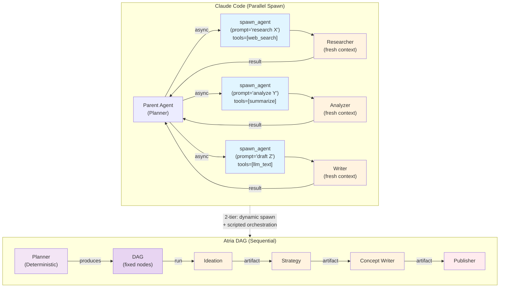

# Dynamic Subagent Orchestration Gap

**Analysis of how Atria could spawn agents at runtime, like Claude Code does.**

---

## 1. Reference Model — Claude Code's Subagent Spawn Mechanics

Claude Code (this coding agent's control plane) decomposes work by **authoring prompts at runtime and spawning fresh subagents** with isolated context windows. Here are the primitives:

| Primitive | How It Works |
|-----------|--------------|
| **Runtime-authored prompt** | Parent agent holds a `prompt` parameter authored at planning time; exact text varies per subagent. No template, free text. |
| **Declarative agent definitions** | Agents defined as markdown files with YAML frontmatter (`.claude/agents/*.md`). Each spec declares: `name`, `description` (used for selection), `tools` (allowlist), `model` (e.g., haiku), `memory`. Example: `.claude/agents/researcher.md` (100+ lines). |
| **Context isolation** | Each subagent receives only: its authored prompt + relevant context passed in (file paths, task description, acceptance criteria). Parent's session history NEVER included. Only the subagent's FINAL message returns. |
| **Lazy tool discovery** | Tools aren't pre-declared; a "tool-search" mechanism at runtime discovers schemas on demand. The parent says `tools: Glob, Grep, Read, Bash` in the agent definition; those schemas load when the subagent runs. |
| **Structured output contract** | Parent can request JSON output with an optional schema. Subagent's response is parsed and validated; malformed output is a recoverable error (retry or fallback). |
| **Parallel fan-out** | Parent can invoke multiple subagents in parallel via multiple tool calls in a single turn. Results arrive async. Example: this doc's task specifies "do 01-05 in parallel". |
| **Depth limits** | Subagents do NOT spawn further subagents (no nesting). A subagent can call tools, but those tools cannot spawn agents. |
| **Skills catalogue** | Beyond tools, agents can load "skills" — markdown instruction packs (`.claude/skills/`) that enhance system prompt on demand. E.g., a researcher agent might load `docs-seeker`, `ai-multimodal`, `sequential-thinking` skills. Each skill is a reusable prompt module. |
| **Scripted orchestration (deterministic tier)** | Above ad-hoc spawning, there's a workflow script layer with primitives like `agent()`, `pipeline()`, `parallel()` for deterministic multi-agent coordination. (Not exercised in this task, but part of the full model.) |

**Key observation:** Atria's closest analogue is `atria-brain.ts` — a Gemini function-calling loop with ~4 fixed tools. Nurture brain (`nurture-brain.ts`) is a SECOND such loop, but still with a fixed tool set.

---

## 2. Gap Analysis — Primitive by Primitive

| Primitive | Claude Code | Atria Today | Nearest Seam in Codebase | Gap Size |
|-----------|-------------|-------------|--------------------------|----------|
| Runtime-authored prompt | Yes. Parent writes prompt + spawns agent. | No. Node prompts are layered (base→language→instructions→contract) but always SELECT from a registry, never INVENT. | `build-agent-prompt.ts:49` composes `promptSections` (registry data) + user instructions into system prompt, but the agent ID is known at plan time. | **Large** — no dynamic prompt authoring. |
| Declarative agent definitions | Yes. Markdown files (`.claude/agents/researcher.md`). | Partial. `agent-registry.ts:8-39` defines agents as TS data structures (`AgentDefinition[]`), including persona fields (emoji, vibe, successMetrics, `promptSections`). But NOT in markdown; stored in code. | `registry/agent-registry.ts:42-100` (`AgentDefinition` interface). Portable as JSON, not yet as YAML/markdown. | **Small** — the structure exists; just needs serialization format. |
| Context isolation | Yes. Subagent receives ONLY its prompt + injected context. Parent's history never leaks. | No. All nodes in a DAG share a single `RunnerContext` (`upstream` artifacts dictionary). A node reads ALL upstream outputs; cross-flow leakage is possible. | `executor/agent-runners.ts:57-97` (`RunnerContext` interface). Every node has access to `upstream: Partial<Record<ArtifactType, unknown>>`. | **Large** — fundamental to DAG execution. |
| Lazy tool discovery | Yes. Tools named in agent spec; schemas load on demand. | No. Tools are baked into runners. E.g., `concept_writer` hardcodes a call to `generateVariantsForPost` (copygen service). A node cannot accept a tool at runtime. | `executor/agent-runners.ts:1-50` imports specific functions (generateVariantsForPost, publishPostNow, sendGmailAs, etc.). No abstraction layer. | **Large** — runners are monolithic. |
| Structured output contract | Yes. Parent specifies JSON schema; output validated. | Yes. Every agent output must match a Zod schema. `publisher` produces `publish_result`, `email_agent` produces `email_result`, etc. | `schemas/artifact-schemas.ts:12-40` (artifactType enum) + individual schemas (e.g., `campaignIdeas`, `strategyBrief`). Contracts are strict Zod. | **None** — already solved. |
| Parallel fan-out | Yes. Multiple tool calls in one turn; results async. | No. The DAG executor runs nodes **sequentially** in dependency order. No two independent nodes run concurrently. | `executor/workflow-executor.ts:132-150` topo-sorts the plan and runs each node via `executeNode()` in a for loop. | **Large** — would require async concurrent execution + SSE event reordering. |
| Depth limits | Yes. Subagents cannot spawn further agents. | Yes (trivial). Atria's planner is deterministic; no runtime spawning at all. | `orchestration/master/` (planner is a pure function, no recursion). | **None** — N/A. |
| Skills catalogue | Yes. Instruction packs loaded on demand. | No. No skills system. Prompts are built once per node (buildAgentPrompt) and never extended. A node doesn't have a "tool" to load a skill mid-execution. | `prompts/build-agent-prompt.ts:49-65`. User instructions exist (`ctx.userInstructions`) but no way to inject a skill (e.g., "Use sequential-thinking skill"). | **Medium** — would slot into buildAgentPrompt as a 5th layer. |

**Summary:** Atria has the OUTPUT side (structured artifacts) but lacks the INPUT side (dynamic prompting, lazy tool binding, parallel spawn). The DAG is fundamentally **sequential + closed**, while Claude Code is **async-capable + open**.

---

## 3. Why Atria Can't Just Do It — Hard Constraints

### 3.1 Runners Are Code, Tools Are Bespoke

**The Problem:** A node's capability is **TypeScript logic**, not a tool binding.

- `concept_writer` (agent-runners.ts:127-150) runs copy-gen by **calling `generateVariantsForPost()`** directly. It doesn't SELECT a tool from a registry; it INVOKES hardcoded TS.
- Similarly, `email_agent` calls `sendGmailAs()`, `publisher` calls `publishPostNow()`, `dm_agent` calls `runDmAgent()`.
- **agent-runners.ts is 1237 lines of bespoke handler code.**

If Atria spawned a dynamic agent with `spawn_agent(prompt, ['copywrite', 'email'], outputSchema)`, what would happen?
- The spawn seam would need a tool registry mapping string IDs to functions. E.g., `'copywrite' → generateVariantsForPost`.
- A NEW capability (e.g., "call a Slack API") would require EITHER (a) a new tool entry in the registry, OR (b) an LLM-written TS function at runtime. Neither is feasible.
- **Upshot: dynamic spawning enables composition (remix existing tools), not innovation (add new tools).**

**Gains:** Can compose, e.g., `spawn(prompt, ['web_search', 'summarize'], {})` to research a topic + condense it. Reuses existing tools.

**Doesn't gain:** Cannot add a tool for "call Segment API" or "generate TikTok captions via custom model" without a human engineer adding the code.

### 3.2 Tool Safety — Social, Email, Money, PII

**The Problem:** Atria's "tools" are not sandbox-safe. They touch high-value customer resources.

| Tool | Risk Class | Current Guards |
|------|-----------|-----------------|
| `publishPostNow` | External write; social platforms | `requiresApproval=true` on publisher node; pre-check `autoPublish` flag; SSE gates approval. |
| `sendGmailAs` | External write; email; may contain offer/commitment | `requiresApproval=false` BUT wrapped in `email_agent` node, which is gated by the planner's approval gate (deterministic). |
| `generateVariantsForPost` | LLM cost; low external risk | `thinkingBudgetFor()` per-node policy; cost accrual. |
| `runDmAgent` | External write; messaging; opt-in gated | `isLiveDmSend` flag (default false); ENABLE_LIVE_DM_SEND env var. |
| Credit debit | Wallet gate | Pre-flight balance check before execute; idempotent debit on terminal node (executor). |

**With dynamic spawning:** A Gemini-authored prompt could say "Send a discount offer via email to the lead" or "Post to all platforms now." The prompt itself BECOMES the policy. A hallucinated prompt ("send $500 credit without checking balance") bypasses all guards because the spawn seam has no approval gate.

**Atria's honest answer:** The gates are layer-based:
1. **Deterministic approval gate** — the planner knows which nodes need approval (from registry) and halts the run.
2. **Environment-level kill-switch** — `isExternalActionsPaused()` (executor/agent-runners.ts) blocks all publishes if `KILL_SWITCH=true`.
3. **Per-tenant credit balance** — pre-flight check; only flows with balance > 0 execute.

**A dynamic spawn would need its OWN approval gate** — the executor would have to treat `spawn_agent()` as a terminal action (requiresApproval=true), and the user would review the spawned agent's output before it commits any write. That's feasible but adds latency.

**Verdict:** Dynamic spawning is safe IFF wrapped in an approval gate. But that defeats the purpose (no autonomy). Without approval, risk is material.

### 3.3 Cost Accounting Breaks Upfront Planning

**The Problem:** Atria's cost model assumes a CLOSED, KNOWN set of agents.

Today:
- The planner produces a DAG with N nodes.
- The executor topo-sorts, pre-computes cost via `videoClipCost()`, `estimateLlmCost()`, etc.
- The user sees a cost card before approving ("This will cost $2.50").
- The credit wallet has a hard pre-flight balance gate (`executePlannedRun` checks `>= 0`).

With dynamic spawning:
- The planner produces a DAG with N-1 nodes + 1 `spawn_agent` node.
- The cost of the spawned agent is UNKNOWN until it runs (the prompt is authored at runtime; we don't know how many tokens the LLM will consume).
- The pre-approval cost card is a lie ("This will cost $2.50... plus up to $100 for the unknown spawned agent").
- The credit debit is non-deterministic — a run with 1000 credits might succeed or fail depending on the spawned agent's complexity.

**Consequences:**
- **Autonomy grant is meaningless** — if the cost is unknown, "auto-run this flow if audience > 1000" is reckless (could spend the tenant's entire wallet on one spawn).
- **Plan-tier cards are unusable** — "Economy: max $1/post" doesn't apply to dynamic spawns.
- **Upfront cost transparency (a user-facing feature) breaks.**

**Atria's honest answer:** To enable dynamic spawning, either:
1. **Publish a cost ceiling upfront** ("this spawn can spend up to $X"), OR
2. **Require per-spawn approval** (user reviews cost AFTER the spawn completes, then approves the publish).

Both trade autonomy for safety. Not terrible, but not "spawn seamlessly."

### 3.4 Determinism & Golden Snapshots

**The Problem:** Atria's verification layer assumes a REPRODUCIBLE planner output.

Today:
- `planner-golden-snapshot.json` (the expected plan for a given goal) is checked into the repo.
- 83 `verify-*.ts` scripts (in MKTAgent/src) compare the planner's output to the snapshot.
- If the planner changes (a new agent, a reweighting), the snapshots break and tests fail.
- This is intentional — it's a **guard against silent plan regressions.**

With dynamic spawning:
- The plan is no longer deterministic. A given goal might produce different prompts on two runs (due to randomness in the spawn seam, or a schema change).
- The golden-snapshot model breaks — you can't compare a dynamic plan to a fixed snapshot.

**Consequences:**
- Verification becomes **statistical** (run 10 times, score the outputs). That's slower and less reliable.
- Regressions are harder to catch (a bad change might pass most runs but fail rare edge cases).

**Atria's honest answer:** To enable dynamic spawning, regression testing must change from "exact plan match" to "output quality metrics" (e.g., "concept_writer output should have >3 variants, >10 chars per variant"). That's doable but requires new infrastructure.

### 3.5 Multi-Tenancy & Context Isolation

**The Problem:** A subagent must inherit `tenantId` scoping; leaking cross-tenant context is a hard failure.

Today:
- Every runner receives `ctx: RunnerContext` with `ownerId` (the tenant).
- Every database query is scoped to `ownerId` (getPostForOwner, getCampaignsForOwner, etc.).
- A runner cannot accidentally read another tenant's data.

With dynamic spawning:
- The spawned agent runs as a Gemini LLM call. The LLM doesn't have access to the database; it only sees the prompt.
- If the spawn seam passes `upstream` artifacts (all-prior-node outputs), a tenant's product knowledge, strategy, copy, etc. could leak into the prompt.
- A malformed spawn prompt could inadvertently include another tenant's data.

**Consequences:**
- Prompts must be **extremely careful** not to include PII or cross-tenant artifacts.
- Best practice: only pass TYPED artifacts (already Zod-validated) to the prompt, never raw context.

**Atria's honest answer:** Context isolation is feasible via **prompt construction discipline**, not architectural barriers. A helper like `buildSpawnPrompt(agentType, artifacts, instructions)` (mirroring `buildAgentPrompt`) ensures every prompt includes ONLY what's needed for that spawn. No worse than today's manual prompt engineering.

### 3.6 Latency & Park/Resume Model

**The Problem:** Atria's runs can **park for days** (scheduled sends). A nested agent tree cannot survive a park.

Today:
- A run reaches `scheduler` node, which parks the run with `scheduledResumeAt` (database column).
- The cron `resume-due-runs.ts` wakes the run at the scheduled time and re-enters the executor.
- The DAG is **pure data** — all state is in the DB. No in-memory agent tree.

With dynamic spawning (naive):
- Spawn a subagent, which spawns a sub-subagent. The in-memory call stack is 2 levels deep.
- The scheduler node parks the run. The in-memory call stack is LOST.
- On resume, there's no way to re-enter the subagent correctly.

**Consequences:**
- Nested spawning is not resumable unless you **serialize the entire call stack to the database.**

**Atria's honest answer:** Dynamic spawning must remain **flat — no nesting**. A spawn_agent call always runs to completion before the run parks. The max depth is 1. That's acceptable; most use cases don't need nesting. But it's a hard architectural limit.

---

## 4. Design — 3 Concrete Options, Staged

### Option A: Declarative Agent Definitions (Config-as-Data)

**Tier:** Phase 1. Highest-value, lowest-risk. Enables options B & C.

**Idea:** Move node system prompts, IO contracts, and model budgets from TypeScript into **portable data** (YAML or database rows). Every node becomes a data record + a generic `llm_runner` that composes the prompt and executes the LLM.

**Proposed Schema (YAML):**

```yaml
# agents/copywriter.yaml
id: concept_writer_v2
name: Concept Writer
description: Generate 3–5 copy variants for a social post.
group: creative
emoji: ✍️
model: gemini-2.5-flash
thinkingBudget: 4096
qualityPrefScaling: { economy: 2048, standard: 4096, high: 8192 }

produces: content_concept
requires: []
optional: [research_summary, strategy_brief]

promptSections:
  role: |
    You are AgentPortal's content strategist…
  goal: |
    Generate 3–5 compelling copy variants…
  capabilities:
    - Hook engineering (curiosity gap, bold claim, story)
    - Per-platform voice adaptation (IG, LinkedIn, TikTok, FB)
  constraints:
    - Ground all claims in research or product knowledge…

outputContract:
  type: object
  properties:
    variants:
      type: array
      items:
        type: object
        properties:
          body: { type: string }
          threads: { type: string }
          x: { type: string }
  required: [variants]
```

**Code Delta:**

| File | Change |
|------|--------|
| `registry/agent-registry.ts` | Keep as-is; becomes an index into the YAML/DB definitions. |
| `registry/agent-loader.ts` (new) | Load YAML or DB rows; parse into `AgentDefinition` + `PromptSpec` + `OutputSchema`. Validates schemas on load. |
| `executor/generic-llm-runner.ts` (new) | For any agent with `llmRunner: true`: compose prompt (role + goal + capabilities + constraints + language + contract), call Gemini, validate output against schema. Replaces the bespoke runner code for text-gen nodes. |
| `executor/agent-runners.ts` | Shrink by routing text-gen nodes (ideation, strategy, concept_writer, email_writer) through generic-llm-runner. Media/action nodes (publisher, email_agent, storyboard) keep bespoke code. |
| `prompts/build-agent-prompt.ts` | Extend to accept loaded PromptSpec from YAML, not just registry data. |

**Effort:** **Medium** (M). ~200 lines of loader code, ~500 lines to genericize runners, ~40 lines per YAML agent definition. Reuses existing artifact schemas.

**Risks:**
- Migrating existing agents to YAML is a large audit (21 agents × ~30 min each = ~10 hours).
- A malformed YAML schema breaks the planner. Need strong validation on load.
- No new capability — just refactoring. Doesn't solve the spawning problem.

**Gains:**
- Agents become portable (can be shared, versioned independently, loaded from a registry service).
- New text-gen agents can be added without touching `agent-runners.ts`.
- Enables Option B (see below).

**Recommendation:** **Do this first.** It's low-risk (refactoring existing agents, no new logic) and unblocks both B and C.

---

### Option B: Runtime-Composed Generic Agents

**Tier:** Phase 2 (after Option A). Enables limited dynamic spawning.

**Idea:** Add a `spawn_agent(prompt, tools[], outputSchema)` tool to `atria-tools.ts`. Atria can author a prompt at runtime and execute it, but ONLY over a vetted tool allowlist, with hard guards.

**Proposed API:**

```typescript
// atria-tools.ts
async function spawn_agent(
  prompt: string,
  tools: ('web_search' | 'get_product_knowledge' | 'summarize_text')[],
  outputSchema?: { type: 'object'; properties: Record<string, any> }
): Promise<{ status: 'success' | 'failed'; result?: unknown; error?: string }> {
  // 1. Validate prompt length (max 2000 chars to avoid token explosion).
  if (prompt.length > 2000) return { status: 'failed', error: 'spawn_prompt_too_long' };

  // 2. Validate tools against allowlist. NO I/O tools (publish, email, dm).
  const SPAWN_ALLOWLIST = ['web_search', 'get_product_knowledge', 'summarize_text', 'analyze_sentiment'];
  for (const t of tools) {
    if (!SPAWN_ALLOWLIST.includes(t)) {
      return { status: 'failed', error: `tool_not_allowed: ${t}` };
    }
  }

  // 3. Bind tools by name to actual functions.
  const toolBindings = {
    web_search: (q: string) => webSearchSvc.search(q, { limit: 5 }),
    get_product_knowledge: () => productKnowledgeCache.get(ctx.runId),
    summarize_text: (text: string) => gemini.summarize(text),
  };

  // 4. Build the spawn LLM call: system prompt = user prompt (no base persona).
  // NO function-calling loop — single request + response, no tool chaining.
  const res = await gemini.generateContent({
    systemInstruction: prompt,
    tools: tools.map(t => TOOL_SCHEMAS[t]),
    generationConfig: { temperature: 0.7 },
  });

  // 5. Execute tool calls once; no looping.
  const toolCall = parseToolCall(res);
  if (!toolCall) {
    return { status: 'failed', error: 'no_tool_call_or_text_response' };
  }
  const toolResult = await toolBindings[toolCall.name](toolCall.args);

  // 6. Validate output against schema if provided.
  if (outputSchema) {
    const validated = await validateAgainstSchema(res, outputSchema);
    if (!validated.ok) return { status: 'failed', error: validated.error };
  }

  // 7. Record cost. Charge against run's budget.
  const cost = estimateLlmCost(res.usage);
  await recordLlmUsage(ctx.ownerId, ctx.runId, 'spawn_agent', cost);

  return { status: 'success', result: res };
}
```

**Safety Envelope:**

| Guard | Implementation |
|-------|-----------------|
| **Tool allowlist** | Only data-read tools (web search, summarize, analyze). No I/O (publish, email, DM, update DB). |
| **Prompt length cap** | Max 2000 chars to avoid runaway token burn. |
| **Single-shot execution** | No function-calling LOOP (unlike atria-brain). Tool is called once; LLM responds once. |
| **Output schema validation** | Enforced Zod schema; malformed output is an error, not a silent bad input. |
| **Cost ceiling per spawn** | Max $X per spawn (e.g., $0.05). Execution fails if exceeded. Configurable per run. |
| **No nesting** | spawn_agent itself has no tools, so it cannot spawn again. Depth = 1 only. |
| **No terminal actions** | Output is draft/research only. Publishing still routes through the existing approval-gated publisher node. |
| **Approval gate** | spawn_agent is NOT auto-approved. The run halts; human reviews the spawned output before it affects publishing. |

**Code Delta:**

| File | Change |
|------|--------|
| `atria/atria-tools.ts` | Add `spawn_agent` tool (lines 50–150). Update TOOL_DECLARATIONS to include it. |
| `executor/approval-policy.ts` | Add `spawn_agent` to requiresApproval checks (treat like a publisher node — halt before, not after). |
| `executor/node-cost.ts` | Track spawn cost separately (`spawn_agent_cost`). |

**Effort:** **Small** (S). ~200 lines of spawn logic + validation. Reuses existing LLM/tool infrastructure.

**Risks:**
- If tool allowlist is too broad, Atria can be tricked into expensive operations (e.g., a malicious spawn prompt: "search for every combination of 'X' in different languages" → 1000s of requests).
- Approval gate adds latency for every spawn. Not truly autonomous.
- Tool allowlist is a maintenance burden (adding new tools requires code change + security audit).

**Gains:**
- Enables Atria to research topics dynamically (spawn a researcher agent to validate a claim before publishing).
- Enables composition (combine web_search + summarize to condense research).
- Doesn't add new capability — reuses existing tools. Safe.

**Recommendation:** **Do this after Option A, IF capability gaps show a pattern.** E.g., if 5+ feature requests are "I need Atria to research something it doesn't know," then spawn_agent earns its keep.

---

### Option C: Parallel Fan-Out in the DAG Executor

**Tier:** Phase 2 (orthogonal to A & B). Pure performance, no new capability.

**Idea:** Identify independent node sets in the DAG (nodes with no edge between them) and execute them concurrently instead of sequentially.

**Examples:**
- `campaign_strategist` produces `content_calendar` (N slots). Each slot has independent copy generation. Today: loop N times, wait for each `concept_writer` run. With fan-out: spawn N concept_writer jobs async, collect results, continue.
- Social publishing: `publisher` node targets 5 platforms. Today: loop 5 times, publish to each. With fan-out: 5 publishes async.
- Parallel research: if a goal says "compare 3 competitors," spawn 3 researcher jobs in parallel.

**Proposed Mechanics:**

```typescript
// executor/workflow-executor.ts (sketch)

// 1. Topo-sort the DAG (existing).
const order = validatePlan(plan).order;

// 2. Identify fan-out points: nodes whose outputs are independent.
const fanOutNodes = identifyFanOutClusters(plan);
// E.g., [ ['concept_writer[slot0]', 'concept_writer[slot1]', ...], ['publisher[fb]', 'publisher[ig]', ...] ]

// 3. Run each cluster concurrently.
for (const cluster of fanOutNodes) {
  const results = await Promise.all(
    cluster.map((nodeId) => executeNode(nodeId, ctx))
  );
  for (const res of results) {
    ctx.upstream[res.type] = res.data; // Merge artifacts.
  }
}
```

**Code Delta:**

| File | Change |
|------|--------|
| `executor/workflow-executor.ts` | Add `identifyFanOutClusters()` (topo-sort + find independent sets). Update main loop to use Promise.all for clusters. |
| `events/bus.ts` | SSE event ordering: fan-out nodes emit events async. Front-end must buffer + sort by nodeId to maintain UI consistency. |
| `executor/node-cost.ts` | Cost rollup now tracks concurrent nodes; time delta changes (max(duration) not sum(duration)). |

**Effort:** **Medium** (M). ~300 lines for fan-out logic + SSE handling. Existing node executors unchanged.

**Risks:**
- SSE event ordering breaks if not careful. A listener expects `node[0] → node[1] → node[2]`, but with fan-out it's `node[0,1,2] (async) → node[3]`. Need buffering on the front-end.
- Park/resume complicates parallelism. If a fan-out cluster includes a `scheduler` node, the entire cluster must wait for it to complete before the run parks.
- Database concurrency: N concurrent copy-gen jobs hit the LLM API simultaneously. Quota exhaustion. Need rate-limiting or a queue.

**Gains:**
- **Performance:** A 10-slot calendar goes from 10 sequential copy-gen calls (50s) to 10 parallel calls (~10s).
- **UX:** Faster feedback; user sees content materialize faster.
- **No capability loss:** Existing logic unchanged, just reordered.

**Recommendation:** **Do this IF profiling shows sequential copy-gen is a bottleneck.** Probably Phase 3+. Today's 1–3 slot calendars don't benefit much; a 20-slot campaign would.

---

## 5. End State — Nodes with Own Prompts & Skills

After Options A, B, C, an Atria node would look like this:

**Before (Today):**
```typescript
// agent-runners.ts — bespoke code for each node
async function runConceptWriter(ctx: RunnerContext): Promise<RunnerOutput> {
  // 1. Hardcoded system prompt + goal + capabilities
  const prompt = buildAgentPrompt('concept_writer', { language: ctx.goal.language });
  
  // 2. Hardcoded LLM call
  const result = await generateVariantsForPost(postId, ctx.ownerId, 5, ctx.geminiFn);
  
  // 3. Hardcoded output parsing
  const variants = result.variants;
  const cost = estimateLlmCost(goalContext(ctx), ...);
  
  return { type: 'content_concept', data: { variants, ... }, cost };
}
```

**After (With A+B+Skills):**
```yaml
# agents/concept_writer.yaml
id: concept_writer
name: Concept Writer
description: Generate 3–5 copy variants for a social post.
llmRunner: true
model: gemini-2.5-flash
thinkingBudget: 4096
skills: [hook_engineering, per_platform_voice]

promptSections:
  role: You are AgentPortal's content strategist…
  goal: Generate 3–5 compelling copy variants…
  capabilities:
    - Hook engineering (loaded from hook_engineering skill)
    - Per-platform voice adaptation (loaded from per_platform_voice skill)

outputContract: { type: object, properties: { variants: { type: array, ... } } }
```

```typescript
// executor/generic-llm-runner.ts — runs ANY llmRunner agent
async function runGenericLlmNode(ctx: RunnerContext, agentId: string): Promise<RunnerOutput> {
  const agent = await loadAgentDefinition(agentId); // Load from YAML
  const skills = await loadSkills(agent.skills); // Load skill prompts
  
  const { system, contract } = buildAgentPrompt(agentId, {
    language: ctx.goal.language,
    userInstructions: resolveInstructions(...),
    skills: skills.map(s => s.content), // Inject skills as 4.5th layer
  });
  
  const result = await callGeminiJson(system, inputContext, agent.outputContract);
  
  const cost = estimateLlmCost(result.usage);
  return { type: agent.produces[0], data: result, cost };
}
```

**Comparison Table:**

| Aspect | Before | After |
|--------|--------|-------|
| **Prompt location** | `agent-runners.ts` (buried in code) | `agents/concept_writer.yaml` (portable, versionable) |
| **Prompt authorship** | TS string literals (hard to refactor) | Declarative YAML (easy to tweak) |
| **Skills** | None | Loaded on demand (hook_engineering, per_platform_voice) |
| **IO contract** | Hardcoded validation + error handling | Zod schema (enforced, testable) |
| **Cost control** | `thinkingBudgetFor()` lookup table | `qualityPrefScaling` in agent YAML (data-driven) |
| **Test/audit** | Read TS code + trace execution | Read YAML + snapshot the contract |
| **Self-verify** | N/A | "Did this agent emit the contract shape?" (easy to assert) |
| **New agent** | Add 50 lines to agent-runners.ts | Add 40 lines to agents/ directory (no code change) |

---

## 6. Mermaid Diagrams

### Diagram 1: Claude Code Spawn Model vs. Atria DAG Model



### Diagram 2: Option B Safety Envelope (Runtime Spawn with Guards)

```mermaid
graph LR
  User["User<br/>(chat)"]
  Brain["Atria Brain<br/>(Gemini reasoning loop)"]
  SpawnGate["spawn_agent()<br/>Tool Gate"]
  
  User -->|"message"| Brain
  
  Brain -->|"decides:<br/>research needed"| SpawnGate
  
  subgraph Guards["⚠️ Safety Envelope"]
    direction TB
    Guard1["✓ Tool Allowlist<br/>(web_search,<br/>summarize only)"]
    Guard2["✓ Prompt Length<br/>(max 2000 chars)"]
    Guard3["✓ Cost Ceiling<br/>(max $0.05)"]
    Guard4["✓ Single-Shot<br/>(no loop, no nesting)"]
    Guard5["✓ Output Schema<br/>(Zod validation)"]
  end
  
  SpawnGate -->|validates| Guards
  
  subgraph Spawn["Spawned Agent"]
    direction TB
    LLM["Gemini<br/>(author prompt)"]
    Tools["Allowed Tools Only"]
    LLM --> Tools
  end
  
  Guards -->|if pass| Spawn
  
  ApprovalGate["👤 Human Approval<br/>Gate"]
  Spawn -->|"result"| ApprovalGate
  
  ApprovalGate -->|"approve"| ContinueDAG["Continue DAG<br/>(existing nodes)"]
  ApprovalGate -->|"reject"| FallbackReply["Fallback Reply"]
  
  ContinueDAG -->|"publish"| User
  FallbackReply -->|"chat"| User
  
  style Guards fill:#fff9c4
  style SpawnGate fill:#ffccbc
  style ApprovalGate fill:#ffccbc
  style Spawn fill:#c8e6c9
  style User fill:#e1f5fe
```



---

## 7. Recommendation & Sequencing

**If Atria should spawn agents, here's the path:**

| Phase | Option | Trigger | Effort | Payoff |
|-------|--------|---------|--------|--------|
| **1** | **A: Declarative Definitions** | Always (refactoring) | M | Unblocks B+C; cleaner codebase; enables versioning. |
| **2** | **C: Parallel Fan-Out** | Profiling shows sequential copy-gen > 50% of run time. | M | 50–80% faster calendars (10s vs 50s). Quality unchanged. |
| **2.5** | **B: Runtime Spawn** | 5+ feature requests for "dynamic capabilities" (research, analyze, etc.). | S | Enables Atria to fact-check itself. Needs approval gate discipline. |

**If Atria should NOT spawn agents:**

The honest truth: **Atria's value is deterministic planning + human-gated autonomy.** The magic is not "agents spawn at runtime" but "a human approves once, then 1000 posts publish reliably." Dynamic spawning trades **reproducibility** for **flexibility**. That's a bad trade for a marketing planner.

**Better alternative if capability gaps appear:**
- **Add new nodes to the registry** (not dynamic spawning). A feature request for "validate claims against sources" becomes a new `fact_checker` node, code-reviewed, versioned, golden-snapshotted.
- **Teach existing nodes to compose** (Option B's tool allowlist). Let the strategist or researcher call helper functions without leaving the node boundary.

**Verdict:** Do **Option A** (refactoring to YAML). Consider **Option C** (parallelism) if runs are too slow. Skip **Option B** unless there's a pressing use case. **Dynamic spawning is not the answer to Atria's gaps — more deterministic agents are.**

---

## 8. Unresolved Questions

1. **Skills discovery:** How are skills selected? Does the prompt author explicitly name them ("use hook_engineering"), or does a skill-loading phase infer them from the prompt intent? Today we have no precedent.

2. **Tool allowlist governance:** Who maintains the spawn_agent tool allowlist? A security audit for each new tool is expensive. How do we scale?

3. **Cost ceiling policy:** $0.05 per spawn seems arbitrary. Should it be configurable per goal? Per user tier? Should we expose it to the user in the approval gate ("This spawn will cost $0.02–$0.05. Approve?")?

4. **Parallel fan-out + park/resume:** A fan-out cluster includes a `scheduler` node that parks the run. What happens to the other nodes in the cluster? Do they stay in-flight, or do we abort them? If abort, is their cost refunded?

5. **Backwards compatibility:** If we move agents to YAML (Option A), do existing flows break? Do we need a migration script for saved flows? Does `campaign.agentVersion` become a thing?

6. **SSE event ordering (Option C):** If 10 concept_writer nodes run async, the UI sees events in arbitrary order. Do we need a "buffering" layer on the front-end that waits for all events before rendering? Or accept that the UI updates out-of-order?

7. **Nested spawning (future):** Option B disallows depth > 1. But what if a research agent wants to spawn a sub-researcher to deep-dive into one topic? Is that a future phase, or a hard architectural limit?

---

## Status & Summary

**Status:** ANALYSIS COMPLETE (research-only, no code changes).

**Summary:**
- Atria's DAG is fundamentally **sequential + closed**; Claude Code's spawn model is **async + open**.
- The gap is real in 3 dimensions: **dynamic prompting** (none today), **lazy tool binding** (none), **parallel execution** (sequential only).
- Atria **cannot** adopt dynamic spawning without major rewrites to cost accounting, determinism, and multi-tenancy. But it **can** safely add it via an approval gate (Option B) or optimize parallelism (Option C).
- **Best first step:** Move agents to YAML (Option A, refactoring). This unblocks later options and improves maintainability.
- **Honest verdict:** Dynamic spawning is not Atria's bottleneck. Reproducibility, cost control, and human approval are. Adding spawning trades those for flexibility — probably the wrong trade for a marketing planner.

**Concerns:**
- If we do add dynamic spawning, the approval gate CANNOT be skipped. A Gemini-authored prompt touching social/email/money requires human eyes.
- Parallel execution (Option C) is lower-risk and higher-payoff than dynamic spawning. Prioritize it if performance is the issue.
- Golden snapshots + deterministic verification are a feature, not a bug. Don't break them lightly.
