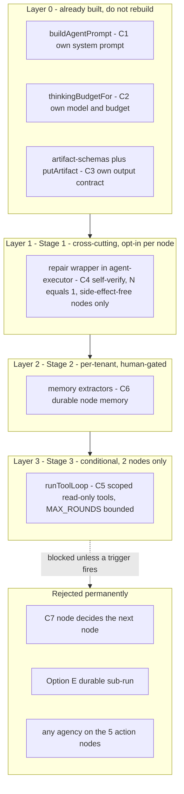
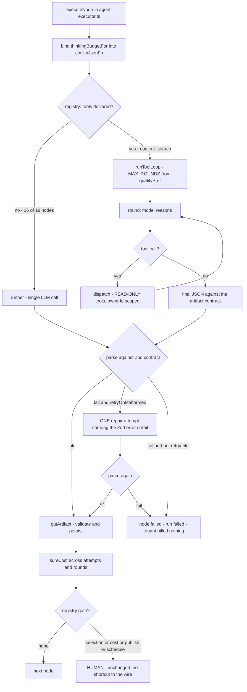

# 08 — Making Agent Nodes Real Sub-Agents

**Design exploration.** Not a plan, not a decision record — a brainstorm that ends in a recommendation
I would defend in review.

**Question:** doc 05 §5 established that all 18 registry nodes are deterministic functions with prompts,
not sub-agents. Should they become sub-agents, which ones, and by what mechanism?

**Scope boundary vs doc 07:** doc 07 asks *"can Atria invent and spawn agents at runtime?"* (answer:
largely no, and mostly shouldn't). This doc asks the narrower, more tractable question: *"can the 18
agents we already have be upgraded in place?"* Different question, different answer.

All paths relative to `MKTAgent/src/` unless stated.

---

> ## ⚠ MEASURED 2026-07-18 — Stage 1's trigger is NOT met. Read this before acting on Part 4.
>
> This doc's headline recommendation (a bounded self-repair wrapper for malformed LLM output) was written against an **unmeasured** failure rate — the doc says so honestly and defines Stage 0 as "go measure it". Stage 0 has now been run against the dev database (191 runs / 358 node executions):
>
> | Metric | Value |
> |---|---|
> | Node executions | 358 |
> | Failed node executions | 6 (1.7%) |
> | **Failures from malformed LLM output** | **0** |
>
> **Zero.** The doc's own trigger was "if below 1%, deprioritise". The actual rate is 0%. **Stage 1 as designed fixes none of the failures this system actually has.** Do not build it.
>
> The economic argument behind it survives and is worth keeping — failed runs bill the tenant $0 (`workflow-executor.ts:119`) while still costing us tokens, so prevented failures are recovered revenue. Measured leak: **$0.21 across 6 failed runs, ~5.6% of all LLM spend in this DB.** The argument was simply pointed at the wrong failure mode.
>
> **What actually fails (4 of 6, one root cause):** a post with no image is planned for Facebook, whose connector action requires `assets`. Both error texts are deterministic preconditions, not model flakiness:
> - `publisher: publish did not complete (facebook:missing required input(s): assets)`
> - `publisher: publish did not complete (no target platform can publish this post: facebook (facebook: no asset (image)))`
>
> This is the "text-only post can't publish" issue on record since 2026-07-08. It is checkable **at plan time** — `approval-policy.ts:22` already defines `cleanlyPostable` for exactly this, but these runs reached the publisher and threw anyway. Remaining 2 failures: one Veo 429 quota, one Prisma `artifact.create()` error.
>
> **Revised priority:** validate the asset/platform precondition before the run spends tokens. That fixes 4 of 6 observed failures with no agency, no loop, and no new framework. Self-repair stays shelved until a measured malformed-output rate justifies it.

## 0. The ground truth we are designing against

Verified by reading, not assumed:

| Fact | Evidence |
|---|---|
| A node is a plain `(ctx) => Promise<RunnerOutput>`. Nothing else. | `executor/agent-runners.ts:1216-1237` |
| One node execution = at most one LLM call, then a Zod parse | `agent-runners.ts:434-436` ideation, `:452-454` strategy, `:494-496` strategist |
| **Zero retries exist anywhere in the runner layer** | grep for retry/attempt in `agent-runners.ts` returns nothing |
| Malformed LLM output = `throw` then node `failed` then run `failed` | `agent-runners.ts:436`; `workflow-executor.ts:520-527` |
| A failed run bills the tenant **nothing** | `workflow-executor.ts:114-128` — `reconcileCredits` returns early when status is `failed` |
| A cross-cutting node capability can be added with zero per-runner edits | `executor/agent-executor.ts:31-34` — `thinkingBudgetFor` binds a per-node budget into `ctx.llmJsonFn` |
| Cost quotes come from **per-agent historical averages**, not static numbers | `cost/plan-estimate.ts:40-55`; `master/plan-tiers.ts:37` |
| Durable run state is `wf_node_run` + `wf_artifact` rows; nothing in memory survives a park | `executor/artifact-store.ts:24-40`; `workflow-executor.ts:169-174` re-seeds `upstream` from the DB on every resume |
| Two real agentic loops already exist and share a shape | `atria/atria-brain.ts:124-238`; `nurture/nurture-brain.ts:93-130` |
| 76 `verify-*.ts` scripts + `planner-golden-snapshot.json` pin behaviour | `src/orchestration/verify-*.ts` |

Two of these are load-bearing and deserve calling out.

**(1) The estimate is historical, not static.** `estimateAgents` looks up `avgTotalTokens` per agentId
from real run history (`plan-estimate.ts:46-48`). A node whose cost varies by a *bounded* factor does
not break the quote — it widens the distribution around a converging mean. A node whose cost varies by
an *unbounded* factor destroys it. **Constraint 1 is therefore not "no loops"; it is "no unbounded
loops."** That is much weaker than it first appears and it is the biggest unlock in this document.

**(2) A failed run is free.** When `strategy` returns malformed JSON the tenant pays $0 and gets
nothing, and we eat the token cost. A retry that succeeds converts a $0-revenue failure into a billable
success. **Self-correction is not just a quality feature here — it is directly revenue-positive.**

---

## Part 1 — Decomposing "sub-agent"

"Make the nodes real sub-agents" is not one decision. It is eight, and they are independently adoptable.
Conflating them is how this turns into a framework nobody needs.

### 1.1 The eight capabilities

| # | Capability | What it means here | Already have it? |
|---|---|---|---|
| C1 | **Own system prompt** | Node-specific persona, constraints, quality bar | YES — `prompts/build-agent-prompt.ts:49-66` + registry `promptSections` |
| C2 | **Own model / budget** | Per-node model tier + thinking ceiling | YES — `thinking-budget.ts:36-55`, bound at `agent-executor.ts:31-34` |
| C3 | **Own output contract** | Strict typed IO, validated at the boundary | YES — `schemas/artifact-schemas.ts` + `artifact-store.ts:24-40` |
| C4 | **Self-verify / self-correct** | Detect its own bad output and fix it before failing | NO. One shot, then `throw` |
| C5 | **Own scoped tool set** | Declare N tools, call them in a loop until done | NO. Tools are hardcoded TS imports |
| C6 | **Own durable memory** | Learns across invocations for this tenant | PARTIAL — `atria/memory-agent.ts` proposes style rules that land as `concept_writer` instructions, but only via an explicit human accept |
| C7 | **Decide the next node** | Extend or redirect the DAG from inside a node | NO. The DAG is frozen at plan time |
| C8 | **Ask a human mid-run** | Halt, ask a question, resume on the answer | PARTIAL — gates halt and ask for *approval*, but a node cannot author a *question* |

**Three of eight are already done.** C1/C2/C3 are the parts most agent frameworks sell you. We built
them, and better than a generic framework would: prompt-as-data in the registry, budget policy in one
file, Zod contracts enforced at the persistence boundary. Any proposal that rebuilds C1-C3 should be
rejected on sight.

The real question is only about **C4, C5, C6, C7, C8**.

### 1.2 Per-node benefit — where each capability actually pays

Legend: **WIN** = real gain · **~** = neutral or marginal · **BAD** = actively worse (cost, latency, or
nondeterminism bought for nothing).

| Node | C4 self-verify | C5 tools | C6 memory | C7 next-node | C8 ask-human |
|---|---|---|---|---|---|
| `ideation` | WIN — variety collapse is detectable, "3 ideas that are one idea" | ~ research is already upstream | ~ | BAD | BAD |
| `strategy` | WIN | ~ | ~ | BAD | ~ |
| `content_search` | WIN **strongest case** — "did I answer the question?" | WIN **strongest case** — follow-up queries | ~ | ~ | BAD |
| `campaign_strategist` | WIN — slot count and dayOffset spread are mechanically checkable | ~ | WIN "this tenant posts Tue/Thu" | ~ | WIN "3 or 5 posts a week?" |
| `concept_writer` | WIN | WIN **fact lookup**, see §3.3 | WIN **strongest case** — voice learning | BAD | ~ |
| `infographic` | WIN — a prompt self-check is cheap against a $0.04 regen | ~ | WIN brand palette | BAD | BAD |
| `storyboard` | WIN — frame consistency is exactly what it gets wrong | ~ | WIN | BAD | ~ |
| `video` | ~ verify *before* Veo spend, not after | ~ | ~ | BAD | ~ the cost gate already asks |
| `publisher` | BAD | BAD | BAD | BAD | BAD |
| `email_writer` | WIN | WIN lead lookup | WIN | ~ | ~ |
| `email_agent` | BAD | BAD | BAD | BAD | BAD |
| `dm_writer` | WIN | ~ | WIN | ~ | ~ |
| `dm_agent` | BAD | BAD | BAD | BAD | BAD |
| `greeting_writer` | WIN | ~ | ~ | BAD | BAD |
| `greeting_agent` | BAD | BAD | BAD | BAD | BAD |
| `scheduler` | BAD | BAD | BAD | BAD | ~ its gate IS the ask |
| `security` | BAD **must stay deterministic** | BAD | BAD | BAD | BAD |
| `summarize` | WIN faithfulness check | ~ | ~ | ~ | BAD |

**Read the columns, not the rows.**

- **C4 self-verify: 12 of 18 nodes benefit.** The only capability with broad applicability. A very
  strong signal about where to spend.
- **C5 tools: 3 nodes.** `content_search`, `concept_writer`, `email_writer`. Narrow but deep.
- **C6 memory: 5 nodes**, and `concept_writer` dominates — it is the node users hand-edit, which is
  precisely the signal `memory-agent.ts:31-44` already harvests.
- **C7 next-node: 0 nodes benefit.** Not one. Every node here has a job fully determined by its inputs.
  DAG shape is a *planning* concern and the planner already backward-chains from targets. Letting a node
  rewrite the graph mid-run buys nothing and costs the golden snapshot, the cost quote, and the user's
  mental model of "here is the plan you approved." **Discard C7 permanently.**
- **C8 ask-human: 2 nodes**, and both are better served by an *upstream* clarification than a mid-node
  question. The analyzer already asks clarifying questions before planning.

**The five action nodes — `publisher`, `email_agent`, `dm_agent`, `greeting_agent`, `scheduler` — score
BAD across the entire matrix.** This is not a gap. `runPublisher` (`agent-runners.ts:300-336`) is 36
lines that call `publishPostNow`, check the outcome, and fail loud. There is no judgement in it; the
judgement happened at the gate, and the gate is a *human*. Adding agency here means inserting a
reasoning layer between the human's approval and the wire, which is exactly what constraint 4 forbids.
**These five stay functions forever, and that is a design achievement, not debt.**

`security` deserves a note: it is a data-protection primitive whose value comes from being predictable.
A PII masker that sometimes reasons its way to a different answer is worse than one consistently a bit
over-eager — `agent-registry.ts:418` already encodes the right policy, "when in doubt, mask."
Nondeterminism here is a compliance liability, not a feature.

---

## Part 2 — Six approaches

### Option A — Config-as-data nodes behind one generic `llm-node` runner

**Idea:** the ~8 pure LLM runners (`ideation`, `strategy`, `campaign_strategist`, `summarize`,
`email_writer`, `dm_writer`, `greeting_writer`, `security`) are the same 12 lines with different names.
Compare `runIdeation` (`:426-443`) and `runStrategy` (`:446-465`): they differ in the agentId string,
the Zod schema, and one post-processing line. Collapse them into one runner driven by registry data —
`{ contract, promptBuilder, contextBuilder }`.

**Adds zero agency.** Purely a DRY refactor.

| Dimension | Assessment |
|---|---|
| Buys | Roughly 400 lines off a 1237-line file; a new pure-LLM node becomes a registry entry with no TS |
| Costs | An indirection layer; per-node quirks (strategy's `leadScoringCriteria` merge at `:459`, the strategist's slot math at `:479-492`) need escape hatches, and escape hatches are how generic runners rot |
| Stresses | Constraint 2 (determinism). Output *should* be byte-identical, but "should" needs 8 verify scripts to prove |
| Files | `agent-runners.ts`, `agent-registry.ts`, `agent-types.ts` |
| Effort | **M** |

**Before/after — `summarize`:** today `runSummarize` (`:977-1013`) is a bespoke function. After, it is
`{ id: 'summarize', contract: 'summarize', contextFrom: ['security_scan'] }` and no TS at all.

**Verdict: correct but not urgent.** It makes the file smaller without making the product better. Do it
*as a byproduct* of Option B, never as its own project. Standalone it is a refactor carrying test risk
with zero user-visible upside — a hard sell against YAGNI.

---

### Option B — Bounded self-repair as a cross-cutting wrapper

**Idea:** reuse the `thinking-budget.ts` trick exactly. `agent-executor.ts:36` currently reads
`const output = await runner(boundCtx);`. Wrap it:

```
attempt 1 -> runner -> putArtifact
   success                      -> done
   ArtifactValidationError      -> attempt 2 carrying the Zod error detail -> done or fail
   /malformed output/ throw     -> attempt 2 carrying the message          -> done or fail
```

Bounded at **N=1 retry**. Not a loop — a single retry. Zero per-runner edits.

**Why this is the highest-leverage change in the document:**

1. It is the only option that touches 12 of 18 nodes with one edit to one 41-line file.
2. It converts a $0-revenue failure into a billable success (`workflow-executor.ts:121`).
3. Its cost impact is **bounded and small**: worst case 2x on one node, and only on the small fraction
   of calls that currently fail outright. The historical-average estimator (`plan-estimate.ts:46`)
   absorbs this automatically within one billing cycle.
4. The error signal already exists machine-readable: `ArtifactValidationError` carries
   `detail: string[]` of exact Zod paths (`artifact-store.ts:15-20`). We can tell the model *precisely*
   what was wrong. This is repair with a real error message, not "try again."

**The one genuine hazard — side effects.** `concept_writer` materialises a Campaign plus a Post
(`agent-runners.ts:108-118` documents this explicitly). Re-invoking it would create a second Post. So
the wrapper must be **opt-in per node**, via a registry flag:

```ts
// agent-types.ts — additive, defaults to undefined (= no retry, today's behaviour)
retryOnMalformed?: boolean;
```

Set it true only on nodes proven side-effect-free: `ideation`, `strategy`, `campaign_strategist`,
`storyboard`, `summarize`, `security`, `email_writer`, `dm_writer`, `greeting_writer`. Leave it unset on
anything that writes a row or touches a wire.

| Dimension | Assessment |
|---|---|
| Buys | C4 across 9-12 nodes; a measurable drop in `wf_node` error logs; recovered revenue |
| Costs | ~40 lines in `agent-executor.ts`; one optional registry field; retry cost folded in via the existing `sumCost` (`node-cost.ts:103`) |
| Stresses | Constraint 1 **mildly** — cost is 1x or 2x, never more. Constraint 2 **not at all** — the happy path is byte-identical, so the golden snapshot and all 76 verify scripts pass unchanged; the retry only fires on a path that today throws |
| Files | `executor/agent-executor.ts`, `registry/agent-types.ts`, `registry/agent-registry.ts`, new `verify-node-repair.ts` |
| Effort | **S** |

**Before/after — `strategy`:**

- *Today:* Gemini returns `{"positioning": "...", "pillars": "brand, growth"}` — `pillars` is a string,
  not an array. `strategyBrief.safeParse` fails at `:453`. Node failed. Run failed. The user sees a red
  node and a dead flow. Tenant billed $0. We paid for the tokens.
- *After:* the wrapper catches and re-invokes with an appended hint — *"Your previous response failed
  validation: pillars: Expected array, received string. Return valid JSON matching the contract."* —
  attempt 2 succeeds. The user sees a completed node. Cost is recorded as attempt 1 plus attempt 2.
  Nobody ever knows anything happened.

**Verdict: ship this first.** Highest impact-to-effort ratio in the document by a wide margin.

---

### Option C — Tool-using nodes via a shared `runAgenticNode()`

**Idea:** a node declares `tools: ['web_search', 'get_product_fact']`. A shared helper runs the
`atria-brain.ts` loop shape (`:176-231`) with those declarations, bounded by `MAX_ROUNDS` plus a
wall-clock deadline, finalising through the node's existing artifact contract. The loop is already
proven to generalise — `nurture-brain.ts` is the second instance and it is 130 lines.

**Which nodes opt in:** `content_search` and `concept_writer`. Possibly `email_writer` later. That is
it. Everything else already has all the information it needs in `ctx.upstream`.

**Cost predictability, handled honestly:** `MAX_ROUNDS = 3` (mirroring `atria-brain.ts:51`) means the
node costs between 1x and 4x a single call. Bounded, so it satisfies the literal reading of constraint
1 — but a 4x spread on a *quoted* node is a worse experience than a 2x spread. Two cheap mitigations:

1. Quote agentic nodes at **worst case** in `plan-estimate.ts`, not average. Over-quoting and
   under-charging is a good failure mode; the reverse is not.
2. Derive round count from `goal.qualityPref` — the field exists and already drives the creative budget
   (`thinking-budget.ts:24`). Economy tier means 1 round, which is today's behaviour exactly.

| Dimension | Assessment |
|---|---|
| Buys | C5 on the 2-3 nodes that genuinely need lookup; a researcher that can follow up on what it found |
| Costs | A third copy of the brain loop — extract a shared `runToolLoop` first, or accept three copies and refactor at four; a per-node tool registry; a new nondeterminism surface on 2 nodes |
| Stresses | Constraint 1 (**most stressed of all six options**); constraint 2 (opted-in nodes lose runner-level determinism — the golden snapshot pins *plan shape* not runner output, so it survives, but `verify-researcher.ts` must be reworked); constraint 5 (tools must be `ownerId`-scoped — `atria-tools.ts`'s `ToolContext` already does this correctly) |
| Files | new `executor/agentic-node.ts`, new `executor/node-tools.ts`, `agent-types.ts`, `agent-registry.ts`, `agent-runners.ts` for 2 runners |
| Effort | **L** |

**Before/after — `content_search`:**

- *Today:* `runResearcher` (`:257-295`) makes one grounded call built from product, audience and angle,
  and takes whatever comes back. If the search returns "competitor X dominates this keyword" the node
  cannot ask the obvious follow-up "what does X charge?" It writes a summary of a half-answered question.
- *After:* round 1 searches the market, reads the result, decides the pricing gap is the real story,
  searches again in round 2, then synthesises. Same `research_summary` contract out. Costs about 2.5x.

**Verdict: real, but stage it.** The only option that delivers something genuinely new rather than
making the existing thing more reliable — and the only one that meaningfully stresses the cost promise.
Gate it behind an observed need (§4.3).

---

### Option D — Per-node, per-tenant durable memory slice

**Idea:** each node gets a memory namespace keyed by `(tenantId, agentId)`, read into its prompt as a
fifth `buildAgentPrompt` layer, written by an extraction step. The copywriter learns this tenant's voice.

**We are 80% there already and nobody noticed.** `memory-agent.ts:82-95` reads hand-edited posts
(`copyEdited: true`), infers style rules, and emits proposals targeted at `MEMORY_TARGET_AGENT =
'concept_writer'` (`:19`). Accepted proposals become instructions, and `resolveRunInstructions`
(`agent-runners.ts:358-366`) already injects agent-scoped instructions into every runner's prompt.

So the "node-level memory slice" *exists*, is human-gated, and is wired to exactly the one node the
matrix says needs it most. What is missing is far smaller than a memory subsystem:

| Gap | Fix size |
|---|---|
| Only `concept_writer` is targeted | Change one constant into a per-agent extractor set |
| Acceptance is manual | Leave it manual — this is the *right* design, see Part 3 |
| No memory for `campaign_strategist` (cadence) or `infographic` (palette) | Two more extractors |

| Dimension | Assessment |
|---|---|
| Buys | The product's most emotionally legible feature: "it learned my voice." Compounding per-tenant value |
| Costs | Extraction cost per tenant, already bounded — `MIN_EDITS = 3`, `MAX_SAMPLES = 15` (`memory-agent.ts:14-15`) |
| Stresses | Constraint 5 (**hardest here**) — memory is the one thing whose cross-tenant leak is catastrophic *and silent*. Every read must be `ownerId`-filtered at the query, as `memory-agent.ts:33` does. Constraint 2 — a tenant with memory produces different output than one without, so verify scripts must run memory-free |
| Files | `atria/memory-agent.ts`, `prompts/resolve-instructions.ts` |
| Effort | **S-M** — extending existing machinery, not building new |

**Verdict: cheap, high perceived value, mostly already built.** The honest framing is "finish the memory
agent," not "add memory to nodes."

---

### Option E — Durable sub-run: a node spawns a child `WorkflowRun`

**Idea:** a node needing complex work creates a real child run row and returns its result as an
artifact. Sub-agency via the primitive we already have, inheriting park/resume, credit reconciliation,
gates, SSE and the audit trail for free.

**This is the most architecturally elegant option and I am going to argue against it.**

The elegance is real. `runWorkflow` (`workflow-executor.ts:132`) is fully re-entrant, seeds `upstream`
from the DB (`:169-174`), reconciles credits on every exit path (`:533-535`), and a parked run resumes
days later from a cron in a different process. A child run inherits all of it at no cost. Textbook
answer to constraint 3.

But: **what would the child run actually run?** A child run executes a DAG of registry nodes. So a
sub-run only helps when a node's job decomposes into *other registry nodes*. Scan the 18 and find one
where that is true. I cannot. `concept_writer` does not want a mini-DAG; it wants to look up a fact.
`content_search` does not want a sub-DAG; it wants a second query.

There is exactly one plausible use — a `campaign_strategist` materialising N per-slot child runs — and
that is **already how campaign materialisation works**, at the campaign layer, above the DAG.

| Dimension | Assessment |
|---|---|
| Buys | Durability and gate inheritance, for a decomposition need that does not exist |
| Costs | Recursion in the executor; run-tree UI; credit attribution across parent and child; abort and kill-switch propagation; a whole new class of "run stuck because its child is stuck" bug |
| Stresses | Constraint 6 hardest — a framework for a problem we do not have |
| Effort | **L** |

**Verdict: discard, and record why.** Revive only if a concrete node appears whose job is genuinely
"run a sub-DAG." The trigger is specific: a second registry node wanting to call the planner.

---

### Option F — Three alternatives I generated and mostly rejected

**F1 · Critic as a first-class DAG node.** Rather than wrapping nodes in a critique loop, insert a
`critic` node after `concept_writer`. It produces a `critique` artifact; the copywriter re-runs if the
critique fails.

- *Pro:* completely visible. The user sees the critic in the plan, in the quote, and in the output. No
  hidden loops. Perfectly compatible with constraints 1 and 2 — it is just another node.
- *Con:* it needs a cycle in the DAG to be useful, and the planner is a topological sort
  (`workflow-executor.ts:139-144` via `validatePlan`). A critic that can only *report* and never *cause*
  a re-run is a fancy log line.
- **Verdict: rejected on the cycle problem** — but its *visibility* property is the best idea in this
  section, and I steal it for the recommendation (§4.3, Stage 1 step 6).

**F2 · N-best sampling with a judge.** Generate 3 candidates across a temperature spread; a cheap judge
model picks one.

- *Pro:* dead simple, no loop, bounded at exactly 4 calls. Cost is *more* predictable than today —
  fixed 4x rather than a variable retry.
- *Con:* costs 4x on every run against Option B's 2x on the rare failing fraction. And `concept_writer`
  **already does this** — it generates 3-5 variants and a human picks (`finalizeConcept:127-150`, gate
  `selection`). Replacing the human picker with a model judge is a strict downgrade for a product whose
  differentiator is human-gated trust.
- **Verdict: rejected.** We already have n-best. The judge is a human. That is better.

**F3 · Repair inside the artifact store instead of the executor.** Put the retry inside `putArtifact`
(`artifact-store.ts:24`) so *any* validation failure anywhere gets a repair pass.

- *Pro:* one function, catches everything.
- *Con:* the artifact store has no access to the prompt or the LLM seam — it would need one injected,
  inverting the dependency. And it would only catch `putArtifact` failures, missing the in-runner
  `safeParse` throws at `:436`, `:454`, `:496`, which are the majority of real failures.
- **Verdict: rejected — wrong layer.** `agent-executor.ts` is right because it sees both the runner
  invocation and the store.

### 2.7 Options side by side

| | A config-as-data | B self-repair | C tool nodes | D node memory | E sub-run | F1 critic node |
|---|---|---|---|---|---|---|
| Adds agency? | No | Minimal, C4 | Yes, C5 | Yes, C6 | Yes | Minimal |
| Nodes affected | 8 | 9-12 | 2-3 | 1-3 | 0 today | 1 |
| Effort | M | **S** | L | S-M | L | M |
| Cost multiplier | 1x | 1-2x on a rare path | 1-4x | 1x | n x | ~1.3x |
| Breaks golden snapshot? | Must prove not | **No** | No — pins plan shape, not output | No | Yes | **Yes** — changes plan shape |
| Survives park/resume? | n/a | Yes, within one node | Yes, within one node | Yes, DB-backed | Yes | Yes |
| Gate integrity risk | None | None | **Tool scoping** | None | Propagation | None |
| Tenant-leak risk | None | None | Medium | **High** | Medium | None |
| User-visible upside | None | Fewer dead runs | Better research | "It learned my voice" | None | Visible QA |

---

## Part 3 — The adversarial case: leave them alone

I am now going to argue the opposite of everything above, as strongly as I can.

### 3.1 The steelman

**Determinism is the product.** Atria sells to marketers who are afraid of AI posting nonsense to their
brand account. Every design decision in this codebase reflects that: `autoPublish` defaults **off**
(`workflow-executor.ts:389`), the schedule gate is *never* auto-cleared even for a granted run
(`approval-policy.ts:55-59`), the nurture brain has a deterministic opt-out fast path that never reaches
the LLM at all (`nurture-brain.ts:95-97`), and DM sends are DRY-RUN by default. The differentiator is
not autonomy. **It is legible, bounded, gated behaviour.** Agency is what the competition sells and what
customers are nervous about.

**Deterministic nodes are debuggable.** When `strategy` produces a bad brief today the fix is: read the
prompt at `agent-registry.ts:54-67`, change a constraint line, re-run. One input, one output, one place
to look. When an agentic `strategy` produces a bad brief the fix is: reconstruct a 3-round tool
conversation from logs, work out which round poisoned the context, and change... what? The prompt? The
tool description? The round limit? That is a categorical increase in debugging cost, landing on a very
small team.

**Deterministic nodes are testable.** 76 verify scripts and a golden snapshot exist because someone
decided "does the planner still produce this exact DAG" was worth pinning. That investment pays only
while behaviour is pinnable. Agentic nodes are pinnable only through mocked tool responses, which tests
the mock, not the node.

**Deterministic nodes are quotable.** The whole plan-tier UX (`plan-tiers.ts:24-26` — "Just the
essentials, fewest agents, lowest credits") is a promise about spend. Every loop weakens it. A user who
approved "Economy, 340 credits" and gets charged 900 does not care that the researcher found something
interesting on round 3.

**And the honest one:** most quality complaints about this system are *prompt* problems, not *agency*
problems. `runIdeation` produces samey ideas because the prompt says "3-5 genuinely different campaign
directions" and the model half-listens. The fix is a better prompt plus a few-shot example — a 20-line
change — not a reasoning loop. **Reaching for agency to fix a prompt problem is the most common and most
expensive mistake in this entire category.**

### 3.2 Where the steelman is right

It is right about C5 for 15 of 18 nodes, right about C7 entirely, right about the five action nodes,
right about `security`, and right that Option E is a framework in search of a problem. Roughly 70% of
the "make the nodes agentic" surface area should be rejected on these grounds. **This document's
recommendation rejects it.**

### 3.3 Where it breaks — four failures only sub-agency fixes

The steelman covers *quality*. It does not cover these four, and these are the ones I would put in front
of a customer.

**Failure 1 — one bad JSON key kills the whole run, and we eat the cost.**
`agent-runners.ts:436` throws. `workflow-executor.ts:520-527` marks node and run `failed`.
`workflow-executor.ts:121` then declines to bill it. The user — possibly six nodes in, with a generated
image already paid for — sees a dead run and a "Try again" button that restarts from scratch. **No
prompt improvement fixes this.** The model will occasionally return a string where an array was
specified; that is a property of LLMs, not of our prompt. The only fix is a retry. *This is Option B,
and there is no argument against it.*

**Failure 2 — the copywriter cannot look up a fact it needs.**
`concept_writer` writes claims grounded in whatever `resolveProductKnowledge` (`:372`) hands it. If the
concept needs a number that lives in the product library but is not in the resolved blob, the node has
two options: omit it, or invent it. The registry forbids inventing (`agent-registry.ts:152` — "Zero
invented claims"), so it omits, and the copy is weaker than it should be. A `get_product_fact` tool
solves this and nothing else does. *This is Option C, narrowly scoped.*

**Failure 3 — the researcher cannot follow up.**
Covered under Option C. One query, one answer, no matter what the answer reveals. The single largest
quality ceiling in the intelligence group, and it is structural, not promptable.

**Failure 4 — the system cannot learn from correction.**
A user hand-edits every generated post to strip emoji. The system notices (`copyEdited: true`) and can
even infer the rule (`memory-agent.ts`) — but only if a human goes and accepts the proposal. Meanwhile
the copywriter emits emoji on run 40 exactly as it did on run 1. The user's reasonable conclusion is
that the product does not learn. *This is Option D.*

**These four map cleanly onto B, C, C and D. Not onto "make everything an agent."**

---

## Part 4 — Recommendation

### 4.1 The shape of the answer

Three of the eight capabilities are already built (C1-C3). One should never be built (C7). Two are
narrow and conditional (C5, C8). One is cheap and mostly built (C6). **One is broad, cheap, safe and
revenue-positive (C4).**

So the recommendation is deliberately unbalanced: **do C4 everywhere it is safe, do C6 where the signal
already exists, and hold C5 behind an observed trigger.**

### 4.2 Diagram — the layered wrapper model



### 4.3 Staged sequence with explicit triggers

**Stage 0 — measure before building. Effort XS, 1 day.**

Add a counter on `wf_node` error logs keyed by `agentId` and error shape. We currently do not know how
often Failure 1 fires. Everything below is calibrated to that number.

- *Trigger for Stage 1:* schema-validation failures exceed **1% of node executions** over two weeks.
- *If below 1%:* Stage 1 drops to low priority and Stage 2 goes first. State this now so we do not build
  a retry for a problem that does not exist.

**Stage 1 — bounded self-repair, Option B. Effort S.**

1. Add `retryOnMalformed?: boolean` to `AgentDefinition` (`agent-types.ts`). Default undefined = today.
2. Wrap the runner invocation at `agent-executor.ts:36` with a single retry, fired only on
   `ArtifactValidationError` or an error matching `/malformed output/`. Feed
   `ArtifactValidationError.detail` back to the model as an explicit repair hint.
3. Fold both attempts into the node's cost via `sumCost` (`node-cost.ts:103`) so the ledger stays honest.
4. Enable on the 9 side-effect-free nodes. Leave `concept_writer` and every action node off.
5. New `verify-node-repair.ts` using an injected failing-then-succeeding LLM stub.
6. Emit `wf_node_repaired` at info level. Visibility, stolen from F1 — a hidden loop is a debugging
   liability; a logged one is an observation.

**Do NOT** add a quality-critique retry in this stage. Schema repair only. Quality critique fires on
*every* run (2x cost always) and is unbounded in judgement; schema repair fires only on the rare broken
run and has a mechanical pass/fail signal.

- *Trigger for Stage 2:* Stage 1 shipped and `wf_node_repaired` shows repairs succeeding more than 70%
  of the time. If repairs mostly fail, the problem is the prompt and the steelman was right.

**Stage 2 — finish the memory agent, Option D. Effort S-M.**

1. Generalise `MEMORY_TARGET_AGENT` (`memory-agent.ts:19`) from a constant into a per-agent extractor set.
2. Add extractors for `campaign_strategist` (cadence and day preferences from calendar edits) and
   `infographic` (palette from accepted images).
3. Keep acceptance **human-gated**. This is not a limitation to remove — it is the product. An
   auto-learning copywriter that drifts is the exact fear the gating architecture exists to answer.
4. Add an explicit `ownerId` assertion in the memory read path plus a verify script that seeds two
   tenants and asserts zero cross-read. Constraint 5 is the highest-severity risk in this document.

- *Trigger for Stage 3:* **at least 5 logged, specific instances** of Failure 2 or Failure 3 — a copy
  claim omitted for want of a fact, or a research summary that visibly stops at the first hop. Not
  "research could be better." Five concrete, cited cases.

**Stage 3 — tool loop for exactly two nodes, Option C. Effort L. Conditional.**

1. Extract the loop shape shared by `atria-brain.ts:176-231` and `nurture-brain.ts:109-124` into
   `executor/agentic-node.ts`. Three copies is the right moment to DRY it, not before.
2. Add `tools?: string[]` to `AgentDefinition`. Populate on `content_search` only, at first.
3. Tools resolve through a per-node registry with a `ToolContext` carrying `ownerId` — copy
   `atria-tools.ts`'s scoping exactly. **No tool in this registry may perform an external write.** The
   gate architecture is non-negotiable; a tool loop gets read access only.
4. Derive `MAX_ROUNDS` from `goal.qualityPref` — economy means 1 round, byte-for-byte today's behaviour.
5. Quote worst case in `plan-estimate.ts` for tool-bearing nodes.
6. Rework `verify-researcher.ts` against a scripted tool sequence.

Then stop and measure for a month before touching `concept_writer`.

**Never do:** C7 · Option E · any agency on `publisher`, `email_agent`, `dm_agent`, `greeting_agent`,
`scheduler`, `security`.

### 4.4 Diagram — recommended end state for one upgraded node (`content_search`)



Note what does **not** change in that diagram: the gate, the contract, the cost ledger, the failure
semantics, the park/resume boundary. All the agency is contained between "runner invoked" and "artifact
validated" — a window that opens and closes inside a single node execution and therefore never has to
survive a park.

### 4.5 Effort and impact

| Stage | Option | Effort | Nodes | User-visible impact | Risk | Do it? |
|---|---|---|---|---|---|---|
| 0 | Measure error rate | XS | — | none | none | **Yes, now** |
| 1 | Self-repair wrapper | S | 9 | Fewer dead runs, recovered revenue | Low | **Yes** |
| 2 | Finish memory agent | S-M | 1 to 3 | "It learned my voice" | Medium — tenant isolation | **Yes** |
| 3 | Tool loop, `content_search` | L | 1 | Research that follows up | High — cost variance | **Only on trigger** |
| 3b | Tool loop, `concept_writer` | M | 1 | Copy grounded in real facts | High | **Only after 3 settles** |
| — | Config-as-data refactor | M | 8 | none | Medium | Byproduct of Stage 1, never standalone |
| — | Critic node | M | 1 | Visible QA | High — breaks the golden snapshot | No |
| — | N-best plus judge | M | 1 | none — we have it, judged by a human | — | No |
| — | Durable sub-run | L | 0 | none | High | No |
| — | C7 next-node | L | 0 | negative | Very high | **Never** |

### 4.6 The final asymmetry, stated plainly

| Category | Nodes | Ends up as | Why |
|---|---|---|---|
| **Real sub-agents** — tools, loop, repair | `content_search`, later `concept_writer` | Bounded read-only tool loop | Their job requires information they do not have at invocation time. Only these two |
| **Self-correcting functions** — repair, some memory | `ideation`, `strategy`, `campaign_strategist`, `storyboard`, `infographic`, `summarize`, `email_writer`, `dm_writer`, `greeting_writer` | Function plus N=1 repair | Their job is fully determined by their inputs. They need reliability, not judgement |
| **Pure functions, forever** | `publisher`, `email_agent`, `dm_agent`, `greeting_agent`, `scheduler`, `security` | Unchanged | They touch the wire or the compliance boundary. The judgement in these steps belongs to a human, and already does |

**Why the asymmetry is correct:** agency is a tool for handling *uncertainty about what to do next*. Two
of eighteen nodes face that uncertainty. Sixteen do not — they face uncertainty about *whether they did
it right*, a far cheaper problem solved by a retry and a contract. Giving all eighteen the expensive
tool because two need it is exactly the framework-building that YAGNI exists to prevent.

**And the deeper reason:** the five action nodes are where the money and the reputation live, and they
are *deliberately* the dumbest code in the system. `runPublisher` is 36 lines with no judgement in it.
That is not technical debt awaiting an upgrade — that is the architecture working. Every ounce of
judgement was moved upstream, in front of a human, at a gate. **Any proposal that makes the action nodes
smarter is a proposal to move judgement back across the gate, and should be rejected on that basis
alone.**

---

**Status:** DONE

**Summary:** Decomposed "sub-agent" into 8 independent capabilities and found that 3 are already built
(own prompt, own budget, own contract), 1 should never be built (a node deciding the next node), and
only 2 of 18 nodes genuinely need tools. Recommended sequence: measure the schema-failure rate, then a
bounded N=1 self-repair wrapper in `agent-executor.ts` (zero per-runner edits, byte-identical happy
path, converts unbilled failed runs into billable successes), then finish the existing memory agent,
then a read-only tool loop for `content_search` alone and only on an explicit observed trigger. The 5
action nodes and `security` stay deterministic functions permanently.

**Concerns:**

1. **Tenant isolation in Stage 2** is the highest-severity risk in this document. A cross-tenant memory
   leak is silent and catastrophic. It needs its own verify script seeding two tenants, not a code review.
2. **`concept_writer` cannot use the Stage 1 wrapper** as designed — it materialises a Campaign plus a
   Post (`agent-runners.ts:108-118`), so a naive re-invoke creates duplicate rows. Handled here via an
   opt-in registry flag, but the consequence is that the node most likely to produce malformed output is
   the one that cannot be repaired without a separate idempotency design.
3. **Stage 3's cost variance is genuinely in tension with the plan-tier promise.** Worst-case quoting is
   a mitigation, not a solution. If plan-tier accuracy is a hard product requirement, Stage 3 should be
   dropped rather than softened.
4. **Docs 07 and 08 must be read together.** 07 says "no runtime spawning"; 08 says "upgrade the fixed
   set." Read separately they sound contradictory. Suggest a cross-link in `docs/product/README.md`.

**Unresolved questions:**

1. What *is* the current schema-validation failure rate per agent? Everything in Stage 1 is calibrated
   to a number nobody has measured. Stage 0 exists for exactly this reason.
2. Should `retryOnMalformed` distinguish "the model returned bad JSON" from "the model returned good
   JSON that violates a business rule"? The first is worth retrying; the second probably is not.
3. Is `plan-estimate`'s historical-average estimator allowed to over-quote? If under-charging against a
   quote is acceptable, Stage 3's cost problem largely dissolves. That is a product and pricing call,
   not an engineering one.
4. Should memory acceptance ever become automatic for a tenant who has accepted N proposals in a row?
   Argued no above, but that is a product-trust judgement, not a technical one.
5. If the tool loop is extracted into `executor/agentic-node.ts`, should `atria-brain` and
   `nurture-brain` be refactored onto it, or left alone? Both carry distinct guardrail layers
   (`nurture-brain.ts:77-89`) that a shared abstraction would have to accommodate — possibly at the cost
   of the clarity that makes those guardrails auditable today.
